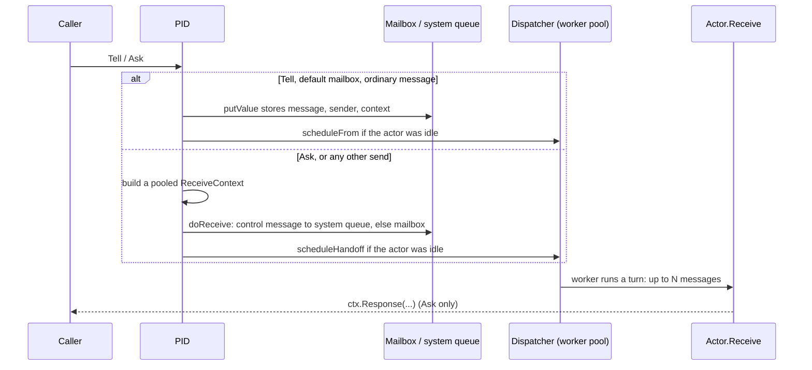
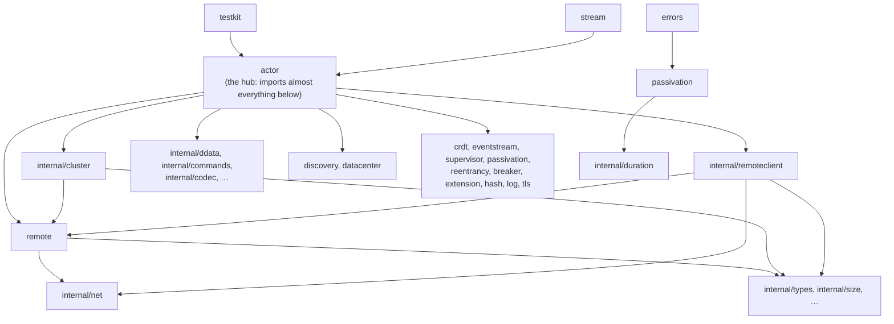

# 1. What GoAkt Is

## Contents

- [What you will learn](#what-you-will-learn)
- [The model](#the-model)
- [Sending messages](#sending-messages)
- [How a message reaches `Receive`](#how-a-message-reaches-receive)
- [The repository](#the-repository)
  - [Dependency layers](#dependency-layers)
  - [Public and internal](#public-and-internal)
  - [What else is in the repository](#what-else-is-in-the-repository)
- [Guarantees](#guarantees)
- [Implementation details (may change)](#implementation-details-may-change)
- [Behaviours to know](#behaviours-to-know)

## What you will learn

- What GoAkt is, described by its code.
- The shape of the repository: which packages exist, how big they are, and which depend on which.
- The interface every actor implements, and the four functions that send messages.
- How a message travels from a caller to an actor's `Receive` ([Chapter 5](chap-05.md), [Chapter 6](chap-06.md), [Chapter 7](chap-07.md)), in the detail you need before reading the chapters that follow.
- What is public API and what is internal, and why that line matters when you contribute.

## The model

GoAkt is a Go library (module `github.com/tochemey/goakt/v4`, `go.mod`) that implements the actor model. Its minimum Go version is 1.26.0.

An **actor** is a value that implements three methods (`Actor` in `actor/actor.go`):

```go
type Actor interface {
	PreStart(ctx *Context) error
	Receive(ctx *ReceiveContext)
	PostStop(ctx *Context) error
}
```

- `PreStart` runs before the actor handles messages. A failing `PreStart` is retried, and if the last attempt fails, the actor is not started ([Chapter 4, §4.4](chap-04.md#44-prestart-retries-and-the-timeout-that-is-not-one)). It runs again on every restart, on the same actor value (`Actor` in `actor/actor.go`; [Chapter 9, §9.6](chap-09.md#96-the-restart-itself)).
- `Receive` handles every message, one at a time, through a [`ReceiveContext`](chap-08.md#81-one-object-per-message).
- `PostStop` runs when the actor stops, including when it is passivated for being idle ([Chapter 10](chap-10.md)). Depending on how the actor is stopped, it may run while `Receive` is still handling a message ([Chapter 3, §3.5](chap-03.md#35-stop)). An error from it is logged but does not prevent the stop (`Actor` in `actor/actor.go`).

An actor never runs on its own goroutine. The **actor system** ([Chapter 3](chap-03.md)) owns a fixed pool of worker goroutines, the dispatcher, and lends a worker to an actor whenever that actor has messages waiting ([Chapter 7](chap-07.md)). A **PID** is the handle you hold to send messages to an actor ([Chapter 4](chap-04.md)). It can point to an actor in this process or, with remoting enabled, to one on another node ([Chapter 15](chap-15.md)).

> **Actors are pointers.** Implement the three methods on a pointer receiver and pass a pointer to `Spawn` (`&MyActor{}`). GoAkt does not support actors passed by value.

On top of that core sit grains (virtual actors that activate on first message, [Chapter 13](chap-13.md)), remoting ([Chapter 15](chap-15.md)), clustering ([Chapter 19](chap-19.md)), and higher-level subsystems: reliable delivery ([Chapter 23](chap-23.md)), CRDT-based distributed data ([Chapter 24](chap-24.md)), and reactive streams ([Chapter 25](chap-25.md)).

The same code runs in three shapes. **Standalone**: one process and no network. **Clustered**: nodes discover each other ([Chapter 19](chap-19.md)) and share a registry of actors and grains ([Chapter 20](chap-20.md)), so a name resolves to whichever node holds it. **Multi-datacenter**: several clusters linked through a control plane ([Chapter 22](chap-22.md)). Remoting can also be enabled on its own, without a cluster.

A message is any Go value; the API takes `any`. A local send passes the value itself, so nothing is serialised and no `.proto` definition is needed inside one process. A message is serialised only when it crosses the network, by a serializer chosen for its type ([Chapter 17](chap-17.md)).

## Sending messages

Four package-level functions in `actor/api.go` send to a PID ([Chapter 5, §5.1](chap-05.md#51-three-ways-to-send)):

| Function | Behaviour |
|---|---|
| `Tell(ctx, pid, msg)` | Enqueue and return. No reply. |
| `Ask(ctx, pid, msg, timeout)` | Enqueue and block until the actor replies, the timeout fires, or `ctx` is done. |
| `BatchTell(ctx, pid, msgs...)` | Calls `Tell` once per message, in order, and stops at the first error. |
| `BatchAsk(ctx, pid, timeout, msgs...)` | Calls `Ask` once per message, sequentially, and stops at the first error. |

All four are declared in `actor/api.go`.

Their error contract:

- A `nil` PID, or a local PID whose actor is not running, gives `ErrDead` (`Ask` and `Tell` in `actor/api.go`).
- An `Ask` that gets no reply within `timeout` gives `ErrRequestTimeout` (`actor/api.go`). If `ctx` ends first, the error joins `ctx.Err()` with `ErrRequestTimeout`.
- A remote PID with no remoting client gives `ErrRemotingDisabled` ([Chapter 16](chap-16.md)); a remote `Ask` with a non-positive timeout gives `ErrInvalidTimeout` (`actor/api.go`).

`BatchAsk` is easy to misread. It is not pipelined: each message waits for its reply before the next one is sent. It returns a buffered, already closed channel holding the replies in order; on error it returns a `nil` channel and no partial results (`BatchAsk` in `actor/api.go`).

## How a message reaches `Receive`

This is the local path. Later chapters take each step apart: the reply side in [Chapter 5, §5.3](chap-05.md#53-how-a-reply-gets-back), the mailboxes in [Chapter 6](chap-06.md), the workers in [Chapter 7](chap-07.md).



1. A local `Tell` to an actor on the default mailbox stores the message, its sender and its context straight into a mailbox slot, with no `ReceiveContext` of its own (`PID.putValue` in `actor/pid.go`; [Chapter 6, §6.2](chap-06.md#62-the-default-mailbox)). Every other send, an `Ask` among them, builds a `ReceiveContext` taken from a pool (`toReceiveContext` in `actor/api.go`). It carries the message, the sender, and for `Ask` a reply channel.
2. `PID.doReceive` refuses a message that is not a system message with `ErrSystemShuttingDown` if the actor system is stopping. Otherwise it routes control messages to a separate system queue ([Chapter 7, §7.4](chap-07.md#74-the-system-queue)) and everything else to the mailbox, where a mailbox that refuses the message (a full bounded mailbox, for instance) turns it into an error (`actor/pid.go`; [Chapter 6](chap-06.md)). `putValue` leaves both cases to it.
3. If the actor was idle, the send schedules it ([Chapter 7, §7.5](chap-07.md#75-the-ready-queue)). `putValue` goes through `PID.scheduleFrom`, which puts the actor on the sending worker's own queue when the send is made from a turn of the same dispatcher (`ReceiveContext` sends pass their worker); the package-level `Tell` passes none, so the actor goes on the dispatcher's ready queue. `doReceive` hands the actor to a parked worker (`PID.doReceive` in `actor/pid.go`).
4. A dispatcher worker runs one **turn** ([Chapter 7, §7.3](chap-07.md#73-one-turn)): it processes up to a throughput budget of messages (32 by default, `dispatcherThroughput` in `actor/dispatcher.go`; `WithThroughputBudget` in `actor/option.go` changes it), with system messages taking priority, then yields to other actors.

One detail in `Ask` matters when you debug it. After the context is handed to the mailbox it can be recycled for an unrelated message, so `Ask` keeps only its own reply channel. A reply that arrives after the `Ask` gave up goes into that orphaned channel and is dropped (`actor/api.go`).

## The repository

Line counts, taken over the files that `git ls-files --cached --others --exclude-standard` lists, test files counted apart from source files:

| Package | Purpose | Source lines | Test lines |
|---|---|---:|---:|
| `actor` | Actor system, PIDs, mailboxes, dispatcher, supervision, grains, clustering glue, reliable delivery, relocation | 51,838 | 105,537 |
| `internal/net` | Wire transport: frames, chunking, compression, handshake, duplex streams | 11,319 | 15,565 |
| `stream` | Reactive streams on top of actors | 9,710 | 9,547 |
| `internal/remoteclient` | Outbound remoting client | 6,639 | 8,178 |
| `internal/cluster` | Cluster membership state, partitioning, registry stores | 3,667 | 7,933 |
| `discovery/...` | Discovery providers: consul, dnssd, etcd, kubernetes, mdns, nats, selfmanaged, static | 3,303 | 3,835 |
| `remote` | Public remoting configuration and serializers | 2,818 | 2,178 |
| `crdt` | CRDT data types | 2,236 | 3,223 |
| `datacenter/...` | Multi-datacenter configuration and control planes (etcd, NATS) | 1,589 | 3,053 |
| `log` | Logger interface and implementation | 1,584 | 2,147 |
| `testkit` | Test helpers for actor code | 1,558 | 1,388 |
| `client` | Standalone client | 1,165 | 2,424 |
| `internal/commands` | Internal command types | 1,140 | 983 |
| `breaker` | Circuit breaker | 792 | 1,074 |
| `internal/internalpb` | Generated protobuf code | 15,690 | 0 |

In total there are about 108,800 hand-written source lines (excluding `playground/`, `mocks/`, `benchmark/`, `vendor/` and generated code) and about 178,300 test lines (excluding `vendor/`). `actor` alone holds about 48% of the source and 59% of the tests. Becoming fluent in GoAkt mostly means becoming fluent in `actor`.

### Dependency layers

`go list -f '{{.ImportPath}}: {{.Imports}}' ./...`, restricted to the module's own packages, gives this structure:



An arrow points from a package to a package it imports. The `errors → passivation → internal/duration` chain at the bottom is drawn separately. `stream` also imports `remote`; the diagram shows only the edges that matter for the facts below.

Keep four facts from the import graph in mind:

- **`actor` is the only package that ties everything together.** Remoting, clustering, distributed data and reliable delivery all have their entry points in `actor`, not in their own packages. When you look for "where does X start", start in `actor`.
- **Among library packages, only `stream` and `testkit` import `actor`.** Apart from the `playground/` programs, nothing else does, so lower packages cannot call back into the actor system except through interfaces passed down to them.
- **`crdt`, `discovery`, `extension`, `hash`, `log`, `memory` and `tls` are leaves.** They import no other package of the module. `errors` is close to the bottom but is not a leaf: it imports `passivation`, which imports `internal/duration`.
- **`internal/cluster` does not import `actor`.** Cluster membership events are delivered to the actor system through a channel (`cluster.Events()`), which `actor` drains in its own loop (`actorSystem.clusterEventsLoop` in `actor/actor_system.go`; [Chapter 20, §20.9](chap-20.md#209-cluster-events)).

### Public and internal

Users cannot import anything under `internal/`, and the generated protobuf code lives there too (`Makefile`). The public surface is `actor` plus the small configuration packages it accepts (`remote`, `discovery/*`, `supervisor`, `passivation`, `reentrancy`, `extension`, `log`, `tls`, `hash`, `datacenter`), the `errors` package of sentinel errors, `eventstream` and `memory`, and the higher-level `stream`, `crdt`, `client`, `breaker` and `testkit`.

> **Warning for contributors.** You can change code under `internal/` freely. Changing an exported identifier in a public package is a breaking change for users.

### What else is in the repository

| Path | Contents |
|---|---|
| `protos/internal/*.proto` | Wire formats: actor, cluster, crdt, datacenter, delivery, grain, handshake, metric, … Generated into `internal/internalpb` |
| `mocks/` | Generated mocks for six interfaces in five packages (`.mockery.yml`) |
| `playground/` | Standalone `package main` programs, most named after a GitHub issue they reproduce |
| `benchmark/` | The benchmark suite (`bench_*_test.go` files and `doc.md`) |
| `test/data/` | Test fixtures: TLS certificates, generated test protobufs |
| `docs/` | The Mintlify documentation site |
| `book/` | This book |
| `vendor/` | Not committed (it is in `.gitignore`); created by `make vendor` ([Chapter 2](chap-02.md)) |

## Guarantees

| Statement | Enforced by |
|---|---|
| `Tell`/`Ask` on a nil or stopped PID return `ErrDead` | `TestAsk` and `TestTell` in `actor/api_test.go` |
| `Ask` with no reply returns `ErrRequestTimeout`; a context that ends first also matches it | `TestAsk` (subtests "With request timeout", "With context canceled") in `actor/api_test.go` |
| A remote PID without remoting gives `ErrRemotingDisabled`; a remote `Ask` with a zero timeout gives `ErrInvalidTimeout` | `TestAsk` and `TestTell` in `actor/api_test.go` |
| `BatchAsk` returns an error and no replies when one `Ask` fails; `BatchTell` returns the error of a dead actor | `TestAsk` and `TestTell` ("With Batch request" subtests) in `actor/api_test.go` |

## Implementation details (may change)

- The default throughput budget of 32 messages per turn.
- The `ReceiveContext` pool, the `Tell` that bypasses it, and the fact that a late `Ask` reply is silently dropped rather than dead-lettered ([Chapter 5, §5.3](chap-05.md#53-how-a-reply-gets-back)).

## Behaviours to know

- The package-level `Tell` and `Ask` send with the system's `NoSender` as sender (`Tell` in `actor/api.go`), so a reply sent to `ctx.Sender()` becomes a dead letter ([Chapter 5, §5.4](chap-05.md#54-dead-letters)).
