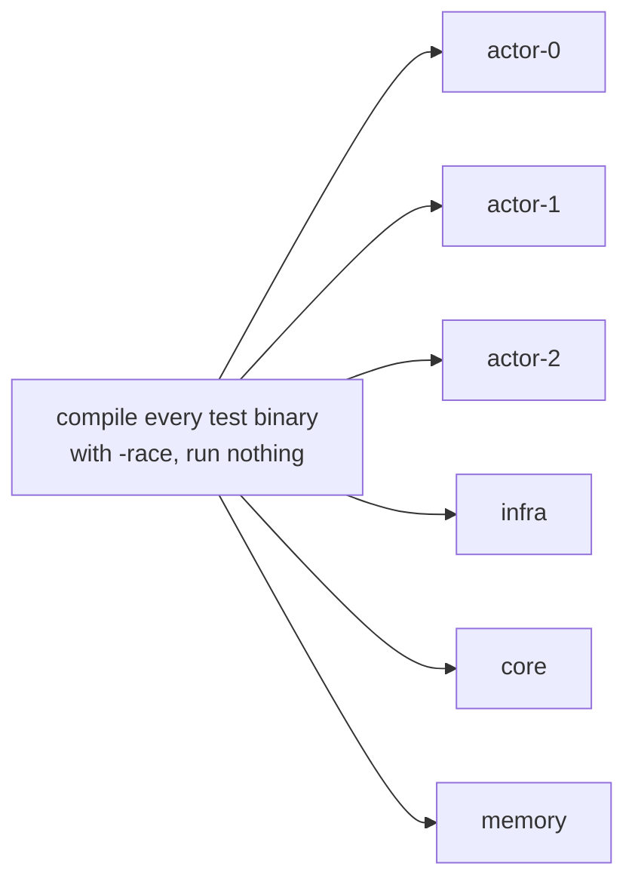

# 2. Building, Running and Testing the Code

## Contents

- [What you will learn](#what-you-will-learn)
- [Everything runs in a container](#everything-runs-in-a-container)
  - [`vendor/` is not committed](#vendor-is-not-committed)
- [Running one test while you read](#running-one-test-while-you-read)
- [How the full suite is split](#how-the-full-suite-is-split)
- [Generated code](#generated-code)
- [Lint rules that affect how code reads](#lint-rules-that-affect-how-code-reads)

## What you will learn

- Why the `make` targets that build, lint, test and generate run in a container, which tool versions the image pins, and where they differ from CI.
- Why `vendor/` is not committed and how the build still uses it.
- How to run a single test while reading the code.
- How the full suite is split into shards (the tests themselves are the subject of [Chapter 27](chap-27.md)).
- Which code is generated, and from what ([Chapter 1](chap-01.md#what-else-is-in-the-repository) lists the directories).
- The lint rules that shape how the code reads.

## Everything runs in a container

The `make` targets `vendor`, `lint`, `unit-test`, `mock`, `protogen`, `proto-format`, `proto-lint` and `certs` run inside a Docker image built from `Dockerfile.tools` (`make image`), so the only host requirements are Docker and Make (`Makefile`). `book-check` runs in stock Python and Node images instead, and `book-affected` in the Python one. The image pins the tools:

| Tool | Version |
|---|---|
| Go | `golang:1.27.2-alpine` |
| golangci-lint | v2.14.0 |
| buf | v1.73.0 |
| mockery | v3.8.1 |
| `protoc-gen-go`, `protoc-gen-go-grpc`, `protoc-gen-connect-go`, `grpcurl` | `latest` (unpinned) |

All versions are `ARG` lines in `Dockerfile.tools`, except Go, which is the `FROM` line. CI installs golangci-lint v2.14.0, the same version as the image (`.github/workflows/pr.yml`). Three differences to be aware of:

- The container builds with Go 1.27.2, CI installs Go 1.27.3 (`.github/workflows/pr.yml`), and `go.mod` declares 1.26.0. A local run can therefore use a slightly different toolchain than CI.
- `protoc-gen-go` is installed at `latest`, so regenerating protobuf code on two different days can produce different output.
- `make unit-test` does not use the image's `GOFLAGS`. The shard containers set `GOFLAGS=-mod=readonly` and `GOTOOLCHAIN=local`, as the CI jobs do, and take their modules from the image's pre-downloaded cache rather than from `vendor/` (`scripts/unit-test.sh`, `Dockerfile.tools`).

### `vendor/` is not committed

`vendor` is in `.gitignore`. The tools image sets `GOFLAGS=-mod=vendor` (`Dockerfile.tools`), so `make lint`, `make mock` and `make protogen` read modules from `vendor/`, and golangci-lint is configured with `modules-download-mode: vendor` (`.golangci.yml`). CI creates `vendor/` with `go mod tidy && go mod vendor` before its lint, cross-compile and unit-test jobs (`.github/workflows/pr.yml`). On a fresh clone, run `make vendor` first (`Makefile`); it runs the two commands in the image with `GOFLAGS` cleared.

## Running one test while you read

The full suite is large (about 178,000 test lines; [§27.1](chap-27.md#271-the-suite-in-numbers)), and the `actor` package alone dominates its wall-clock time (`.github/workflows/pr.yml`; [Chapter 3](chap-03.md) describes the system its tests start). While reading, run only the test you care about with a local Go toolchain at least as new as `go.mod` requires, after `make vendor` (the command below uses `-mod=vendor`):

```bash
go test -mod=vendor -race -count=1 -run '^TestActorSystem$/^When_already_started$' ./actor
```

Subtest names replace spaces with underscores. Run the parent test with `-v` to see its subtest names.

## How the full suite is split

`make unit-test` (`Makefile`) calls `scripts/unit-test.sh`; `SHARD=<name>` runs one shard and `V=1` streams every test. Each run first removes the `goakt-test-*` containers and volumes, logs and coverage files of earlier runs. It works in two phases:

1. **Compile.** One container compiles every test binary with the race detector but runs nothing (`go test -race -exec true -run '^$' ./...`, `scripts/unit-test.sh`). A compile error stops the run here.
2. **Shards.** Six shards run in parallel, each in its own fresh container (`scripts/unit-test.sh`). The Docker socket is shared with the containers because some tests start Consul and etcd containers of their own ([Chapter 27, §27.5](chap-27.md#275-how-tests-build-actor-systems)).



`scripts/test-shard.sh` defines the shards:

| Shard | What it runs |
|---|---|
| `actor-0`, `actor-1`, `actor-2` | The `actor` package's top-level tests (`go test ./actor -list '^Test'`), sorted by name and dealt round-robin into three slices, run serially (`-p 1`) over `./actor/...` |
| `infra` | `internal/cluster`, `internal/net`, `internal/remoteclient`, `remote`, `client`, `testkit`, `discovery` and `datacenter` (each with its subpackages), run serially (`-p 1`) |
| `core` | `go list ./...` minus the paths above, `actor`, `goaktpb`, `mocks`, `internal/internalpb`, `bench` and `playground`, with go's default package parallelism |
| `memory` | The `memory` package ([Chapter 26, §26.9](chap-26.md#269-reading-memory-on-each-platform)) with `-count=1 -v` and without the race detector or coverage |

The other shards run with `-race -covermode=atomic` and write `coverage-<shard>.out`, with a 30-minute timeout per test binary (the `memory` shard has 5 minutes).

The round-robin split matters when you add a test to `actor`: you do not choose its shard. It lands in whichever slice its name sorts into, and that can change which other tests it shares a process with. [Chapter 27, §27.3](chap-27.md#273-which-shard-runs-a-new-test) covers what a test author needs from the shard rules.

CI runs the five race shards (`actor-0`, `actor-1`, `actor-2`, `infra` and `core`) as a job matrix (`.github/workflows/pr.yml`; `.github/workflows/build.yml` repeats the jobs on pushes to `main`). The lint, cross-compile and unit-test jobs skip draft pull requests. CI has no Linux `memory` shard. It adds a cross-compile of the module for seven OS and architecture targets, which the local script does not have. It also runs the `memory` package's tests on real macOS and Windows runners, because the package's per-OS code can compile cleanly and still fail at runtime; the BSD targets are compile-only.

## Generated code

| What | Command | Notes |
|---|---|---|
| Protobuf (`internal/internalpb` from `protos/internal`, `test/data/testpb` from `protos/test`) | `make protogen` | Generated with `protoc-gen-go` and the **opaque API** (`default_api_level=API_OPAQUE` in `buf.gen.yaml`) |
| Mocks (`mocks/`) | `make mock` | Six interfaces: `hash.Hasher`, `discovery.Provider`, `internal/cluster.Cluster`, `extension.Dependency` and `extension.Extension`, `internal/remoteclient.Client` (`.mockery.yml`) |

The opaque API changes how every protobuf message is used in this codebase. Generated messages have unexported fields, so a struct literal cannot set them. The implementation creates an empty message and calls setters and getters, for example `peerState.SetHost(x.Host())` (`actorSystem.preShutdown` in `actor/actor_system.go`; [Chapter 3, §3.5](chap-03.md#35-stop)). Expect this pattern wherever the implementation touches the wire ([Chapter 15](chap-15.md#buffer-ownership) notes the same). The test messages are described in [Chapter 27, "Test protobuf messages"](chap-27.md#test-protobuf-messages), and the generated mocks in ["Generated mocks"](chap-27.md#generated-mocks) there.

## Lint rules that affect how code reads

`make lint` enables eight linters (`gocyclo`, `gosec`, `misspell`, `revive`, `staticcheck`, `whitespace`, `govet`, `goheader`) and the `gofmt` and `goimports` formatters (`.golangci.yml`). Test files are linted too (`tests: true`) and `mocks/` is excluded. Two of the linters shape every file you will read:

- **`goheader`** requires the exact MIT license header, including the year range `2022-2026`, at the top of every Go file (`.golangci.yml`).
- **`misspell`** runs with the US locale but whitelists British spellings (`.golangci.yml`). Comments say "behaviour", "serialise" and "cancelled", and the linter accepts them.

House style uses `x` as the method receiver name in most of the code (`func (x *actorSystem) Start(...)`; [Chapter 3](chap-03.md)). Some older types keep their own: `pid` on `PID` in `actor/pid.go` ([Chapter 4](chap-04.md)), `rctx` on `ReceiveContext` in `actor/receive_context.go` ([Chapter 8](chap-08.md)). revive's `receiver-naming` rule, part of the default rules that `.golangci.yml` enables, rejects two receiver names for one type within a file, so a method added to such a file keeps the file's name.
