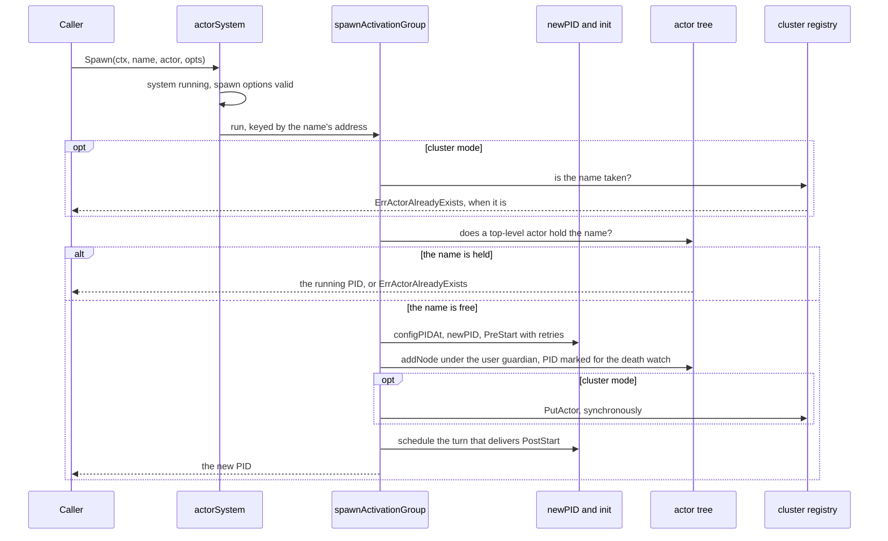
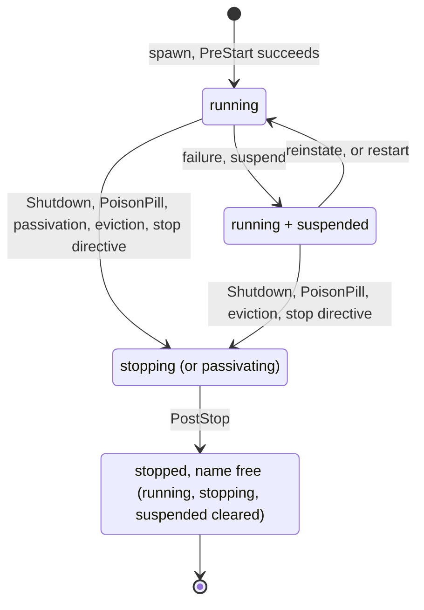
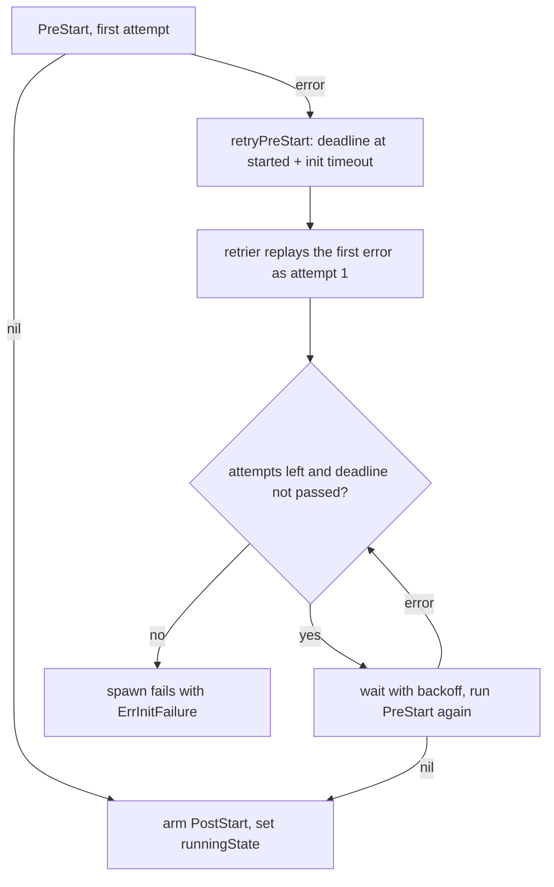

# 4. Spawning and the PID

## Contents

- [What you will learn](#what-you-will-learn)
- [4.1 The spawn entry points](#41-the-spawn-entry-points)
- [4.2 The local Spawn path, step by step](#42-the-local-spawn-path-step-by-step)
- [4.3 Inside newPID](#43-inside-newpid)
  - [PostStart is always the first message](#poststart-is-always-the-first-message)
  - [The PID struct is laid out for the cache](#the-pid-struct-is-laid-out-for-the-cache)
  - [State is one bitmask](#state-is-one-bitmask)
  - [Local and remote PIDs share one type](#local-and-remote-pids-share-one-type)
- [4.4 PreStart: retries and the timeout that is not one](#44-prestart-retries-and-the-timeout-that-is-not-one)
- [4.5 Names, addresses and identity](#45-names-addresses-and-identity)
  - [The address](#the-address)
  - [Name rules](#name-rules)
  - [What Equals compares](#what-equals-compares)
- [4.6 Children](#46-children)
- [4.7 Looking up, killing and restarting by name](#47-looking-up-killing-and-restarting-by-name)
- [4.8 Function actors](#48-function-actors)
- [Guarantees](#guarantees)
- [Implementation details (may change)](#implementation-details-may-change)
- [Behaviours to know](#behaviours-to-know)

## What you will learn

- The exact path a local `Spawn` takes, from the call to a running actor, and which step owns which guarantee.
- How concurrent spawns of one name collapse into one actor, and what that costs.
- What a `PID` contains, why its fields are ordered the way they are, and how its state is tracked.
- How `PreStart`, its retries and its timeout really behave.
- How children differ from top-level actors, and which spawn options do not apply to a child.
- How actors are named and addressed, what `PID.Equals` compares, and what `Restart` keeps.

## 4.1 The spawn entry points

Methods named without a type are on the actor system (`actorSystem` in `actor/actor_system.go`); their implementations are in `actor/spawn.go`.

| Entry point | Places the actor | Parent | Notes |
|---|---|---|---|
| `Spawn` | here, or on `host:port` given by `WithHostAndPort` | user guardian | `actorSystem.Spawn` |
| `SpawnNamedFromFunc` | here | user guardian | wraps a function in `FuncActor`; never relocatable ([§4.8](#48-function-actors); `actorSystem.SpawnNamedFromFunc`) |
| `SpawnFromFunc` | here | user guardian | the same, under a random UUID name (`actorSystem.SpawnFromFunc`) |
| `SpawnOn` | a cluster member chosen by placement strategy, or a node of another data center | user guardian of that node | returns a remote PID when the actor is placed elsewhere ([Chapter 21, §21.1](chap-21.md#211-placement-with-spawnon); data centers in [Chapter 22, §22.10](chap-22.md#2210-cross-datacenter-operations); `actorSystem.SpawnOn`) |
| `SpawnSingleton` | the cluster coordinator, or with `WithSingletonRole` the oldest member that advertises the role | singleton manager | [Chapter 21, §21.4](chap-21.md#214-cluster-singletons) (`actorSystem.SpawnSingleton`) |
| `SpawnRouter` | here | user guardian | a system actor, never relocatable, long-lived ([Chapter 11, §11.2](chap-11.md#112-routers); `actorSystem.SpawnRouter`) |
| `PID.SpawnChild` | the parent's node | the calling PID | [§4.6](#46-children) (`PID.SpawnChild` in `actor/pid.go`) |

With `WithHostAndPort`, `Spawn` creates nothing locally. It fails with `ErrRemotingDisabled` when remoting is off, sends a `RemoteSpawn` request that names the actor's kind, and returns a remote PID (`actorSystem.Spawn`; the transport is [Chapter 15](chap-15.md), the client call [Chapter 16, §16.1](chap-16.md#161-the-client-and-its-operations)). The kind must be registered on the target node, which instantiates it and calls its own `Spawn`, so the local path below runs there ([Chapter 17, §17.6](chap-17.md#176-actor-lifecycle-and-query-handlers); `actorSystem.remoteSpawnHandler` in `actor/remote_server.go`). The request carries the same settings `SpawnOn` sends, the dispatcher name included. The rest of this chapter follows the local path.

## 4.2 The local Spawn path, step by step



Unless another file is named, the functions in this section are in `actor/actor_system.go` (`actorSystem.Spawn` and `nameResolver` are in `actor/spawn.go`). The body of `actorSystem.Spawn` is short, and each line delegates to one step.

**Step 1. Preconditions.** The system must be running (`ErrActorSystemNotStarted`), and the spawn options must validate (`spawnConfig.Validate` in `actor/spawn_option.go`). `newSpawnConfig` sets the defaults: relocatable on, placement `RoundRobin`, everything else off (`actor/spawn_option.go`).

**Step 2. Serialise on the name.** The rest runs inside `runSpawnActivation`, keyed by the actor's address string (`actorSystem.runSpawnActivation` in `actor/spawn.go`). The group is a `spawnActivationGroup` (`actor/spawn_activation.go`), the part of singleflight a spawn needs and nothing more: the first caller for a key runs the spawn on its own goroutine, and concurrent spawns of the same name join that execution and share its result. The key is the string of the address, which carries no incarnation ID, so it is the same for every caller. `Spawn` mints that address with `actorAddress` and hands the same one to `configPIDAt` instead of minting a second; `SpawnNamedFromFunc` and the singleton spawn key the group with `actorReference` and let `configPID` mint the address that the PID carries.

`runSpawnActivation`'s comment spells out three subtleties:

- A waiter whose own context ends stops waiting, but the spawn carries on for the others.
- The shared execution runs under the **first** caller's context. If it fails because that context was cancelled while the waiter's context is still live, the waiter retries once rather than inheriting a cancellation that was never its own.
- Spawning the same name again from inside the actor's own `PreStart` joins its own in-flight execution and blocks until the caller's context expires.

A context that is already done does not start or join a spawn at all. The group is sharded 64 ways by the key's hash (`spawnActivationShards`, like the tree's indexes), so spawns of different names on different cores do not serialise on one mutex, and the channel a joining caller waits on is created only when one joins (`spawnActivationGroup.shard` in `actor/spawn_activation.go`).

Because the spawn runs on the first caller's goroutine, that caller returns when its spawn returns, even if its own context ended meanwhile: only the callers that joined leave early. A panic in the spawn path reaches that caller, after the group has completed the call with an error for the callers that joined it, so none of them waits on a call that never finishes (`spawnActivationGroup.run` in `actor/spawn_activation.go`).

**Step 3. Cluster precondition.** In cluster mode, `checkOrdinarySpawnPreconditions` asks the registry ([Chapter 20, §20.4](chap-20.md#204-the-registry)) whether the name exists. A name held by a node that has left the cluster counts as free, so a crashed owner's name can be reused; so does a name whose record this node wrote for an incarnation that has since stopped (`actorSystem.departedClaim`). The comment of `checkSpawnPreconditions` calls this "the first line of the name uniqueness rule, not the whole of it": two spawns can both pass the read, and the registry write in step 7 decides between them ([Chapter 21, §21.2](chap-21.md#212-one-name-in-the-whole-cluster)).

**Step 4. Local name check.** `topLevelActor` looks the name up as a top-level qualified name only, so a child that happens to share the name does not count. If an actor holds the name, `nameResolver` decides:

| Holder | Result |
|---|---|
| running | that **existing PID**, with no error |
| present but not running (suspended, stopping, passivating, restarting) | `ErrActorAlreadyExists` |
| node with no PID | name is free, continue |

The first row means a repeated `Spawn` of a running name is a lookup. The actor value passed the second time is ignored: the PID returned is the first actor's, still running the first actor's code.

In cluster mode step 3 runs first, and it finds this node's own live record and reports the name as taken. The same call therefore returns `ErrActorAlreadyExists` instead of the PID. In a cluster a name identifies one actor across all nodes, and the `Spawn` comment says to use `ActorOf` to get the running actor (`actor/spawn.go`).

**Step 5. Build the PID.** `configPIDAt` turns the spawn config into one `pidSettings` value, the settings every actor inherits from its system, plus a `pidOption` for each thing this spawn adds, and calls `newPID` (`pidSettings` in `actor/pid_option.go`, `newPID` in `actor/pid.go`). The settings travel as one value so that a spawn allocates no closure per setting. In order:

1. A controller of a reliable-delivery endpoint is made non-relocatable ([Chapter 23, §23.13](chap-23.md#2313-companions-identity-spawn-and-resolution)). Then reject a reserved name (`ErrReservedName`), unless the spawn is internal.
2. Fall back to the system's default supervisor ([Chapter 9, §9.1](chap-09.md#91-the-supervisor-value)) when none was given.
3. Resolve the named dispatcher ([Chapter 7, named dispatchers](chap-07.md#named-dispatchers)); an unknown name fails with `ErrDispatcherNotFound`, and an empty name keeps the default one (`actorSystem.dispatcherNamed`).
4. Collect the system settings: init retries, init timeout override, remoting, passivation manager ([Chapter 10, §10.2](chap-10.md#102-the-manager-and-its-entries)), metric provider ([Chapter 12, §12.4](chap-12.md#124-opentelemetry-instruments)), supervisor, mailbox ([Chapter 6](chap-06.md)), dispatcher and the relocation flag ([Chapter 21, §21.3](chap-21.md#213-what-relocates)).
5. Add the pid options this spawn needs: system, singleton ([Chapter 21, §21.4](chap-21.md#214-cluster-singletons)), stashing ([Chapter 8, §8.4](chap-08.md#84-the-stash)), reentrancy ([Chapter 8, §8.5](chap-08.md#85-reentrancy-requests-that-do-not-block)), role, dependencies ([Chapter 12, §12.2](chap-12.md#122-dependencies)), and for reliable delivery ([Chapter 23](chap-23.md)) the endpoint settings, its durable queues and the controller marker.
6. Fall back to the system's default passivation strategy (two minutes idle), or to long-lived for reliable-delivery endpoints and controllers ([Chapter 10, §10.1](chap-10.md#101-strategies)).

`newPID` validates the address and is covered in [§4.3](#43-inside-newpid). It runs `PreStart`, so **by the time `configPIDAt` returns, the actor has started but is not yet in the tree.**

**Step 6. Attach.** `completeSpawn` calls `attachAndPublish`, which:

1. Increments the live-actor counter for non-system actors.
2. Inserts the PID under its parent, which also makes the parent a watcher of the child ([Chapter 3, §3.4](chap-03.md#34-the-guardian-tree)).
3. Sets `deathWatchedState`. In a cluster the stopping actor then tells the death watch itself, without a watch edge in the tree (which would cost every actor a watcher entry and the death watch a watchee entry that nothing reads); that message is how a stopped actor's registry record is removed. Outside a cluster the death watch has nothing to do for a stopped actor and is not told (`PID.freeWatchers` in `actor/pid.go`). The stopping actor leaves the tree and the live-actor count by itself either way ([Chapter 9, §9.8](chap-09.md#98-death-watch)).

If the tree already holds this ID with a *different* PID, a concurrent spawn won. The function returns the canonical PID and undoes the counter. The duplicate is deliberately not shut down, because stopping it would tear down tree state keyed by the shared ID. The comment says this path should be unreachable while every entry point goes through `runSpawnActivation`; it logs a warning when it is reached.

**Step 7. Publish.** In cluster mode, `putActorOnCluster` writes the registry record **synchronously**. `Spawn` returns only after the write, so a successful spawn is resolvable by name from any node. System actors are not published, except reliable-delivery controllers. A conflicting record held by a departed node is replaced, fenced by its incarnation ID ([Chapter 20, §20.6](chap-20.md#206-claims-fences-and-scans)). If publication fails, `rollbackSpawn` shuts the actor down with a non-cancellable context, so a failed spawn leaves nothing behind.

**Step 8. Start and count.** `attachAndPublish` then calls `PID.firePostStartFrom` to schedule the turn that delivers `PostStart` ([§4.3](#poststart-is-always-the-first-message)), and `recordActorSpawned` updates the per-kind metric ([Chapter 12, §12.4](chap-12.md#124-opentelemetry-instruments)). It derives the kind name with `types.Name`, which requires a pointer; this is one of the places that makes pointer actors a requirement ([Chapter 1](chap-01.md)). Back in `completeSpawn`, a reliable-delivery endpoint then gets its controller (`ensureReliableCompanion`), and a companion that cannot start rolls the endpoint back (`rollbackReliableSpawn`, [Chapter 23](chap-23.md)).

## 4.3 Inside newPID

`newPID` (`actor/pid.go`):

1. Validates the address and allocates the struct, with a context-pool shard chosen round-robin (`nextContextShard` in `actor/context_pool.go`) so that concurrently busy actors take contexts from different pool shards ([Chapter 8, §8.1](chap-08.md#81-one-object-per-message)).
2. Sets the `relocationState` bit, then applies the settings and the options in that order (`pidSettings.apply` in `actor/pid_option.go`). The settings clear the bit when relocation is disabled, and set the dispatcher only when one was resolved; otherwise `PID.setActorSystem` has already cached the system's default.
3. **Embeds the default mailbox in the PID.** Without a custom mailbox, `newPID` allocates the mailbox's small `embeddedMailboxState`, which holds the actor's turn context, and `pid.mailbox` becomes the PID itself viewed as `*embeddedMailbox`. The PID's own `mailboxHead`/`mailboxTail` pointers stay nil until the first message brings the first segment. [Chapter 6, §6.2](chap-06.md#62-the-default-mailbox) covers this.
4. Resolves whether metrics are enabled, once, from the provider the settings wired in.
5. Falls back to package-level defaults for a missing supervisor or passivation strategy (`defaultSupervisor` and `defaultPassivationStrategy` in `actor/pid.go`). A top-level actor never reaches these fallbacks, because `configPIDAt` already supplied the system defaults. A child spawned without a passivation strategy reaches the passivation fallback. It never reaches the supervisor fallback, because `PID.buildChildSettings` in `actor/pid.go` already gave it the system's default supervisor ([§4.6](#46-children)).
6. Pushes `actor.Receive` as the first entry of the behaviour stack ([Chapter 8, §8.3](chap-08.md#83-behaviours)).
7. Runs `init`, which runs `PreStart` ([§4.4](#44-prestart-retries-and-the-timeout-that-is-not-one)), arms `PostStart`, sets `runningState` and, when someone subscribes, publishes `ActorStarted` to the event stream ([Chapter 11, §11.3](chap-11.md#113-the-event-stream)).
8. Registers with the passivation manager when the strategy auto-passivates (`PID.startPassivation`, [Chapter 10, §10.2](chap-10.md#102-the-manager-and-its-entries)), and builds the metric attributes (`PID.buildObserveOptions`).

The first turn is not scheduled in `newPID`. `attachAndPublish` schedules it once the actor is in the tree and, in a cluster, in the registry, and `attachSystemActor` does the same for system actors. A child spawned from its parent's turn is queued on that turn's worker when the worker belongs to the child's dispatcher, as a message the turn sends is; any other spawn goes through the dispatcher's ready queue ([Chapter 7, §7.5](chap-07.md#75-the-ready-queue); `PID.firePostStart`, `PID.firePostStartFrom` and `PID.scheduleFrom` in `actor/pid.go`).

### PostStart is always the first message

`init` arms `PostStart` in a dedicated slot (`PID.armPostStart`) *before* setting `runningState`. A turn runs the pending `PostStart` before each message, the system queue's included (`PID.runPendingPostStart` in `PID.runTurn`, [Chapter 7, §7.3](chap-07.md#73-one-turn)), and the slot is separate from both queues, so a full bounded mailbox ([Chapter 6, §6.4](chap-06.md#64-bounded-mailboxes)) cannot refuse it. Even if a user message, a child's `Terminated` or a `PanicSignal` arrives first, the actor sees `PostStart` first. The ordering is deliberate: from the moment `runningState` is set, senders can reach the actor.

`PostStart` also means the actor has fully started. Its turn is scheduled after the actor is attached to the tree and, in a cluster, after its registry record is written, so a `PostStart` handler can rely on the registry: `ActorSystem.Partition` finds the actor's own name and `ActorExists` reports it. One window remains: `init` marks the actor running before `attachAndPublish` attaches it, so a message that reaches the actor through a local name lookup between the tree attachment and the registry write triggers a turn that runs `PostStart` before the record exists. A spawn whose publication fails stops the actor without scheduling `PostStart`; only a message that arrived in that window could have run it.

### The PID struct is laid out for the cache

The `PID` struct is ordered by *which goroutine touches each field on the message path* rather than by topic, in four groups (`PID` in `actor/pid.go`). A PID is not cache-line aligned, so the separation comes from distance, not offsets.

| Group | Fields | Why they sit together |
|---|---|---|
| Producer | `state`, `schedState`, `ctxShard`, `metricsEnabled`, `mailboxTail`, `embedded`, `dispatcher`, `actorSystem`, `mailboxEnqueued` | every send reads them; only lifecycle changes or the producers' own tail and counter write them |
| Cold configuration | `actor`, `address`, `path`, `mailbox`, `remoting`, `supervisor`, `passivationStrategy`, `passivationManager`, `dependencies`, `companion`, `behaviorStack` | written at construction or on lifecycle paths; their size keeps the other two groups more than a cache line apart |
| Consumer | `processedCount`, `mailboxDequeued`, `turnWorker`, `mailboxHead`, `latestReceiveTimeNano`, `postStart`, `systemQueue` and neighbours | written by the processing turn for every message or every turn |
| Lifecycle and failure | the lockers, `initMaxRetries`, `initTimeout`, restart and failure counters, `remoteHolds` | touched on lifecycle, failure and configuration paths only |

The field comments give the reasons:

- `mailboxDequeued` and `turnWorker`, written by the consumer, sit next to `processedCount`, which the consumer writes on every message.
- `mailboxTail` and `mailboxEnqueued`, written by producers, are kept away from everything the turn touches. A send reads the tail on every message but writes it only when it links a new segment ([Chapter 6, §6.2](chap-06.md#62-the-default-mailbox)).
- Counting the mailbox size with two counters, one per side, instead of one shared counter avoids a cache line bouncing between producer and consumer on every message.
- `latestReceiveTimeNano` is stored once per turn, not once per message: `PID.markActivity` skips a store of the instant already recorded, since a turn passes the same instant for all its messages ([Chapter 10, §10.3](chap-10.md#103-activity)).
- Rarely used settings live in an optional `companion` pointer (`pidCompanion` in `actor/pid_companion.go`) that stays `nil` for an ordinary actor: reliable delivery, durable queues, role, singleton spec and the metrics identity (provider, observe options, kind).

When you add a field to `PID`, place it by write pattern. A hot field in the wrong place is a performance regression no functional test will catch.

### State is one bitmask

Fourteen independent flags live in one `atomic.Uint32` (`pidState` in `actor/pid_state.go`). The type's comment gives the reason: separate `atomic.Bool` fields would waste cache lines and padding. `PID.setState` updates one bit with a compare-and-swap loop, so goroutines flipping different bits never lose each other's updates. There is no state machine enforcing legal transitions. The bits are set and cleared at the points described in this and later chapters.

| Flag | Meaning while set | Chapter |
|---|---|---|
| `runningState` | initialisation is complete and the actor may handle messages; a suspended actor keeps this bit | this chapter |
| `stoppingState` | a stop is in progress | [§3.5](chap-03.md#35-stop) |
| `suspendedState` | supervision has suspended the actor | [Chapter 9](chap-09.md) |
| `passivatingState` | the actor is being passivated, and the stop is certain | [§10.5](chap-10.md#105-one-attempt) |
| `passivationPausedState` | passivation is paused while the actor is suspended | [§10.6](chap-10.md#106-pause-resume-reinstate) |
| `passivationSkipNextState` | the next passivation attempt must be skipped, once | [§10.6](chap-10.md#106-pause-resume-reinstate) |
| `singletonState` | the actor is a cluster singleton | [§21.4](chap-21.md#214-cluster-singletons) |
| `relocationState` | the actor may be relocated to another node | [§21.3](chap-21.md#213-what-relocates) |
| `systemState` | the actor is a system actor | [§3.4](chap-03.md#34-the-guardian-tree) |
| `remoteState` | the PID is a handle for an actor on another node | this chapter |
| `remoteHoldsClosedState` | teardown has drained the remote hold registry, so a flow-control credit tracked after it is repaid at once | [§17.9](chap-17.md#179-the-remote-hold-registry) |
| `restartingState` | the teardown in progress belongs to a restart, not a stop | [§9.6](chap-09.md#96-the-restart-itself) |
| `supervisionPendingState` | a failure awaits a supervision decision, and no user message is handled | [§7.6](chap-07.md#76-failures-leave-the-turn) |
| `deathWatchedState` | the death watch is told when the actor stops | [§4.2](#42-the-local-spawn-path-step-by-step) step 6, [§9.8](chap-09.md#98-death-watch) |

Several bits are set at once, so the lifecycle is easier to read as the combinations an observer can see:



Passivation never starts from `running + suspended`: `PID.tryPassivation` refuses while `suspendedState` or `passivationPausedState` is set (`actor/pid.go`). Eviction ([Chapter 10, §10.7](chap-10.md#107-system-eviction)) stops its actors with `Shutdown` (`actorSystem.runEviction` in `actor/actor_system.go`), so it reaches a suspended actor.

A restart passes through `restarting` + `stopping` and returns to `running` on the same PID ([Chapter 9, §9.6](chap-09.md#96-the-restart-itself)).

Two mutexes complete the picture. `stopLocker` serialises the two ways an actor can be stopped, `Shutdown` and a passivation attempt, so `PostStop` runs once ([Chapter 10, §10.5](chap-10.md#105-one-attempt)). `fieldsLocker` is a read-write mutex over the fields that can change after construction and are read from other goroutines. These include the actor system pointer, through which the logger and the event stream are looked up, the address and the behaviour stack's switches (`PID.getLogger`, `PID.getEventsStream`, `PID.getAddress`, `PID.setBehavior` in `actor/pid.go`). A send that is accepted takes neither: the local path (`PID.tell` and `PID.doReceive`) uses only the bitmask and the dispatch state ([Chapter 7, §7.2](chap-07.md#72-the-dispatch-state)).

### Local and remote PIDs share one type

A remote PID is the same struct with only `address`, `path` and `remoting` set, plus `remoteState` (`newRemotePID` in `actor/pid.go`). Most public methods branch on `IsRemote()`. The identity methods `ID`, `Name`, `Path` and `Equals` do not: they read the path, which a remote PID carries like a local one. Some of those branches are hidden network calls ([Chapter 16](chap-16.md)). For example, `ProcessedCount` and `RestartCount` on a remote PID each issue a `RemoteMetric` RPC with `context.Background()`, so the call has no deadline, and they return 0 when the call fails. `ActorSystem()` returns `nil` for a remote PID.

## 4.4 PreStart: retries and the timeout that is not one

`PID.init` (`actor/pid.go`) calls `PreStart` once directly, and only when that attempt fails does it build the retry machinery and run the remaining attempts through `internal/retry`:

```go
initContext := newContext(ctx, pid.Name(), pid.actorSystem, pid.Dependencies()...)
started := time.Now()
if err := pid.actor.PreStart(initContext); err != nil {
	if err = pid.retryPreStart(ctx, initContext, started, err); err != nil { ... }
}
```



`PID.retryPreStart` creates the deadline context, measured from `started`, and the retrier, and hands the retrier the first failure as the outcome of its own first attempt, so the attempts, the delays and the timeout are those of one retried run. A `PreStart` that succeeds, which is nearly all of them, therefore pays nothing for the deadline context, its timer or the backoff policy; it runs once (`TestInitRetriesPreStart` in `actor/pid_test.go`).

**Attempts.** The retry count is the total number of attempts, the first included (`NewRetrier` in `internal/retry/retry.go`). With the default of 5 (`DefaultInitMaxRetries` in `actor/defaults.go`; the system option is `WithActorInitMaxRetries`), a failing `PreStart` runs five times, with exponential backoff and jitter that starts at 1 ms and is capped at the init timeout. The spawn then fails with `ErrInitFailure` and returns no PID, and the last `PreStart` error is the cause it reports (`TestInitRetriesPreStart` and `TestFailedPreStart` in `actor/pid_test.go`). `PreStart` must therefore be safe to run more than once.

**Timeout.** The init timeout bounds only the retry loop. It is the actor's `WithInitTimeout` override when set, otherwise the system's (`PID.effectiveInitTimeout`), 1 s by default (`DefaultInitTimeout` in `actor/defaults.go`).

- `PreStart` receives `initContext`, which is built from the caller's `ctx` and not from the deadline context (`PID.init`). Even a `PreStart` that honours its context sees no deadline from the init timeout. It sees only the deadline the caller's `ctx` carries, if there is one.
- The retrier checks its deadline context only between attempts.

A `PreStart` that takes 2 s succeeds, and `Spawn` blocks for 2 s. `WithInitTimeout`'s comment says so: the timeout bounds the retries, not an attempt in progress (`actor/spawn_option.go`). If you need a bound, impose it inside `PreStart` with your own context. A grain differs: `grainPID.activate` in `actor/grain_pid.go` passes a context with the timeout to `OnActivate` ([Chapter 14, §14.8](chap-14.md#148-activation-and-deactivation-inside-the-process)).

Because `newPID` runs inside the activation group's execution ([§4.2](#42-the-local-spawn-path-step-by-step), step 2), a slow `PreStart` also holds every concurrent spawn of the same name for as long as it runs.

## 4.5 Names, addresses and identity

### The address

An address has a name, a system name, a host, a port and an optional parent, plus an incarnation ID (`Address` in `internal/address/address.go`). Its string form, computed once at construction, is

```
goakt://<system>@<host>:<port>/<ancestor>/.../<name>
```

(`Address.String` in `internal/address/address.go`). The part after `host:port` is the **qualified name**: every ancestor's name from the top-level actor down, joined by `/`, built by extending the parent's own qualified name, which every constructor computes before a child can be built on it (`Address.buildQualifiedName`). The qualified name is the key the cluster registry uses (`Address.QualifiedName`; [Chapter 20, §20.4](chap-20.md#204-the-registry)). The address tests check the qualified name of top-level, child and nested actors (`TestAddress` in `internal/address/address_test.go`).

Two kinds of constructor exist on purpose:

- `New`, and `NewWithParent` for a child, mint a fresh incarnation UUID and are meant for creating an actor (`actorSystem.actorAddress` in `actor/actor_system.go`, `PID.childAddress` in `actor/pid.go`). One other caller uses `New` for a record: `GrainContext.toDeadletter` in `actor/grain_context.go` builds a grain's dead-letter receiver address with it ([Chapter 5, §5.4](chap-05.md#54-dead-letters)).
- `NewReference` mints none, for lookup keys and references to existing actors (`actorSystem.actorReference` in `actor/actor_system.go`). Such an address does not pass `Validate`.

The incarnation ID tells two lives of the same name apart: it fences registry writes ([§4.2](#42-the-local-spawn-path-step-by-step), step 7) and `SameIncarnation` compares it.

### Name rules

`Address.Validate` (`internal/address/address.go`) requires:

- A non-empty name of at most 255 bytes (`maxNameLength`) matching `^[a-zA-Z0-9][a-zA-Z0-9-_\.]*$`, checked by a loop over the bytes rather than a regular expression because every spawn runs it (`validName`). Dots are allowed, though the error message does not mention them (`errInvalidNamePattern`). The system name must match the same pattern.
- A valid host and port, and a valid incarnation UUID.
- For a child: the same system (compared case-insensitively), host and port as its parent, and a name different from its parent's own name. A grandchild may reuse its grandparent's name.

An address is validated once. `Validate` memoises its result (`validateOnce`), and a child's validation, which recurses into its parent, reads the parent's memoised result rather than re-validating every ancestor; that is what keeps the cost of a child spawn from growing with its depth. `configPIDAt` does not validate the address itself, `newPID` does.

The pattern is matched against `strings.TrimSpace(name)` but the name is kept as given. A name with a trailing space is accepted, becomes part of the address, and cannot be found by its trimmed form. `Spawn`'s comment documents it and tells callers to trim names that come from input (`actor/spawn.go`).

### What Equals compares

| Comparison | Compares | Source |
|---|---|---|
| `PID.Equals` | the full ID string, exactly | `PID.Equals` in `actor/pid.go` |
| `Address.Equals` (internal) | name, system, host, port; not the parent or the incarnation | `Address.Equals` in `internal/address/address.go` |
| `Address.SameIncarnation` (internal) | `Equals` plus the incarnation ID, which must be non-empty | `Address.SameIncarnation` in `internal/address/address.go` |

Two properties of `PID.Equals`:

- **It ignores the incarnation.** A stopped PID equals the PID of a new actor later spawned under the same name. Do not use `Equals` to ask "is this still the actor I spawned"; use `IsRunning` on the PID you hold.
- **It is case-sensitive, like the tree.** `Worker` and `worker` are two actors (the tree's indexes are ordinary case-sensitive maps, keyed by ID, by name and by qualified name; `tree` in `actor/pid_tree.go`), and `Equals` tells them apart (`TestEquals` in `actor/pid_test.go`). This matters to supervision ([Chapter 9, §9.3](chap-09.md#93-the-parent-carries-it-out)): the siblings a OneForAll strategy restarts are found with `Equals`.

## 4.6 Children

`PID.SpawnChild` validates the spawn config, refuses a reliable-delivery option, then goes to `spawnChildRemote` for a remote parent ([Chapter 17, §17.6](chap-17.md#176-actor-lifecycle-and-query-handlers)) and to `spawnChildLocal` for a local one (`actor/pid.go`). `spawnChildLocal`:

1. Requires the parent to be running (`ErrDead`) and rejects reserved names.
2. Builds the child address under the parent (`PID.childAddress`).
3. Resolves an existing child the same way `nameResolver` does (`PID.childNameResolver`), once before the activation group and once inside it.
4. Runs the same activation-group serialisation, `newPID` and `completeSpawn` as a top-level spawn. A child is attached to the tree, marked for the death watch, and in cluster mode **published to the registry under its qualified name**. Unlike a top-level spawn it makes no registry read beforehand: the registry write decides.
5. Publishes `ActorChildCreated` to the event stream ([Chapter 11, §11.3](chap-11.md#113-the-event-stream)), only after the registry write, and only when someone subscribes.

The difference is what the child inherits. `PID.buildChildSettings` passes the parent's runtime wiring (system, remoting, passivation manager, metric provider, init retries) as the child's `pidSettings`, then the child's spawn options:

| Option | Top-level spawn | Child spawn |
|---|---|---|
| `WithMailbox`, `WithSupervisor`, `WithStashing`, `WithReentrancy`, `WithDependencies`, `WithDispatcher`, passivation strategy, `WithInitTimeout` | applied | applied |
| Supervisor when none given | the system's `WithDefaultSupervisor` | the same |
| Relocation | relocatable by default | **always disabled** |
| `WithRole` | applied | **no effect**: a role only constrains placement, and a child is always placed on its parent's node |
| `AsReliableProducer`, `AsReliableConsumer` | applied | **rejected** with `ErrReliableChildSpawnUnsupported` |

`SpawnChild`'s comment states the supervisor, `WithRole` and reliable-delivery rows. The relocation row comes from the `relocationDisabled` setting in `PID.buildChildSettings`. A reliable-delivery endpoint needs a controller that only a top-level spawn creates, and the remote child spawn request cannot carry its settings, so the option is refused rather than accepted without effect. A dispatcher name the system did not declare fails the child spawn with `ErrDispatcherNotFound`; a child does not inherit its parent's dispatcher ([Chapter 7, named dispatchers](chap-07.md#named-dispatchers)).

The test suite checks the supervisor and reentrancy rows (`TestSpawnChildInheritsSpawnOptions` in `actor/pid_test.go`) and the rejection of a reliable child (`TestReliableEndpointLocalChildSpawnRejected` in `actor/reliable_delivery_companion_test.go`).

Without `WithDefaultSupervisor`, the system default is `supervisor.NewSupervisor()`, which stops on `PanicError`, restarts on `PanicNilError`, and has no other rule (`supervisor.NewSupervisor` in `supervisor/supervisor.go`). An ordinary error therefore suspends the actor, child or not (`PID.notifyParent` in `actor/pid.go`; [Chapter 9, §9.2](chap-09.md#92-from-a-failure-to-a-decision)), and it stays suspended until something reinstates it ([Chapter 9, §9.7](chap-09.md#97-reinstate)).

## 4.7 Looking up, killing and restarting by name

`ActorOf` (`actorSystem.ActorOf` in `actor/actor_system.go`; the by-name send built on it is [Chapter 5, §5.8](chap-05.md#58-sending-by-name)) rejects a reserved name as not found, then resolves locally first, by qualified name and then by bare name (`actorSystem.localActor`). A bare child name that several parents share returns the most recently spawned child. The local lookup takes only the lock of the index shard the name hashes to. A node is handed out without that lock and `tree.deleteNode` clears its PID slot when the actor stops, so every caller that needs the PID goes through the tree's PID lookups (`pidOf`, `pidByName` and `pidByQualifiedName` in `actor/pid_tree.go`), which report an actor that has left the tree as not found. A stopping actor is reported as not found; a suspended one is returned.

In cluster mode a name that is not local is read from the registry through `actorSystem.getActorRecord`, which returns a remote PID. It hides the record of a non-relocatable actor whose node has left the cluster membership, and of no other: a relocatable actor's record, a singleton's, and any record when the membership cannot be read are returned as they are. With remoting but no cluster, a name that is not local gives `ErrMethodCallNotAllowed`, not `ErrActorNotFound`.

`Kill` resolves the same way and calls `PID.Shutdown`, or `RemoteStop` for an actor on another node (`actorSystem.Kill`). It inherits everything [Chapter 3, §3.5](chap-03.md#35-stop) says about `Shutdown`: queued messages are dropped and `PostStop` may overlap a running `Receive`.

`ReSpawn` calls `PID.Restart` for a local actor, or `RemoteReSpawn` through the registry (`actorSystem.ReSpawn`). For a reliable-delivery endpoint it also recreates a controller that stopped terminally ([Chapter 23, §23.13](chap-23.md#2313-companions-identity-spawn-and-resolution)). `Restart` (`actor/pid.go`):

1. Snapshots the running and suspended **subtree**.
2. Marks it `restartingState`, so each teardown keeps its name and registry record.
3. Rebuilds the same topology by running `PreStart` again on each actor.
4. If anything fails, stops the whole subtree (`restartNode.terminate`).

The supervisor's restart directive reaches the same machinery ([Chapter 9, §9.6](chap-09.md#96-the-restart-itself)). `ReSpawn`'s comment states the consequences:

- **Grandchildren restart too.** A grandchild's `PreStart` runs a second time.
- **The actor value is reused.** The PID and the Go value behind it are the same objects before and after, and only `PreStart` runs again. A field that `PreStart` does not reset keeps its value: an actor that counts to 3 and is restarted replies 4 next. This is why the `Actor` interface's comment says initialisation belongs in `PreStart` (`actor/actor.go`).
- **The mailbox is kept.** A message being handled when the restart begins finishes on the old incarnation, and the messages queued behind it are handled by the new one, after its `PostStart`. Messages sent while the restart is under way are refused (`PID.Restart` comment; the mailbox side is [Chapter 6, §6.8](chap-06.md#68-stops-restarts-and-other-nodes)).

`PID.Restart` can also revive a PID that already stopped: `restartParent` finds its parent from its address, or the user guardian for a top-level actor, and the restart puts it back into the tree.

## 4.8 Function actors

`SpawnFromFunc` and `SpawnNamedFromFunc` wrap a `ReceiveFunc` in a `FuncActor`. A `ReceiveFunc` has the signature `func(ctx context.Context, message any) error` (`actor/func_actor.go`). The options are `WithPreStart`, `WithPostStop` and `WithFuncMailbox`; the other spawn options do not apply, and the actor is always spawned with `WithRelocationDisabled` (`actorSystem.SpawnNamedFromFunc`).

`FuncActor.Receive` handles `PostStart` itself, to remember its PID, and does not pass it to the function. The function receives a plain `context.Context`, not a `ReceiveContext` ([Chapter 8](chap-08.md)), so it has no `Response`, `Sender` or `Self`. A function actor therefore has no way to reply, so an `Ask` ([Chapter 5, §5.3](chap-05.md#53-how-a-reply-gets-back)) to it can only end at its timeout. A returned error goes to supervision through `ctx.Err` ([Chapter 9, §9.2](chap-09.md#92-from-a-failure-to-a-decision)).

## Guarantees

| Statement | Enforced by |
|---|---|
| Concurrent spawns of one name produce one PID | `TestConcurrentSpawnSameNameCreatesSingleActor` in `actor/spawn_test.go` |
| A running holder of a name is returned by a repeated spawn; a suspended, stopping or passivating holder refuses it with `ErrActorAlreadyExists` and no second actor starts | `TestSpawn` in `actor/spawn_test.go` |
| A failed `PreStart` fails the spawn with `ErrInitFailure` and returns no PID | `TestFailedPreStart` in `actor/pid_test.go` |
| `PreStart` runs once when it succeeds, at most the init retries count of times in all when it fails, and the init timeout bounds the retries | `TestInitRetriesPreStart` in `actor/pid_test.go` |
| `ActorStarted` is published for a spawn only when someone subscribes | `TestInitPublishesActorStarted` in `actor/pid_test.go` |
| `PostStart` is the first message every incarnation handles | `TestPostStartIsTheFirstMessage` in `actor/pid_test.go` |
| In cluster mode a successful spawn is resolvable and reachable from another node at once | `TestSpawnOnImmediateCrossNodeVisibility` in `actor/spawn_test.go` |
| In cluster mode, spawning a name held by a live member, this node included, returns `ErrActorAlreadyExists`; a name held by a departed node is free | `TestCheckOrdinarySpawnPreconditions` and `TestDepartedClaim` in `actor/actor_system_test.go` |
| In cluster mode a second node spawning a name that is taken returns `ErrActorAlreadyExists` | `TestSpawn` in `actor/spawn_test.go` |
| The qualified name joins every ancestor's name | `TestAddress` in `internal/address/address_test.go` |
| A child gets the system default supervisor and its own reentrancy | `TestSpawnChildInheritsSpawnOptions` in `actor/pid_test.go` |
| A child cannot be a reliable producer endpoint | `TestReliableEndpointLocalChildSpawnRejected` in `actor/reliable_delivery_companion_test.go` |
| `PID.Equals` is exact and case-sensitive | `TestEquals` in `actor/pid_test.go` |
| Children are not relocatable, and stay so across a restart | `TestRestartPreservesSpawnTimeConfiguration` in `actor/pid_test.go` |
| `ActorOf`, `Kill` and `ReSpawn` answer an actor that left the tree after its node was found with `ErrActorNotFound`, `ActorExists` with `false` | `TestActorSystem` in `actor/actor_system_test.go` |
| `PID.Child` answers a child that left the tree after its node was found with `ErrActorNotFound` | `TestPIDMethodsWithTwoActorSystems` in `actor/pid_test.go` |
| The tree's PID lookups report an unknown actor and one that left the tree as not found | `TestPIDLookups` in `actor/pid_tree_test.go` |

## Implementation details (may change)

- Cache-line placement of PID fields and the four field groups.
- The 1 ms initial backoff between `PreStart` attempts.
- Round-robin context-pool shard selection.
- The 64 shards of the spawn activation group.

## Behaviours to know

| Behaviour | Source |
|---|---|
| The init timeout bounds `PreStart`'s retries, not an attempt in progress | `PID.init` in `actor/pid.go` |
| A repeated `Spawn` of a running name returns the PID locally but `ErrActorAlreadyExists` in a cluster | `actorSystem.Spawn` in `actor/spawn.go` |
| A name with surrounding whitespace is accepted and kept | `Address.Validate` in `internal/address/address.go` |
| `ActorOf` returns `ErrMethodCallNotAllowed` for a missing name with remoting but no cluster | `actorSystem.ActorOf` in `actor/actor_system.go` |
| `ProcessedCount` and `RestartCount` on a remote PID are RPCs with no deadline | `PID.ProcessedCount` in `actor/pid.go` |
| A function actor takes only `WithPreStart`, `WithPostStop` and `WithFuncMailbox`, and cannot reply | `FuncActor.Receive` in `actor/func_actor.go` |
