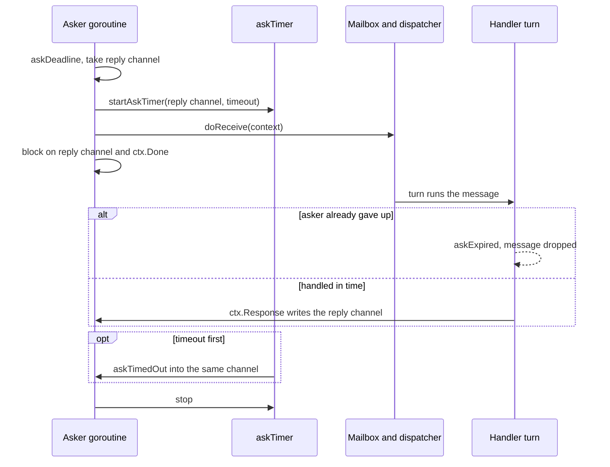
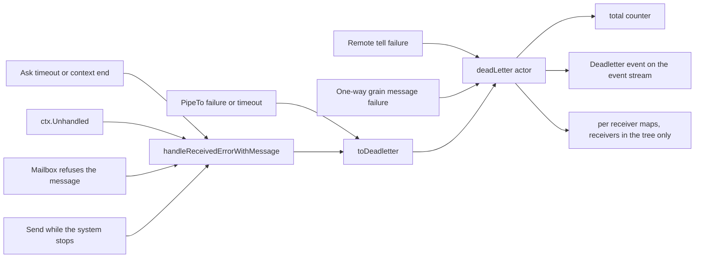

# 5. Messaging

## Contents

- [What you will learn](#what-you-will-learn)
- [5.1 Three ways to send](#51-three-ways-to-send)
  - [Where the families differ](#where-the-families-differ)
- [5.2 What a message carries](#52-what-a-message-carries)
  - [The ask deadline](#the-ask-deadline)
- [5.3 How a reply gets back](#53-how-a-reply-gets-back)
- [5.4 Dead letters](#54-dead-letters)
  - [NoSender](#nosender)
- [5.5 Forwarding](#55-forwarding)
- [5.6 Sending from inside Receive: errors become supervision](#56-sending-from-inside-receive-errors-become-supervision)
- [5.7 PipeTo](#57-pipeto)
- [5.8 Sending by name](#58-sending-by-name)
- [Guarantees](#guarantees)
- [Implementation details (may change)](#implementation-details-may-change)
- [Behaviours to know](#behaviours-to-know)

## What you will learn

- The three families of send functions, and how they differ in sender, validation and error reporting.
- What travels with a message: its sender, its context, and for an `Ask` a reply channel and a deadline.
- How a reply gets back, why it is written at most once, and when an `Ask` is skipped instead of handled.
- What a handler's `ctx.Context()` is, for a `Tell` and for an `Ask`.
- What happens when a send from inside `Receive` fails: errors become [supervision](chap-09.md).
- How `Forward`, `PipeTo`, name-based sends and dead letters work, and their edges.

Asynchronous requests with continuations (`ctx.Request`) belong with reentrancy, in [Chapter 8, §8.5](chap-08.md#85-reentrancy-requests-that-do-not-block). The handoff window that name-based sends meet during relocation is in [Chapter 21, §21.12](chap-21.md#2112-the-handoff-window), and the lookup across data centers is in [Chapter 22, §22.10](chap-22.md#2210-cross-datacenter-operations).

## 5.1 Three ways to send

| Family | Example | Sender the receiver sees | How it reports failure |
|---|---|---|---|
| Package functions | `actor.Tell(ctx, pid, msg)`, `actor.Ask(...)` | the system's NoSender ([§5.4](#nosender)) | returned `error` |
| PID methods | `pid.Tell(ctx, to, msg)`, `pid.Ask(...)`, `pid.SendAsync(ctx, name, msg)` | `pid` | returned `error` |
| ReceiveContext methods, inside `Receive` ([Chapter 8, §8.2](chap-08.md#82-what-a-handler-can-do)) | `ctx.Tell(to, msg)`, `ctx.Ask(...)`, `ctx.Forward(to)` | the current actor, except `ctx.Forward`, which keeps the original sender ([§5.5](#55-forwarding)) | **ctx.Err**, which goes to supervision ([§5.6](#56-sending-from-inside-receive-errors-become-supervision)) |

The ReceiveContext methods wrap the PID methods. Each one first derives a context with `context.WithoutCancel` from the handler's context (`ReceiveContext.withoutCancel` in `actor/receive_context.go`), so a send started in a handler is not cut short when the turn ends. That drops the handler context's deadline as well as its cancellation. `ctx.Tell` and `ctx.BatchTell` call the internal forms `PID.tell` and `PID.batchTell` in `actor/pid.go`, which also name the worker running the turn. A recipient on the default mailbox that is idle is then scheduled on that worker's own queue ([Chapter 7, §7.5](chap-07.md#75-the-ready-queue); `PID.putValue` and `PID.scheduleFrom`). Any other delivery goes through `PID.doReceive`.

### Where the families differ

Functions named here are in `actor/api.go` (`Tell`, `Ask`) or `actor/pid.go` (`PID.Tell`, `PID.Ask`).

| Check | `actor.Tell` / `actor.Ask` | `pid.Tell` / `pid.Ask` |
|---|---|---|
| `to == nil` | `ErrDead` | **panics** in the caller: `PID.tell` reads `to.state`, and `PID.Ask` calls `to.IsRunning`, which reads it |
| Local target not running | `ErrDead` | `ErrDead` |
| Remote target ([Chapter 16](chap-16.md)) | `ErrRemotingDisabled` when the PID has no remoting handle; otherwise a remote call as NoSender | `ErrRemotingDisabled` when the sender's system has no remoting; otherwise a remote call as the sender |
| `Ask` with timeout <= 0 | remote target: `ErrInvalidTimeout`; local target: not validated, and the timeout timer, armed with a non-positive duration, fires at once | `ErrInvalidTimeout` (checked after the target-running check for a local target) |
| The sending PID is not running | not applicable | not checked by `Tell` and `Ask`; `ErrDead` from `BatchTell`, `BatchAsk`, `SendAsync`, `SendSync` |

"Not running" includes **suspended, stopping and passivating** ([Chapter 4, §4.3](chap-04.md#43-inside-newpid)). `PID.IsRunning` is false in all three states, and `PID.tell` tests the same bits directly. A suspended actor therefore accepts no new messages from any family until it is reinstated ([Chapter 9, §9.7](chap-09.md#97-reinstate)). For a remote PID, `IsRunning` is a `RemoteState` call made with `context.Background()`, so the caller sets no timeout on it.

The two `BatchAsk`s take their arguments in a different order: `actor.BatchAsk(ctx, to, timeout, msgs...)` and `pid.BatchAsk(ctx, to, msgs, timeout)`. Both stop at the first failed `Ask` and return no responses. The batch `Tell`s stop at the first failed send; the messages before it are already delivered. For a remote target, `pid.BatchTell` and `pid.BatchAsk` send one RPC instead of one per message (`PID.BatchTell` and `PID.BatchAsk` in `actor/pid.go`).

## 5.2 What a message carries

A message travels with three values: `sender`, `message` and `ctx`; an `Ask` adds a reply channel and a deadline. They are held in a pooled `ReceiveContext` ([Chapter 8, §8.1](chap-08.md#81-one-object-per-message)), filled by `ReceiveContext.build` in `actor/receive_context.go`. Every local `Ask` and `Forward` uses one, and so does a `Tell` to an actor with a custom mailbox, a control message, a `Tell` made while the system is stopping and a message that arrived over remoting. A local `Tell` to an actor on the default mailbox carries the same three values in a mailbox slot instead; the receiving turn hands them to the handler in the actor's turn context (`PID.putValue` in `actor/pid.go`; [Chapter 6, §6.2](chap-06.md#62-the-default-mailbox)). `PipeTo` is the other exception: it delivers in a context allocated by `newReceiveContext` ([§5.7](#57-pipeto)).

| Field | `Tell` | `Ask` |
|---|---|---|
| `sender`, `self`, `message` | set | set |
| `ctx` | the sender's context, with cancellation and deadline removed (`context.WithoutCancel`, skipped when the context has no `Done` channel) | the sender's context as is |
| `response` | `nil` | a channel with room for one reply, borrowed from the sharded reply pool (`getResponseChannel` and `askReplyChannelPool` in `actor/pools.go`) |
| `deadline` | `0` | `askDeadline(ctx, timeout)` (`Ask` in `actor/api.go`) |

The `ctx` row has a consequence handlers depend on. For a `Tell`, the sender's context **values** reach the handler, but its cancellation and deadline do not, so a request-scoped context that ends right after `Tell` returns does not cancel the actor's work.

### The ask deadline

`askDeadline` (`actor/ask_deadline.go`) computes when the asker stops waiting: `timeout` from now, or the sender context's deadline if that is earlier. The result is a reading of a monotonic clock local to the process (`askClock`), not wall time, so it means something only on the node that made it. It is never zero, because zero means "no deadline", and it saturates at the largest value instead of wrapping for a huge timeout.

The deadline is used twice on the receiving side:

1. **Skipping.** When the message reaches the front of the queue, `PID.dispatchOne` checks `askExpired` and drops it without calling `Receive` if the asker has already given up (`actor/pid.go`; [Chapter 7, §7.3](chap-07.md#73-one-turn)). The check also covers a message that sat in the stash ([Chapter 8, §8.4](chap-08.md#84-the-stash)), because an unstashed message comes back through the mailbox with its deadline. The comment explains why: under load, answering requests nobody reads is what keeps an actor behind. An `Ask` already inside `Receive` when its deadline passes still runs to the end.
2. **The handler's context.** For an `Ask`, `ReceiveContext.Context` lazily derives a context that ends at the deadline (`askContext` in `actor/ask_deadline.go`), and `PID.handleReceived` releases it at the end of the turn (`actor/pid.go`). A handler that passes `ctx.Context()` to a database call stops when the asker stops waiting. If the sender's own context already ends by then, it is returned unchanged. For a `Tell`, `ctx.Context()` is the stored context, with no deadline.

## 5.3 How a reply gets back

`ctx.Response(v)` (`ReceiveContext.Response` in `actor/receive_context.go`) has three cases:

1. **No reply channel and no request ID.** The message was a `Tell`, so `Response` does nothing, silently.
2. **A request ID** (`ctx.Request`, [Chapter 8, §8.5](chap-08.md#85-reentrancy-requests-that-do-not-block)). The reply is routed as an asynchronous response message. `nil` is rejected with `ErrInvalidMessage`, recorded through `ctx.Err`.
3. **A reply channel** (an `Ask`). A compare-and-swap on `responseClosed` lets only the first `Response` through, and the send on the channel is non-blocking. A second `Response`, or a reply to an asker who has gone, is dropped.

On the asking side, `Ask` (`actor/api.go`) works in this order:

1. It captures the reply channel *before* handing the context to the mailbox, because after that the pooled context may be recycled for another message.
2. It arms the timeout before the handoff, so that nothing runs between the handoff and the wait.
3. It waits on the reply channel and `ctx.Done()` only. The timeout is a `time.AfterFunc` that delivers a private `askTimedOut` value into the same reply channel (`replyTimer` and `askTimer` in `actor/ask_timer.go`).

`replyTimer`'s comment records why the timeout is not a timer channel in the `select`: blocking on a timer channel makes the runtime arm and disarm that timer around every park of the asker, which the comment measures at about 180 ns per round trip on an 8-core arm64 machine, a fifth of an Ask. The reply channel can take the timeout because it serves one Ask at a time and is written only with non-blocking sends, so whichever of the reply and the timeout comes first is what `Ask` reads.

Recycling follows one rule. A timer stopped before it fired is pooled for the next Ask; one that fired is dropped, since its function may still be running (`replyTimer.stop`). In `PID.Ask`, the reply channel goes back to its pool only when the reply is in hand and the timer was stopped before it fired. On a timeout, a cancellation or a timer that fired late the channel is abandoned, so a late write can never reach a later Ask (`putResponseChannel` in `actor/pools.go`). `actor.Ask` and the remote ask handler (`actorSystem.handleRemoteAsk` in `actor/actor_system.go`; [Chapter 17, §17.5](chap-17.md#175-tell-and-ask)) wait the same way but never return the channel to the pool. Forwarding hands the reply guard over with the channel, so the forwarding actor can no longer reply and at most one reply is ever written to a channel (`ReceiveContext.inheritReplyRoute` in `actor/receive_context.go`).

A timeout or context end is also reported as a dead letter (`request timed out`, joined with the context error for a context end; [§5.4](#54-dead-letters)).

## 5.4 Dead letters

A dead letter is a record that a message was not delivered or not handled. `PID.handleReceivedErrorWithMessage` builds one and `PID.toDeadletter` sends it to the `GoAktDeadletter` system actor (`actor/pid.go`; [Chapter 3, §3.4](chap-03.md#34-the-guardian-tree)). Nothing is built when the system has no event stream, or for a `*PostStart`, a `*Terminated` or a dead-letter command itself, so a failing dead letter cannot recurse.

| Produces a dead letter | Does not |
|---|---|
| `Ask` timeout or context end (`Ask` in `actor/api.go`, `PID.Ask` in `actor/pid.go`) | `Tell`/`Ask` to a stopped or suspended actor, or `actor.Tell`/`actor.Ask` to nil: these return `ErrDead` before anything is built (`pid.Tell` to nil panics, [§5.1](#51-three-ways-to-send)) |
| `ctx.Unhandled()` (`ReceiveContext.Unhandled` in `actor/receive_context.go`) | A reply to an asker that has gone (dropped silently) |
| Mailbox refuses the message, for example a full bounded mailbox (`PID.doReceive` in `actor/pid.go`; [Chapter 6, §6.4](chap-06.md#64-bounded-mailboxes)) | Messages abandoned in a mailbox at `Shutdown` ([Chapter 3, §3.5](chap-03.md#35-stop)) |
| A message sent while the system is stopping, reason `ErrSystemShuttingDown` (`PID.doReceive`) | An `Ask` skipped as expired: its timeout was already recorded by the asker |
| `PipeTo` task failure or timeout ([§5.7](#57-pipeto)) | |
| A reentrancy envelope the actor cannot accept: an invalid `AsyncRequest` or `AsyncResponse` (`ErrInvalidMessage`), or a message that cannot be stashed while a request is in flight (`PID.dispatchOne`, [Chapter 8, §8.5](chap-08.md#85-reentrancy-requests-that-do-not-block)) | |
| A stashed message the mailbox refuses when a restart replays the stash (`PID.replayStash` in `actor/stash.go`) | |
| A remote tell that fails on the receiving node (unknown address, actor not running, dispatch failure, bad metadata), and a batch of remote tells whose transport write fails on the sending node (`actorSystem.deadLetterRemoteMessage` in `actor/remote_server.go`; [Chapter 17, §17.5](chap-17.md#175-tell-and-ask), [Chapter 16, §16.8](chap-16.md#168-the-coalescer)) | |
| A one-way grain message the grain fails to handle (`GrainContext.toDeadletter` in `actor/grain_context.go`; [Chapter 14, §14.4](chap-14.md#144-graincontext)) | |

The dead-letter actor (`deadLetter.handleDeadletter` in `actor/dead_letter.go`) does three things with each one:

1. Increments a total counter.
2. Publishes a `*Deadletter` event on the system event stream ([Chapter 11, §11.3](chap-11.md#113-the-event-stream)).
3. If the receiver is in the actor tree, records it in two maps: the latest dead letter per receiver address, and a count per (receiver address, message type) (`deadLetter` and `deadletterKey` in `actor/dead_letter.go`). A receiver outside the tree (a stopped actor, a grain, a remote actor) is counted in the total only.

The reason travels as text (`err.Error()`), not as an error value, so `errors.Is` is not available to subscribers (`PID.toDeadletter`). Which address is recorded as the receiver depends on the call. `actor.Ask` records NoSender as sender and the target as receiver. `PID.Ask` calls `handleReceivedErrorWithMessage` on the asker, so the asking PID is both sender and receiver. `PipeTo` records the piping actor as both sender and receiver. `ctx.Unhandled` records the actor that did not handle the message as receiver and the message's sender as sender.

The maps are bounded by the live actors. Every reader of the per-receiver counts (the metrics, [Chapter 12, §12.4](chap-12.md#124-opentelemetry-instruments), and the PID's own count) looks actors up in the tree, so an entry for a receiver that has left it can never be read. When adding a bucket brings the count map to `pruneAt` entries (`deadletterPruneThreshold`, 1,024, at first), `deadLetter.prune` drops the entries of receivers no longer in the tree, and `pruneAt` becomes twice the remaining size, never below 1,024. The cost is amortized over the dead letters that grew the maps. An actor spawned again under the same name starts its count from zero only if a prune ran while the name was free. Until then it has the same address string as its predecessor, and so the same counts.

To observe dead letters, subscribe to the system event stream (`ActorSystem.Subscribe`, `actor/actor_system.go`). The stream carries every system event (actor started, stopped, passivated, suspended, relocation) on one topic, so filter by payload type `*Deadletter`. The subscriber's `Iterator()` is not a live channel. It **drains what is buffered at the moment of the call into a channel that is already closed** (`subscriber.Iterator` in `eventstream/subscriber.go`), so a consumer has to call it repeatedly. A `select` on `<-sub.Iterator()` receives `nil` as soon as the buffer is empty.

### NoSender

`NoSender` is a real actor, `GoAktNoSender`, whose `Receive` marks every message unhandled (`noSender` in `actor/no_sender.go`). It is the sender of every package-level send. A handler that replies with `ctx.Tell(ctx.Sender(), …)` to a message sent with `actor.Tell` produces a dead letter, not a crash. Its supervisor resumes on any error (`actorSystem.spawnNoSender` in `actor/no_sender.go`).

## 5.5 Forwarding

`ctx.Forward(to)` (`ReceiveContext.Forward` in `actor/receive_context.go`) re-sends the current message with the **original sender**:

- **Local target.** A new `Tell`-style context is built, then given the reply route of the message it forwards (`ReceiveContext.inheritReplyRoute`): the asker's reply channel, the request ID and reply address of a `ctx.Request`, and the asker's deadline. For an `Ask`, the final actor's `Response` therefore answers the original asker. Because the deadline travels too, a forwarded `Ask` whose asker has given up is skipped ([§5.2](#52-what-a-message-carries)). If both the forwarding actor and the final actor respond, only the first reply is written, because the guard moves with the channel.
- **Remote target.** The message is sent as `sender.Tell`, so an `Ask`'s reply is lost; the `Forward` comment says so. If the original sender is NoSender it returns silently.
- **Target not running.** `ErrDead` through `ctx.Err`.

`ctx.ForwardTo(name)` (`ReceiveContext.ForwardTo`) does nothing outside cluster mode ([Chapter 19](chap-19.md)), and reports nothing. In cluster mode it calls `sender.SendAsync` ([§5.8](#58-sending-by-name)), so the receiver sees the original sender, no reply route is carried, and `sender` must be a local, running PID (a remote sender yields `ErrNotLocal` through `ctx.Err`).

## 5.6 Sending from inside Receive: errors become supervision

`ctx.Err(err)` only records the error. After the turn, `PID.recovery` submits any recorded error to supervision (`actor/pid.go`). From that moment until the decision the actor hands out no user message (`PID.handlesUserMessages`; [Chapter 9, §9.2](chap-09.md#92-from-a-failure-to-a-decision)). Every ReceiveContext send method reports its failure through `ctx.Err`, so **a failed send is a supervised failure of the sender**:

- `PID.submitSupervision` and `PID.notifyParent` ignore `ErrDead` (`actor/pid.go`), so `ctx.Tell` to a stopped actor leaves the sender running.
- Any other error has no directive in the default supervisor, which knows only `PanicError` (stop) and `PanicNilError` (restart) (`NewSupervisor` in `supervisor/supervisor.go`; [Chapter 9, §9.1](chap-09.md#91-the-supervisor-value)), and a missing directive **suspends** the actor (`PID.notifyParent`). The parent is not told and nothing reinstates the actor ([Chapter 9, §9.2](chap-09.md#92-from-a-failure-to-a-decision)). A `ctx.Ask` that times out therefore suspends the actor that asked. A suspended actor accepts no messages ([§5.1](#51-three-ways-to-send)).

Practical rules for handler code:

- Prefer the PID methods (`ctx.Self().Ask(...)`), which return the error to you, when a failure is expected and should be handled in place.
- Or give the actor a supervisor with a directive for the errors you expect ([Chapter 9](chap-09.md)); the `ReceiveContext.Ask` and `ReceiveContext.Err` comments name `WithAnyErrorDirective`.
- `ctx.Ask` blocks the dispatcher worker running this turn for up to `timeout`. A blocked handler holds a worker for the whole wait, and the default pool has `GOMAXPROCS` workers ([Chapter 7, §7.1](chap-07.md#71-the-pieces)), so enough actors asking each other synchronously can stall every actor and grain on the pool. `PipeTo` or `ctx.Request` keep the worker free. Before it blocks, `PID.Ask` called from a turn hands the actor that turn readied to another worker (`worker.handoffRunnext` in `actor/worker.go`), so the asker does not wait on an actor stuck in its own run-next slot.

## 5.7 PipeTo

`pid.PipeTo(ctx, to, task)` (`PID.PipeTo` in `actor/pid.go`) runs `task` on a new goroutine and delivers its result to `to` as an ordinary message, with the piping actor as sender (`PID.handleCompletion`). The calling actor's turn is not blocked. The task runs outside the actor, so it must not touch the actor's state. `PipeTo` returns `ErrNotLocal` when the piping PID is remote, `ErrUndefinedTask` for a nil task and `ErrDead` when `to` is not running at the call.

| Outcome | What happens |
|---|---|
| Task succeeds, `to` running | result delivered to `to`'s mailbox |
| Task returns an error | dead letter, reason = the error, message = `*NoMessage` |
| `to` stopped meanwhile | dead letter with `ErrDead` |
| `WithTimeout` elapses first | dead letter with `context.DeadlineExceeded`; result never delivered |
| `WithCircuitBreaker` open | dead letter with the breaker's error ([Chapter 26, §26.8](chap-26.md#268-where-goakt-uses-the-breaker)) |

The timeout row needs care. `future.New` starts the task on its own goroutine (`internal/future/future.go`). `Await` returns when the context ends, but a task is `func() (any, error)` with no context, so **nothing stops it**: it runs to completion and its result is discarded. A timeout bounds how long you wait for the result, not how long the work runs.

The only options are `WithTimeout` and `WithCircuitBreaker` (`actor/pipe_option.go`). Their comments say only one may be given, but `newPipeConfig` does not check this: with both, `PID.handleCompletion` bounds the wait with the timeout and runs the task through the breaker. `ctx.PipeTo`'s comment lists both options (`ReceiveContext.PipeTo`).

The result is delivered in a context built by `newReceiveContext` in `actor/receive_context.go`, which carries the context given to `PipeTo` (with the timeout, if any, which `handleCompletion` cancels when it returns) and a reply channel that no one waits on, so a `Response` from the receiver is accepted and discarded.

`PipeToName` checks that the name exists when it is called (`ErrActorNotFound` otherwise), but resolves it again when the task finishes, through NoSender's `SendAsync` (`PID.PipeToName` in `actor/pid.go`). The receiver sees NoSender as the sender, not the piping actor. A failed send is a dead letter with the result as message.

## 5.8 Sending by name

`pid.SendAsync(ctx, name, msg)` and `pid.SendSync(ctx, name, msg, timeout)` (`PID.SendAsync` and `PID.SendSync` in `actor/pid.go`) resolve the name and then call `Tell` or `Ask`:

1. Resolve in the local data center with `actorSystem.ActorOf` (`actor/actor_system.go`): the local tree, then, in cluster mode, the cluster registry ([Chapter 20, §20.4](chap-20.md#204-the-registry)). A system actor name is never found, and neither is a local actor that is stopping. With remoting but no cluster, a name absent locally yields `ErrMethodCallNotAllowed`.
2. Only `ErrActorNotFound` falls through to the next step; any other error is returned. If data centers are configured ([Chapter 22, §22.10](chap-22.md#2210-cross-datacenter-operations)), query every active data center's endpoints in parallel and take the first hit (`PID.DiscoverActor`). The lookup is bounded by the data center `RequestTimeout` (5 seconds without a data center config), and `SendSync` lowers it to its own timeout when that is positive and smaller. Without a data center controller `DiscoverActor` returns `ErrActorNotFound`.

They differ in one way. While a departed node's actors are being recreated elsewhere, `SendSync` retries across that short handoff window, bounded by its timeout (`PID.deliverAcrossHandoff` in `actor/relocation_handoff.go`), whereas `SendAsync` never waits. It fails at once: with `ErrRelocationInProgress` while the name still resolves to the departed node (`PID.deliverBypassingHandoff` in `actor/relocation_handoff.go`), and with the lookup error, usually `ErrActorNotFound`, once that record has been removed. Outside a cluster neither retries. The window, its bounds and the retryable errors are in [Chapter 21, §21.12](chap-21.md#2112-the-handoff-window).

## Guarantees

| Statement | Enforced by |
|---|---|
| An `Ask` that expired in the queue is not handled | `TestActorSkipsAnExpiredAskAtDispatch` in `actor/receive_context_test.go` |
| The context an `Ask` handler sees carries the ask deadline and is released with the turn | `TestReceiveContextCarriesTheAskDeadline` in `actor/receive_context_test.go` |
| The ask deadline is never zero and does not wrap for a huge timeout | `TestAskDeadline` and `TestAskDeadlineDoesNotWrapAround` in `actor/ask_deadline_test.go` |
| An `Ask` timeout is delivered into the reply channel, never in place of a reply already there, and a stopped timer delivers nothing, also when it is reused for the next `Ask` | `TestAskTimer` in `actor/ask_timer_test.go` |
| A late reply to a timed-out `Ask` reaches no later `Ask`, a steady stream of `Ask`s allocates no reply channel, and a reply followed by a forward answers the asker once | `TestAskReusesReplyChannels` in `actor/pid_test.go` |
| A forwarding context cannot reply once the receiver holds the reply route | `TestInheritReplyRouteMovesTheReplyGuard` in `actor/receive_context_test.go` |
| A locally forwarded `Ask`, and one from another node, is answered by the final actor | `TestReceiveContext` in `actor/receive_context_test.go` |
| A message marked unhandled becomes a dead letter with reason `ErrUnhandled` | `TestReceiveContext` in `actor/receive_context_test.go` |
| A message sent while the system is stopping is refused with `ErrSystemShuttingDown` as a dead letter | `TestPIDDoReceiveDuringShutdown` in `actor/pid_test.go` |
| A `PipeTo` that times out delivers nothing and records one dead letter | `TestPipeTo` in `actor/pid_test.go` |
| The dead-letter registry counts per receiver address and message type | `TestDeadletter` in `actor/dead_letter_test.go` |
| The dead-letter maps keep entries only for receivers in the actor tree | `TestDeadletterBucketsFollowActorTree` in `actor/dead_letter_test.go` |
| A remote tell that cannot be delivered becomes a dead letter on the receiving node, and a healthy message in the same batch is still delivered | `TestRemoteTellHandlerPerMessageDeadlettering` in `actor/dead_letter_test.go` |
| A remote tell batch that fails in transport becomes dead letters on the sending node | `TestRemoteTellCoalescedTransportFailureDeadletters` in `actor/dead_letter_test.go` |
| A `Tell` made from a turn schedules an idle recipient on the turn's worker, and one made outside a turn goes through the shared queue | `TestReceiveContextTellSchedulesOnTheTurnWorker` in `actor/receive_context_test.go` |
| The by-name delivery helper `SendAsync` uses never retries across a relocation handoff, and the one `SendSync` uses does | `TestDeliverBypassingHandoff` and `TestDeliverAcrossHandoff` in `actor/relocation_handoff_test.go` |
| An actor that tells another actor and then asks it in one turn gets its reply | `TestAskFromATurnHandsOffTheActorItReadied` in `actor/pid_test.go` |

## Implementation details (may change)

- Pooled `ReceiveContext`s, a `Tell` to the default mailbox that takes none, pooled reply channels and pooled timers, so a steady stream of `Ask`s allocates no reply channel (`getResponseChannel` in `actor/pools.go`).
- The process-local monotonic clock used for ask deadlines.
- The `AfterFunc` timer that delivers the timeout into the reply channel.
- The dead-letter registry's two maps and its prune threshold.
- The run-next hand-off before `PID.Ask` blocks inside a turn.

## Behaviours to know

| Behaviour | Source |
|---|---|
| A failed send inside `Receive` (any error except `ErrDead`), such as a `ctx.Ask` timeout, suspends the sending actor under the default supervisor | `PID.notifyParent` in `actor/pid.go` |
| The ReceiveContext send methods drop the handler context's deadline as well as its cancellation | `ReceiveContext.withoutCancel` in `actor/receive_context.go` |
| `PipeTo`'s timeout does not stop the task, and a task that panics is not recovered | `WithTimeout` in `actor/pipe_option.go`; `New` in `internal/future/future.go` |
| A `PipeTo` with `WithTimeout` delivers the result in a context that is cancelled once the message is queued | `PID.handleCompletion` in `actor/pid.go` |
| `PipeTo` is written for a local `to`: it checks `to.IsRunning` and then enqueues into `to`'s mailbox, which a remote PID does not have | `PID.PipeTo` and `PID.handleCompletion` in `actor/pid.go` |
| `Forward` to a remote PID loses an `Ask`'s reply | `ReceiveContext.Forward` in `actor/receive_context.go` |
| `ForwardTo` is a silent no-op outside cluster mode and carries no reply route | `ReceiveContext.ForwardTo` in `actor/receive_context.go` |
| `pid.Tell(ctx, nil, …)` and `pid.Ask(ctx, nil, …)` panic; `actor.Tell` and `actor.Ask` return `ErrDead` | `PID.tell` and `PID.Ask` in `actor/pid.go`; `Tell` in `actor/api.go` |
| `actor.Ask` does not reject a non-positive local timeout | `Ask` in `actor/api.go` |
| The timeout dead letter of `PID.Ask` names the asker as receiver; that of `actor.Ask` names the target | `PID.Ask` in `actor/pid.go`; `Ask` in `actor/api.go` |
| A `Tell` to a remote PID returns once the message is handed to remoting; a failure on the receiving node surfaces only as a dead letter there | `actorSystem.deadLetterRemoteMessage` in `actor/remote_server.go` |
