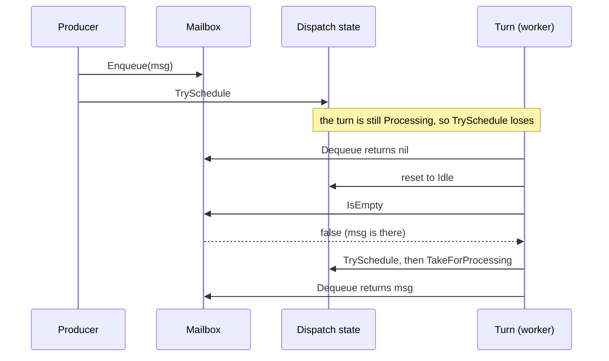
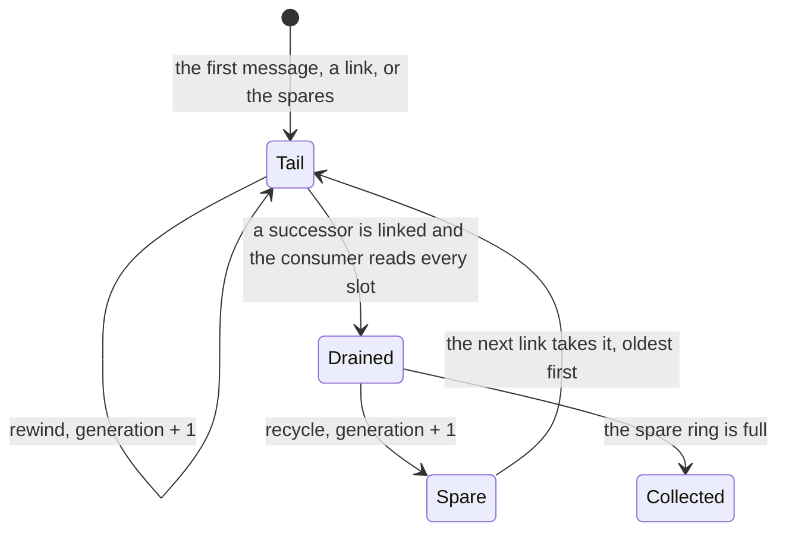

# 6. Mailboxes

## Contents

- [What you will learn](#what-you-will-learn)
- [6.1 The contract](#61-the-contract)
  - [Who owns a dequeued context](#who-owns-a-dequeued-context)
- [6.2 The default mailbox](#62-the-default-mailbox)
  - [Claiming and publishing a slot](#claiming-and-publishing-a-slot)
  - [Reusing segments](#reusing-segments)
  - [Generations and stale claims](#generations-and-stale-claims)
- [6.3 Choosing a mailbox](#63-choosing-a-mailbox)
- [6.4 Bounded mailboxes](#64-bounded-mailboxes)
  - [`BoundedMailbox`: blocking](#boundedmailbox-blocking)
  - [`NonBlockingBoundedMailbox`: dropping](#nonblockingboundedmailbox-dropping)
- [6.5 Priority mailboxes](#65-priority-mailboxes)
- [6.6 The fair mailbox](#66-the-fair-mailbox)
- [6.7 The segmented mailbox](#67-the-segmented-mailbox)
- [6.8 Stops, restarts and other nodes](#68-stops-restarts-and-other-nodes)
- [6.9 Writing your own mailbox](#69-writing-your-own-mailbox)
- [Guarantees](#guarantees)
- [Implementation details (may change)](#implementation-details-may-change)
- [Behaviours to know](#behaviours-to-know)

## What you will learn

- What the `Mailbox` interface promises, and the stronger contract the dispatcher relies on ([Chapter 7](chap-07.md)).
- How the default mailbox works: a lock-free multi-producer, single-consumer queue of reusable segments built into the PID, which a local `Tell` fills without a pooled context.
- How each of the nine mailboxes is built and what it costs: bounded or not, blocking or dropping, FIFO, priority or fair.
- Who owns a `ReceiveContext` ([Chapter 8, §8.1](chap-08.md#81-one-object-per-message)) once it has been dequeued, and when it goes back to the pool.
- What happens to a mailbox when its actor stops, restarts ([Chapter 9, §9.6](chap-09.md#96-the-restart-itself)), or is placed on another node ([Chapter 21, §21.1](chap-21.md#211-placement-with-spawnon)).
- What you must get right to write a mailbox of your own.

## 6.1 The contract

`Mailbox` has five methods (`actor/mailbox.go`): `Enqueue`, `Dequeue`, `IsEmpty`, `Len` and `Dispose`. Its comment asks for "a thread-safe FIFO", but the priority and fair mailboxes are not FIFO, so read that as "the order the mailbox defines".

Only user messages go through the mailbox. `PID.doReceive` sends control messages (`PoisonPill`, `Panicking`, `PausePassivation`, `ResumePassivation`, `PanicSignal`, `Terminated`, `SendDeadletter`) to the separate system queue instead (`isControlMessage` in `actor/pid.go`), which a turn serves first ([Chapter 7, §7.4](chap-07.md#74-the-system-queue)). The async request and response messages used by reentrancy ([Chapter 8, §8.5](chap-08.md#85-reentrancy-requests-that-do-not-block)) stay in the mailbox, so they keep their place relative to user messages.

The two sides of the mailbox run on different goroutines:

- **Producers** are whoever sends. A local `Tell` ([Chapter 5, §5.1](chap-05.md#51-three-ways-to-send)) to a default-mailbox actor writes values straight into a slot (`PID.putValue` in `actor/pid.go`, [§6.2](#62-the-default-mailbox)). Every other delivery (an `Ask`, a remote message, a stash replay ([Chapter 8, §8.4](chap-08.md#84-the-stash)), a `Tell` to an actor with a custom mailbox) goes through `PID.doReceive`, which calls `Enqueue` on the sender's goroutine (`actor/pid.go`).
- **The consumer** is the actor's turn. `PID.runTurn` calls `Dequeue` until it is empty or the throughput budget is spent, and `PID.finishOrReclaim` calls `IsEmpty` before releasing the actor (`actor/pid.go`). Successive turns may run on different worker goroutines, but never two at once: the dispatch state hands the actor from one worker to the next ([Chapter 7, §7.2](chap-07.md#72-the-dispatch-state)).

Reading those call sites gives the contract a mailbox has to meet. The interface comment states only the first point:

1. **One consumer at a time, many producers.** Every built-in mailbox is used this way (MPSC).
2. **`Dequeue` returns nil when empty, and does not block.** `BoundedMailbox` documents its non-blocking `Dequeue` as what the dispatcher requires.
3. **Once `Enqueue` returns, `IsEmpty` must report the message until it is dequeued.** The producer enqueues first and only then tries to schedule the actor. If that attempt loses because a turn is still running, the message is picked up only because `finishOrReclaim` resets the dispatch state *and then* checks `IsEmpty`. A mailbox whose `IsEmpty` could miss a completed enqueue would leave that message stranded until the next send.
4. **An `Enqueue` error drops the message.** `doReceive` logs the error, reports the message as a dead letter (`PID.handleReceivedError`, [Chapter 5, §5.4](chap-05.md#54-dead-letters)), repays its remote credit share ([Chapter 15, §15.8](chap-15.md#158-flow-control)), and returns. The sender is not told: `Tell` has already returned nil, and an `Ask` waits until it times out.

Together with the single consumer, a FIFO mailbox gives the ordering guarantee users rely on: **messages from one sender to one receiver are handled in the order they were sent**. Nothing is promised across senders. The guarantee is the mailbox's, so it holds for the FIFO mailboxes only; the priority, fair and segmented mailboxes define their own order ([§6.5](#65-priority-mailboxes) to [§6.7](#67-the-segmented-mailbox)), and control messages overtake user messages ([Chapter 7, §7.4](chap-07.md#74-the-system-queue)).

`Len` is not on the hot path. The `actor.mailbox.size` metric ([Chapter 12, §12.4](chap-12.md#124-opentelemetry-instruments)) is computed from two counters the actor keeps, one written by producers and one by the turn, on separate cache lines (`PID.observedMailboxSize` in `actor/pid.go`); they are maintained only when metrics are enabled. The interface comment warns that `Len` walks the queue, every node of an `UnboundedMailbox` and every segment of the default mailbox, and is longest when the mailbox is saturated.

### Who owns a dequeued context

A `ReceiveContext` taken from a mailbox is still in use while the handler runs, and it is pooled. The rule, stated in the comment of `PID.dispatchOne` (`actor/pid.go`), is that the mailbox releases a context on the **next** `Dequeue`, not the caller:

| Mailbox | When a dequeued context goes back to the pool |
|---|---|
| Default | a context that came in through `Enqueue` is held and recycled on the next `Dequeue`; a message a `Tell` stored as values comes out in the actor's own turn context, which is never pooled |
| `UnboundedMailbox` | it stays as the list's sentinel and is recycled on the next `Dequeue` |
| `NonBlockingBoundedMailbox`, `BoundedPriorityMailbox`, `BoundedStablePriorityMailbox`, `UnboundedStablePriorityMailbox` | kept in `prev` and recycled on the next `Dequeue` |
| `BoundedMailbox`, `UnboundedPriorityMailBox`, `UnboundedSegmentedMailbox` | never; it is left to the garbage collector |
| `UnboundedFairMailbox` | by the sender's own sub-queue, an `UnboundedMailbox`, on that sub-queue's next `Dequeue` |

A context can be linked into only one mailbox at a time, because the linked mailboxes use its `next` field as the list link (`UnboundedMailbox` in `actor/unbounded_mailbox.go`).

## 6.2 The default mailbox

An actor spawned without `WithMailbox` gets the **embedded mailbox**, built into the PID. The PID carries two segment pointers, `mailboxHead` and `mailboxTail`, and `newPID` allocates a small `embeddedMailboxState` next to it; `(*embeddedMailbox)(pid)` is installed as the mailbox, a pointer conversion that allocates nothing (`newPID` in `actor/pid.go`; `embeddedMailbox` in `actor/embedded_mailbox.go`). An actor with a custom mailbox has neither the state nor the segments.

It is a multi-producer, single-consumer FIFO queue, but not a linked list of contexts. It stores messages in the slots of fixed-size **segments** of 32 (`mailboxSegmentSlots`), in the manner of the segmented array queues of JCTools and .NET's `ConcurrentQueue`. A full segment fits the 2 KiB allocation size class, so the runtime serves a new one from the per-P cache rather than the heap lock a larger segment would take (comment of `mailboxSegmentSlots`). The first segment an actor allocates is smaller, 8 slots (`mailboxFirstSegmentSlots`), a 640-byte allocation: most actors never hold more than a few messages, and a first segment of 2 KiB was close to half of everything a workload that spawns an actor per message allocated. A segment carries its own capacity. A segment allocated after the first is full-size, but the first one is recycled like any other, so a later link may reuse it with its 8 slots (`newMailboxSegment`). All names in this section are in `actor/embedded_mailbox.go` unless another file is named.

Storing messages in slots is what lets a local send skip the context pool. `Tell` writes the message, its sender and its send context into a slot as values (`PID.putValue` in `actor/pid.go`; `embeddedMailbox.put`). When the turn dequeues it, the mailbox fills the actor's one **turn context** with those values and hands that over, refilled for every such message (`embeddedMailbox.take`; `ReceiveContext.reuse` in `actor/receive_context.go`). A message that needs a full `ReceiveContext`, such as an `Ask`, a message that arrived over remoting, or a stash replay, comes in through `Enqueue` and travels in the slot as its context, in the same queue, so the two kinds keep their order. A local send then takes no pooled `ReceiveContext` (`mailboxSlot`), where the pool otherwise falls back to a fresh allocation when a shard is empty (`getContext` in `actor/context_pool.go`). Grains have their own copy of this design ([Chapter 14, §14.2](chap-14.md#142-mailboxes)).

`putValue` declines, and the send takes the `doReceive` path, for a control message and while the actor system is stopping.

### Claiming and publishing a slot

A slot has three states (`mailboxSlotState`): `slotEmpty`, `slotReady` and `slotAbandoned`.

- **Claim.** A producer claims the next slot of the tail segment with a fetch-and-add on the segment's `cursor`, which always succeeds, so many senders to one actor never retry each other's claims. It writes the slot and publishes it by storing `slotReady` (`embeddedMailbox.claim` and `embeddedMailbox.claimIn`).
- **Grow.** The first producer whose claim lands past the end of a full segment, under the segment's current generation, links the next one, a spare if there is one, and makes it the tail. The other producers past the end wait for that link (`embeddedMailbox.claimLink`, `embeddedMailbox.link` and `embeddedMailbox.awaitLink`).
- **First segment.** It is allocated with the first message, as both head and tail, so an actor that never receives a message holds no segment. Messages that arrive before its first turn are all found from the first segment on (`embeddedMailbox.firstSegment`).
- **Dequeue.** The consumer reads the slot at its read index. An empty slot means the mailbox is empty; an abandoned one is skipped; a ready one is emptied and returned. At the end of a segment it moves to the next one (`embeddedMailbox.Dequeue`).
- **IsEmpty** loads slot states from the read index on, and nothing else, so a worker that has just given the actor up may call it while the next owner dequeues (`embeddedMailbox.IsEmpty`).

Between a claim and its publication the slot is claimed but empty. During that window `Dequeue` and `IsEmpty` see an empty mailbox, and a rewind is refused. Contract point 3 still holds, because the window closes before the send returns, and the producer schedules the actor only after that.

Together these keep the mailbox FIFO. A claim succeeds only in the current tail, slots are claimed in increasing order within a segment, and segments are read in the order they were linked, so the claim order is the delivery order: a producer's messages come out in the order it sent them, and a message whose send returned comes out before any message sent after that. The consumer never reads past a claimed slot whose message is not yet written; it stops there, and skips only abandoned slots, which hold no message.

### Reusing segments

Segments are reused rather than left to the garbage collector, in two ways.

- **Rewinding.** When the consumer has read every slot claimed in its segment, it restarts the segment at slot 0 with a compare-and-swap on the cursor, which succeeds only if no producer has claimed a slot since. An actor whose backlog never exceeds one segment keeps reusing it (`embeddedMailbox.rewind`).
- **The spares.** A segment the consumer has finished is pushed onto a ring of spares, up to `mailboxSpareSegments` (32), and the next links take them oldest first (`embeddedMailbox.recycle`, `embeddedMailboxState.offerSpare` and `embeddedMailboxState.takeSpare`). There is one pusher, the consumer, and one popper, the producer whose link publishes the tail the next link fills, so the ring needs no compare-and-swap. A single spare let a backlog deeper than two segments drop all but one of the segments it drained, so a busy actor allocated a segment every few dozen messages; the ring keeps an actor under steady load off the garbage collector and bounds what it retains to 32 segments of 2 KiB (`mailboxSpareSegments`; `TestEmbeddedMailboxKeepsSeveralSpares` and `TestEmbeddedMailboxSteadyBacklogAllocatesNothing` in `actor/embedded_mailbox_test.go`). The ring itself is allocated by the consumer the first time it offers a spare, so an actor whose backlog never exceeds one segment pays only a pointer for it. A segment that is still the tail is not recycled: its successor is linked but not yet published as the tail, and producers that land past its end are still waiting on it. A segment the full ring has no room for is left to the garbage collector.

### Generations and stale claims

Reuse is made safe by a **generation** in the high 32 bits of the cursor (`mailboxGenerationShift`), which both kinds of reuse increment. A producer reads the generation before it claims. If the claim comes back with another generation, the segment was reused in between: the producer marks the slot it claimed in the new generation `slotAbandoned`, so the consumer skips it instead of waiting for it, and tries again (`embeddedMailbox.claimIn`). A producer waiting for the link of a full segment also stops waiting when the generation changes, since the segment may have become the tail again (`embeddedMailbox.awaitLink`).

The generation alone is not enough. A producer may load the tail, stall while the consumer finishes that segment and keeps it as the spare, and only then read the generation, which is the spare's new one: its claim would match, and its message would land in a segment that is not linked into the queue. So after reading the generation, a producer checks that the segment is still the tail, and loads the tail again if not (`embeddedMailbox.claimIn`). A segment that passes the check is either the tail of the generation read, or is reused before the claim, which the generation check catches; one that is linked past before the claim is full, so the claim lands past its end.

A stale claim also consumes an index of the new generation, and that index can be the first one past the end: the stalled producer's claim lands after the segment was rewound and filled again, or in a spare that comes back to the queue with claims past its end. So the link is not the duty of whoever lands on the first index past the end, which may be a stale claim that only retries. It is taken by the first producer past the end whose claim matches the generation, with a compare-and-swap on the segment's `linked` marker, which holds one more than the last generation linked (`embeddedMailbox.claimLink`). A generation is 32 bits and wraps, so the marker is compared with the generation by modular distance, as sequence numbers are, not by order (`linkedInGeneration`; `TestEmbeddedMailboxLinksAfterGenerationWrap` in `actor/embedded_mailbox_test.go`). A claim that matches the generation past the end means the segment holds more claims than slots, so it can be neither rewound, which needs every claim read, nor recycled, which needs it linked: the winner links the tail it claimed in. Tying the duty to the first index past the end wedged the mailbox, because the producers past the end waited for a link the stale claim never made (`TestEmbeddedMailboxStaleClaimOnTheLinkingIndex` and `TestEmbeddedMailboxLinksPastASpareFullOfStaleClaims` in `actor/embedded_mailbox_test.go`).

`UnboundedMailbox` (`actor/unbounded_mailbox.go`) is the linked-list alternative: a multi-producer, single-consumer list with a sentinel node, whose head and tail are padded onto separate cache lines. `Enqueue` swaps the new context in as the tail and links the previous tail to it; `Dequeue` makes the head's successor the new sentinel and recycles the old one. You get it with `WithMailbox(NewUnboundedMailbox())`, and the stash ([Chapter 8, §8.4](chap-08.md#84-the-stash)) uses one as its buffer (`withStash` in `actor/pid_option.go`).

## 6.3 Choosing a mailbox

| Mailbox | Capacity | When full | Order | Producer cost | `Dispose` |
|---|---|---|---|---|---|
| default (embedded) | unbounded, 32-slot segments | n/a | FIFO | one atomic add, a new segment every 32 messages unless a spare exists | no-op |
| `UnboundedMailbox` | unbounded | n/a | FIFO | one atomic swap | no-op |
| `UnboundedSegmentedMailbox` | unbounded, 256-slot segments | n/a | FIFO | one atomic add, a new segment every 256 messages | no-op |
| `UnboundedFairMailbox` | unbounded | n/a | FIFO per sender, round-robin across senders | map lookup per message | no-op |
| `UnboundedPriorityMailBox` | unbounded | n/a | priority; ties unspecified | mutex and heap push | no-op |
| `UnboundedStablePriorityMailbox` | unbounded | n/a | priority; ties in arrival order | lock-free push | no-op |
| `BoundedMailbox` | rounded up to a power of two | **blocks a local sender**; a remote message gets `ErrMailboxFull` and is dead-lettered ([Chapter 5, §5.4](chap-05.md#54-dead-letters)) | FIFO | spin until a slot frees (local); retry a lost slot race, refuse a full ring (remote) | disposes the ring |
| `NonBlockingBoundedMailbox` | rounded up to a power of two, at least 2 | `ErrMailboxFull`, message dead-lettered | FIFO | lock-free | no-op |
| `BoundedPriorityMailbox` | exactly `capacity` | `ErrMailboxFull`, message dead-lettered | priority; ties unspecified | lock-free | no-op |
| `BoundedStablePriorityMailbox` | exactly `capacity` | `ErrMailboxFull`, message dead-lettered | priority; ties in arrival order | lock-free | no-op |

Every mailbox is passed as a value to `WithMailbox`, or to `WithFuncMailbox` for function actors (`actor/func_actor.go`; spawning is in [Chapter 4, §4.1](chap-04.md#41-the-spawn-entry-points)). Each actor needs its own instance: two actors sharing one would be two consumers on a single-consumer queue.

## 6.4 Bounded mailboxes

### `BoundedMailbox`: blocking

`BoundedMailbox` wraps the ring buffer from `github.com/Workiva/go-datastructures/queue` (`NewBoundedMailbox` in `actor/bounded_mailbox.go`). Three properties come from that library rather than from GoAkt:

- **The capacity is rounded up to a power of two.** `NewBoundedMailbox(10)` holds 16 messages.
- **A full mailbox blocks a local sender.** `Put` loops with `runtime.Gosched()` until a slot frees (`BoundedMailbox.Enqueue` in `actor/bounded_mailbox.go`). The sender's goroutine stays busy for that whole time. When the sender is another actor, that goroutine is a dispatcher worker, and it is not available to run any actor, including, possibly, the one it is waiting for.
- **`Dispose` is final.** After it, every `Put` fails with `ErrDisposed`.

GoAkt adds a fourth rule for **remote messages**. A message that arrived over remoting, by tell or by ask, carries the `remote` mark of its `ReceiveContext`, set by `actorSystem.handleRemoteTellHeld` and `actorSystem.handleRemoteAsk` in `actor/actor_system.go` and cleared by `ReceiveContext.reset`; `cloneContext` (`actor/context_pool.go`) does not copy it, since a clone is enqueued by the actor's own turn. For such a message `Enqueue` loops on the ring's `Offer` instead of `Put`. `Offer` reports false both for a full ring and for a slot race lost to another producer, so the loop retries until it claims a slot or sees the ring full (`Len` at `Cap`), and returns `ErrMailboxFull` only then. `PID.doReceive` dead-letters the message and repays its credit share ([Chapter 15, §15.8](chap-15.md#158-flow-control)); a refused ask is answered by its own timeout, as on a `NonBlockingBoundedMailbox`. The reason is the producer: for a remote message it is the connection's inbound dispatcher (the read goroutine or its drainer), and a `Put` that spun there would stop the lane for every receiver sharing it, asks and keepalives included, until the slow actor's mailbox drained. The mark is not `remoteHold`: a chunked message or a lease-less path delivers without a hold.

`Dequeue` returns nil when the ring's length is zero and calls the ring's `Get` only when it is positive (`BoundedMailbox.Dequeue`). See [Behaviours to know](#behaviours-to-know) for the one window in which that `Get` waits.

### `NonBlockingBoundedMailbox`: dropping

`NonBlockingBoundedMailbox` is Dmitry Vyukov's bounded queue, written in GoAkt (`actor/non_blocking_bounded_mailbox.go`). Every cell carries a sequence number. A producer claims a cell by advancing `enqueuePos` with a compare-and-swap when the cell's sequence equals the position, then stores the message and publishes it by advancing the sequence. When the cell still holds an unconsumed message, the sequence is behind the position, and `Enqueue` returns `ErrMailboxFull` instead of waiting. The consumer does the mirror image (`NonBlockingBoundedMailbox.Dequeue`).

The capacity is rounded up to a power of two, with a floor of two, so a position maps to a cell with a mask (`nextPowerOfTwo`). `Len` is the difference between the two positions, and `IsEmpty` is `Len() == 0`. A producer that has claimed a cell but not yet published it counts in `Len` while `Dequeue` still returns nil. The turn then sees "not empty" and "nothing to take" at the same time; `finishOrReclaim` keeps the actor scheduled, and the turn retries until the message is published or its budget runs out.

## 6.5 Priority mailboxes

A `PriorityFunc` is `func(msg1, msg2 any) bool`, and returning true means `msg1` goes first (`heap.Less` in `actor/unbounded_priority_mailbox.go`). In the three intake-based mailboxes it is called on the consumer's goroutine, during `Dequeue`, for every comparison the heap makes. In `UnboundedPriorityMailBox` it also runs on the sender's goroutine, because `Enqueue` pushes into the heap under the mutex. It receives every message that enters the mailbox, including the reentrancy messages from [§6.1](#61-the-contract), so it must handle types it does not know.

There are two designs:

- **`UnboundedPriorityMailBox`** pushes into a `container/heap` under a mutex (`UnboundedPriorityMailBox.Enqueue` and `UnboundedPriorityMailBox.Dequeue` in `actor/unbounded_priority_mailbox.go`). A binary heap is not stable, so messages the function ranks equally come out in no particular order. Its comment says so, and recommends the stable variant when ties must keep their order.
- **The other three** split producers from the heap. Producers push onto a lock-free stack, the *intake* (`priorityIntake` in `actor/priority_intake.go`). Before each `Dequeue`, the consumer takes the whole stack in one swap and reverses it into arrival order (`priorityIntake.drain`), then pushes it into a heap only it touches. Producers never contend with the consumer, and nothing is allocated per message.

The stable variants give each drained message an increasing sequence number and use it to break ties (`stableHeap.less` in `actor/unbounded_stable_priority_mailbox.go`). Deciding a tie takes two calls to the priority function, one in each direction.

The bounded variants admit a message by incrementing the length first and undoing it if that exceeds the capacity (`BoundedPriorityMailbox.Enqueue` in `actor/bounded_priority_mailbox.go`). Unlike the ring-based mailboxes, their capacity is exact. `UnboundedStablePriorityMailbox` and the bounded variants all increment the length before pushing onto the intake, so briefly `IsEmpty` is false while the intake is still empty. That is the same harmless retry as in [§6.4](#64-bounded-mailboxes).

Priority is decided only among messages already in the mailbox when the turn takes one: a high-priority message that arrives later still has to wait for the message being handled.

## 6.6 The fair mailbox

`UnboundedFairMailbox` gives every sender its own sub-queue and serves the senders in turn, so a chatty sender cannot starve the others (`actor/unbounded_fair_mailbox.go`):

- The sender key is `Sender().ID()` (`deriveSenderKey`). Every package-level `actor.Tell` and `actor.Ask` comes from NoSender, so all of them share one sub-queue.
- Each sub-queue is an `UnboundedMailbox`. A sender becomes *active*, and joins a lock-free queue of active senders, when its count of pending messages goes from zero to one (`UnboundedFairMailbox.Enqueue`).
- `Dequeue` takes the next active sender, pops one of its messages, and puts the sender back at the end of the active queue if it has more (`UnboundedFairMailbox.finalizeSender`).

`finalizeSender` handles the race where a sender's last message is taken just as a new one arrives. It marks the sender inactive, then checks the pending count again, and re-activates it if a message slipped in between.

`IsEmpty` and `Len` read one total counter, which producers increment before the sender is activated, so `IsEmpty` can be false for a moment while `Dequeue` has no active sender and returns nil; the turn retries, as in [§6.4](#64-bounded-mailboxes).

Nothing removes a sender's sub-queue, so the mailbox keeps one per distinct sender for as long as it lives. Each idle sub-queue also keeps its last message, which stays as the sentinel until that sender sends again. The type's comment warns about this (`UnboundedFairMailbox`).

## 6.7 The segmented mailbox

`UnboundedSegmentedMailbox` stores messages in arrays of 256 slots linked into a list (`segmentSize`, `segment` and `newSegment` in `actor/unbounded_segmented_mailbox.go`):

- **`Enqueue`** loads the tail segment, reserves a slot with an atomic add on its write index, and stores the message there. When the index passes 255, the producer links a new segment, or helps move the tail to one another producer linked, and retries.
- **`Dequeue`** reads slots in order. A slot that is reserved but not yet written makes it return nil, "not yet published; treat as empty".

Two details keep the list consistent under concurrent producers:

- **A segment is left only when all 256 of its slots have been dequeued.** The write index the consumer read may predate reservations made just before a producer linked the next segment. Linking happens only after a reservation past the end, so a successor means every slot here is reserved; leaving on the stale count would abandon the late ones (`UnboundedSegmentedMailbox.Dequeue`).
- **Segments are never reused.** A producer may still hold a pointer to a segment the consumer has drained, because it loaded the tail just before the segment filled. A reused segment would let that producer reserve a slot in another queue. A drained segment is left to the garbage collector; a stale producer finds it full and moves on to the tail (`newSegment`). The cost is one allocation per 256 messages.

## 6.8 Stops, restarts and other nodes

**Stop.** Every stop ends in `PID.reset` (`actor/pid.go`), through `PID.doStop`. A turn hands out user messages only while the actor can handle them: running, not stopping, not suspended, and with no failure awaiting a supervision decision ([Chapter 9, §9.2](chap-09.md#92-from-a-failure-to-a-decision); `PID.handlesUserMessages`). A stopping actor therefore leaves its queued messages in the mailbox. On a terminal stop they are abandoned with the PID, and none of them becomes a dead letter; `reset` zeroes the two counters behind `actor.mailbox.size` and disposes of the mailbox. Remote messages among them hold flow-control credit, which `reset` returns to their peers through the actor's hold registry ([Chapter 17, §17.9](chap-17.md#179-the-remote-hold-registry)).

**Restart.** A restart reuses the same PID and the same mailbox ([Chapter 4, §4.7](chap-04.md#47-looking-up-killing-and-restarting-by-name)), and keeps the messages in it:

- The message in flight when the restart begins finishes on the old incarnation. The turn then stops handing out user messages, as for any stop, and `restartSubtree` waits until no worker holds the actor before it re-initializes it (`actor/pid.go`).
- When the stop belongs to a restart, `reset` does not dispose of the mailbox and keeps the two counters behind `actor.mailbox.size`. That matters for `BoundedMailbox`, whose `Dispose` is final (`actor/bounded_mailbox.go`).
- The new incarnation handles the queued messages after its `PostStart`.

A `Tell` sent while the actor is down for the restart returns `ErrDead`, because the actor is not running (`PID.tell` in `actor/pid.go`).

**Other nodes.** A mailbox is a Go value and does not travel ([Chapter 17, §17.6](chap-17.md#176-actor-lifecycle-and-query-handlers) for the remote spawn handler; [Chapter 21, §21.3](chap-21.md#213-what-relocates) for relocation). The remote spawn request has no field for it (`RemoteSpawnRequest` in `protos/internal/remoting.proto`), and neither has the record relocation rebuilds an actor from (`actorSystem.wireSpawnOptions` in `actor/spawn.go`). An actor that `SpawnOn` places on another node, that `Spawn` creates there through `WithHostAndPort`, or that relocation re-creates after its node left, runs on the default mailbox, whatever `WithMailbox` said.

## 6.9 Writing your own mailbox

A custom mailbox is passed to `WithMailbox` like the built-in ones. From [§6.1](#61-the-contract), it must:

1. Accept concurrent `Enqueue` calls and assume one `Dequeue` caller at a time, possibly a different goroutine each turn. Publish its state with atomics or a lock, never with plain fields shared across turns.
2. Return nil from `Dequeue` when empty, without blocking.
3. Never let `IsEmpty` return true for a message whose `Enqueue` has returned and that has not been dequeued.
4. Keep a dequeued context valid until the next `Dequeue`. Recycling it is optional; if you do, use the same reset as the built-ins (`recycleContext`, `actor/context_pool.go`), which is internal to the package.
5. Treat an `Enqueue` error as "drop this message": the actor turns it into a dead letter.
6. Make `Dispose` safe to call on every stop, including the one inside a restart, after which the same mailbox is used again.

## Guarantees

| Statement | Enforced by |
|---|---|
| The default spawn uses the embedded mailbox; `WithMailbox` replaces it | `TestEmbeddedMailboxDefaultSpawnUsesIt` in `actor/embedded_mailbox_test.go` |
| The default mailbox is FIFO across segments, with many concurrent producers, and messages stored as values keep their order with enqueued contexts | `TestEmbeddedMailboxFIFOOrder`, `TestEmbeddedMailboxConcurrentProducers` and `TestEmbeddedMailboxValuesAndContextsKeepOrder` in `actor/embedded_mailbox_test.go` |
| The default mailbox holds an enqueued context until the next `Dequeue` and then recycles it; a value message leaves no context behind, and a read slot keeps no reference to its message | `TestEmbeddedMailboxRecyclesHeldContext` and `TestEmbeddedMailboxTakeClearsTheSlot` in `actor/embedded_mailbox_test.go` |
| The first segment appears with the first message, and messages that fill several segments before the first turn all come out | `TestEmbeddedMailboxAllocatesFirstSegmentOnFirstMessage`, `TestEmbeddedMailboxBacklogBeforeFirstTurn` and `TestEmbeddedMailboxFirstSegmentRaceKeepsWinner` in `actor/embedded_mailbox_test.go` |
| The first segment holds 8 slots, a linked one 32, and a full segment fits the 2 KiB size class and a first segment the 640-byte class | `TestEmbeddedMailboxReusesSpareSegment` and `TestEmbeddedMailboxSegmentFitsTheSizeClass` in `actor/embedded_mailbox_test.go` |
| A drained segment is rewound, never past a claimed slot; a finished one becomes the spare the next link takes, unless it is still the tail | `TestEmbeddedMailboxRewindsDrainedSegment`, `TestEmbeddedMailboxDoesNotRewindPastAClaim`, `TestEmbeddedMailboxReusesSpareSegment` and `TestEmbeddedMailboxRecycleSkipsSegmentStillTail` in `actor/embedded_mailbox_test.go` |
| A claim under a stale generation is abandoned and skipped, and a producer waiting on a reused segment stops waiting | `TestEmbeddedMailboxStaleClaimIsAbandoned`, `TestEmbeddedMailboxStaleClaimPastTheEnd` and `TestEmbeddedMailboxAwaitLinkReturns` in `actor/embedded_mailbox_test.go` |
| A producer claims nothing in a segment that is no longer the tail, such as the spare, even when it read the spare's current generation | `TestEmbeddedMailboxClaimRefusesSegmentNoLongerTail` in `actor/embedded_mailbox_test.go` |
| The default mailbox keeps several spare segments, never more than 32, and a steady backlog allocates nothing | `TestEmbeddedMailboxKeepsSeveralSpares`, `TestEmbeddedMailboxDropsSparesBeyondTheCap` and `TestEmbeddedMailboxSteadyBacklogAllocatesNothing` in `actor/embedded_mailbox_test.go` |
| A stale claim on the linking index does not wedge the mailbox, and one producer per generation links | `TestEmbeddedMailboxStaleClaimOnTheLinkingIndex`, `TestEmbeddedMailboxLinksPastASpareFullOfStaleClaims`, `TestEmbeddedMailboxLinksPastADelayedLinker` and `TestEmbeddedMailboxClaimLink` in `actor/embedded_mailbox_test.go` |
| The link marker is compared by modular distance, so a segment still links after its generation wraps to zero | `TestEmbeddedMailboxLinkedInGeneration` and `TestEmbeddedMailboxLinksAfterGenerationWrap` in `actor/embedded_mailbox_test.go` |
| `NonBlockingBoundedMailbox` rounds its capacity to a power of two and returns `ErrMailboxFull` when full | `TestNonBlockingBoundedMailbox` in `actor/non_blocking_bounded_mailbox_test.go` |
| The bounded priority mailboxes return `ErrMailboxFull` when full | `TestBoundedPriorityMailbox` in `actor/bounded_priority_mailbox_test.go` |
| The stable priority mailboxes keep arrival order among equal priorities | `TestUnboundedStablePriorityMailbox` in `actor/unbounded_stable_priority_mailbox_test.go`; `TestBoundedStablePriorityMailbox` in `actor/bounded_stable_priority_mailbox_test.go` |
| The fair mailbox keeps each sender's order and starves no sender | `TestUnboundedFairMailboxPreservesPerSenderOrdering` and `TestUnboundedFairMailboxNoStarvation` in `actor/unbounded_fair_mailbox_test.go` |
| A restart keeps the mailbox: queued messages reach the new incarnation, and a `BoundedMailbox` still accepts messages | `TestRestartKeepsMailbox` in `actor/pid_test.go` |
| The segmented mailbox loses nothing under concurrent producers, and never hands a drained segment to another mailbox | `TestUnboundedSegmentedMailbox_DrainedSegmentIsNotReused` and `TestUnboundedSegmentedMailbox_ConcurrentMailboxesLoseNothing` in `actor/unbounded_segmented_mailbox_test.go` |
| The segmented mailbox keeps FIFO order across segment boundaries | `TestUnboundedSegmentedMailbox_Dequeue_OrderAcrossSegments` in `actor/unbounded_segmented_mailbox_test.go` |
| A full `BoundedMailbox` refuses a remote message with `ErrMailboxFull` and never refuses one while it has room; a local sender still blocks | `TestBoundedMailboxEnqueueRemoteMessage`, `TestBoundedMailboxEnqueueRemoteUnderContention` and `TestBoundedMailboxEnqueueBlocksLocalSender` in `actor/bounded_mailbox_test.go` |
| The overflow of a remote tell or ask is dead-lettered, and a full `BoundedMailbox` does not stall the connection's lane | `TestDoReceiveRefusesRemoteOverflowOnBoundedMailbox` in `actor/pid_test.go`; `TestHandleRemoteAskRefusesOverflowOnBoundedMailbox` in `actor/actor_system_test.go`; `TestRemoteTellFullBoundedMailboxKeepsLaneAlive` in `actor/remote_server_test.go` |

## Implementation details (may change)

- The embedded mailbox: its 8-slot first segment and 32-slot segments, rewinding, the ring of 32 spares, the generation scheme, the spin limit of a producer waiting for a link (`mailboxSpinLimit`), and the placement of its two pointers in the PID.
- The segment size of 256 in `UnboundedSegmentedMailbox`, and allocating a new segment instead of reusing one.
- The lock-free intake in front of the priority heaps.
- Which mailboxes recycle contexts.

## Behaviours to know

| Behaviour | Source |
|---|---|
| An actor on the default mailbox holds no segment until its first message, which allocates an 8-slot segment of 640 bytes. A backlog that outgrows it links full segments of 2 KiB. The consumer recycles every segment it finishes, the first one included, and keeps up to 32 as spares, so an actor retains at most about 64 KiB after a backlog has passed | `mailboxFirstSegmentSlots`, `mailboxSegmentSlots` and `mailboxSpareSegments` in `actor/embedded_mailbox.go` |
| A message refused by a full bounded mailbox becomes a dead letter ([Chapter 5, §5.4](chap-05.md#54-dead-letters)); `Tell` still returns nil | `PID.doReceive` in `actor/pid.go` |
| `BoundedMailbox` blocks a local sender, and a sending actor's worker with it | `BoundedMailbox.Enqueue` in `actor/bounded_mailbox.go` |
| `BoundedMailbox.Dequeue` calls the ring's `Get` whenever the ring's length is positive. The length counts a slot as soon as a producer claims it, before it stores the message, and `Get` waits (yielding the processor in a loop) for that producer to publish. So `Dequeue` can wait briefly on a worker, for as long as a claiming producer is descheduled | `BoundedMailbox.Dequeue` in `actor/bounded_mailbox.go`; `RingBuffer.Poll` in `github.com/Workiva/go-datastructures/queue` |
| A full `BoundedMailbox` refuses a remote message with `ErrMailboxFull` instead of blocking the connection's inbound dispatcher; the overflow is dead-lettered, its credit repaid, and an ask to a sibling on the same lane still answers; a remote message is never refused while the mailbox has room, whatever the contention; a local sender still blocks | `BoundedMailbox.Enqueue` in `actor/bounded_mailbox.go`; `PID.doReceive` in `actor/pid.go`; `playground/issue-1453` |
| `BoundedMailbox` and `NonBlockingBoundedMailbox` round the capacity up to a power of two | `NewBoundedMailbox` in `actor/bounded_mailbox.go`; `nextPowerOfTwo` in `actor/non_blocking_bounded_mailbox.go` |
| `NonBlockingBoundedMailbox` reports full when the cell at the producer's position still holds a message the consumer has taken but not yet released, so it can refuse a message while the consumer is mid-`Dequeue` | `NonBlockingBoundedMailbox.Enqueue` in `actor/non_blocking_bounded_mailbox.go` |
| Messages queued when an actor stops are abandoned, not dead-lettered; a restart keeps them. User messages also wait, without being lost, while the actor is suspended or a failure awaits a supervision decision | `PID.handlesUserMessages` and `PID.reset` in `actor/pid.go` |
| `WithMailbox` has no effect on an actor placed on another node or relocated ([Chapter 21, §21.1](chap-21.md#211-placement-with-spawnon)) | `actorSystem.SpawnOn` in `actor/spawn.go` |
| The fair mailbox keeps a sub-queue per distinct sender for its whole life | `UnboundedFairMailbox.Enqueue` in `actor/unbounded_fair_mailbox.go` |
| A priority function sees the reentrancy messages too | `isControlMessage` in `actor/pid.go` |
