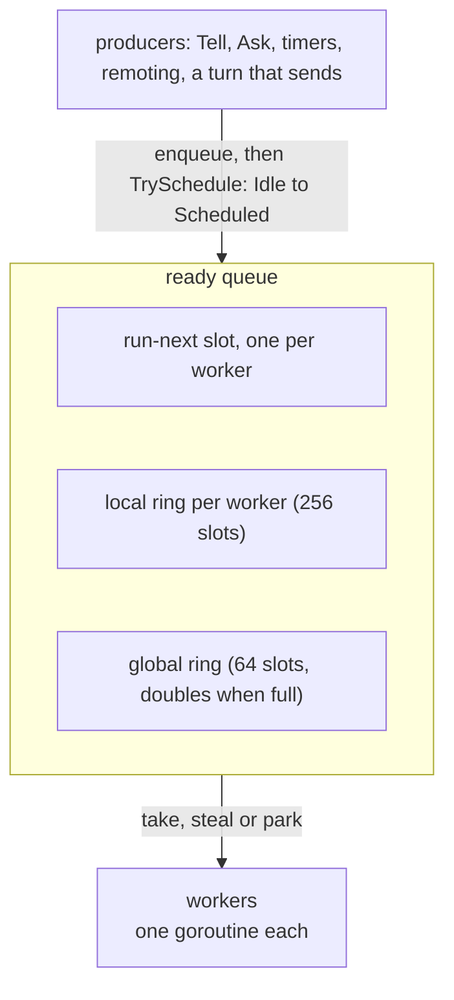
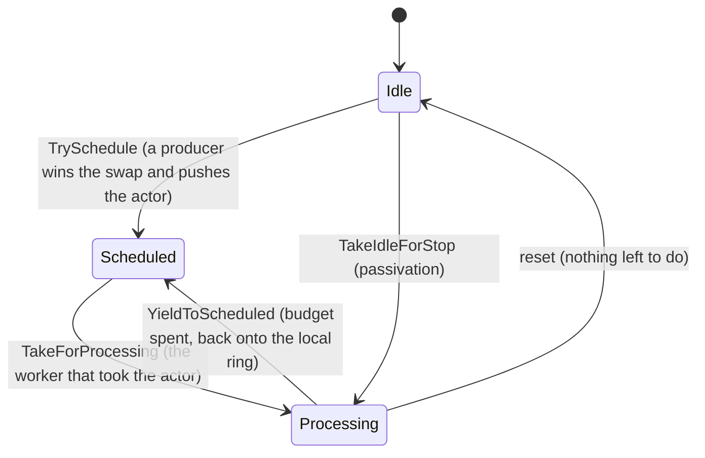
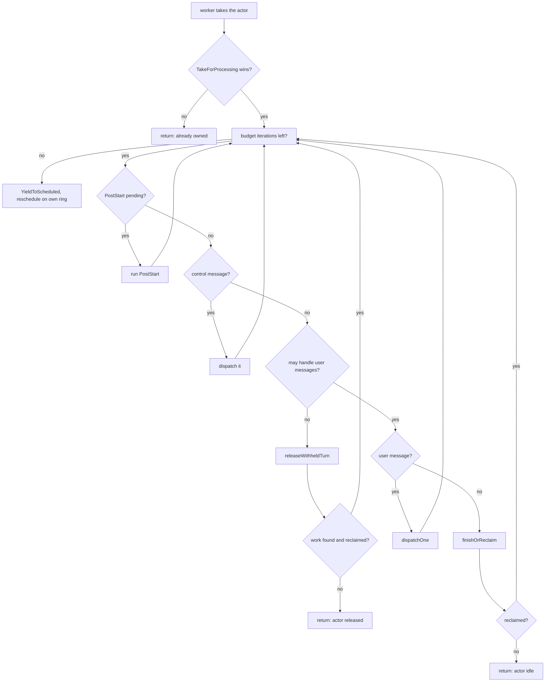
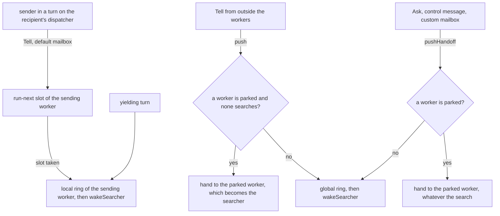
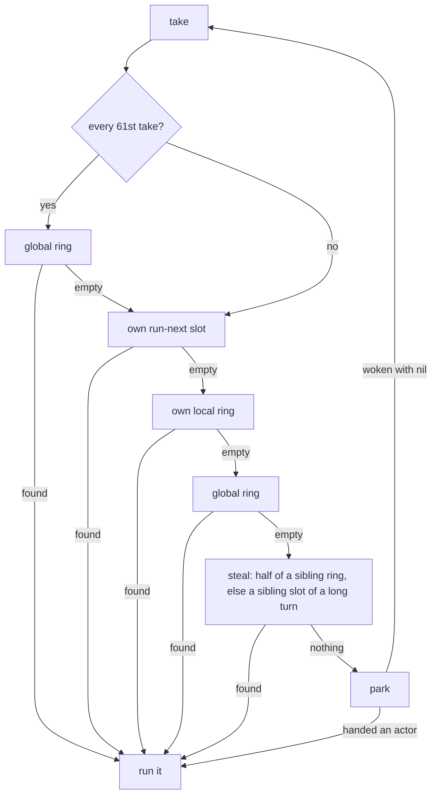

# 7. Dispatch

## Contents

- [What you will learn](#what-you-will-learn)
- [7.1 The pieces](#71-the-pieces)
  - [Pool size](#pool-size)
  - [Named dispatchers](#named-dispatchers)
  - [Turn budget](#turn-budget)
  - [Other goroutines](#other-goroutines)
- [7.2 The dispatch state](#72-the-dispatch-state)
  - [Not losing a wake-up](#not-losing-a-wake-up)
- [7.3 One turn](#73-one-turn)
- [7.4 The system queue](#74-the-system-queue)
- [7.5 The ready queue](#75-the-ready-queue)
  - [Where an actor goes](#where-an-actor-goes)
  - [Run-next slot rules](#run-next-slot-rules)
  - [Where a worker looks](#where-a-worker-looks)
  - [Waking and parking](#waking-and-parking)
  - [Why a wake-up cannot be lost](#why-a-wake-up-cannot-be-lost)
  - [Saturation](#saturation)
- [7.6 Failures leave the turn](#76-failures-leave-the-turn)
- [7.7 Stopping the pool](#77-stopping-the-pool)
- [Guarantees](#guarantees)
- [Implementation details (may change)](#implementation-details-may-change)
- [Behaviours to know](#behaviours-to-know)
- [Further reading](#further-reading)

## What you will learn

- How a fixed pool of goroutines runs every actor and grain ([Chapter 14](chap-14.md)) in the system, and why no actor owns a goroutine.
- The three-state machine that makes sure one actor is never run by two workers at once, and how it avoids losing a wake-up.
- Exactly what one turn does, message by message, and when it gives the worker up.
- How the ready queue is built: per-worker local rings, a run-next slot, a global ring, work stealing, and parking with direct hand-off.
- How control messages jump the queue through the system queue.
- How failures leave the turn and reach supervision, and what that delay means.
- What happens when the pool is saturated, and how named dispatchers isolate blocking work.

## 7.1 The pieces

An actor is not a goroutine. The `dispatcher` owns a fixed pool of worker goroutines that take ready actors from a ready queue and run them one *turn* at a time (`actor/dispatcher.go`). An actor or grain is anything with a `runTurn(w *worker)` method, the `schedulable` interface (`actor/ready_queue.go`). The `worker` is intentionally agnostic of the actor state machine, the mailbox and the throughput policy: it takes a schedulable, runs a turn, and takes again (`worker.run` in `actor/worker.go`). Grains are the second kind of schedulable ([Chapter 14, §14.3](chap-14.md#143-scheduling-and-the-turn)).

The number of workers defaults to `max(GOMAXPROCS, 2)` and is independent of the number of actors; no actor runs a goroutine of its own to drain its [mailbox](chap-06.md) (`dispatcher` in `actor/dispatcher.go`). The dispatcher sits below `PID.doReceive` ([Chapter 5](chap-05.md)); an application tunes it only through the options in the table below. `NewActorSystem` builds the dispatchers once the options are applied, and `Start` starts their workers before any actor is spawned ([Chapter 3, §3.3](chap-03.md#33-start)).

| Setting | Default | Option |
|---|---|---|
| Workers | `max(GOMAXPROCS, 2)`, never fewer than 2 | `WithDispatcherPoolSize` |
| Messages per turn | 32 | `WithThroughputBudget` |
| Named dispatchers | none | `WithDispatcherPool`, with `WithDispatcher` and `WithGrainDispatcher` |

The defaults are `dispatcherWorkerCount` and `dispatcherThroughput` in `actor/dispatcher.go`; the options are in `actor/option.go`, and `NewActorSystem` in `actor/actor_system.go` applies them.

### Pool size

The floor of two workers has two reasons, each recorded in a comment. A handler that waits for another actor inside its turn holds its worker, and with one worker the actor it waits for could never run (`WithDispatcherPoolSize` in `actor/option.go`). And work stealing needs at least one sibling to steal from (`dispatcherWorkerCount` in `actor/dispatcher.go`).

The option's comment explains the other trade-off. A handler that blocks, on a database or an HTTP call, holds a worker for the whole wait, so with the default pool no more than `GOMAXPROCS` actors and grains make progress at once. A larger pool lets more handlers wait, but slows dispatch for everyone: a producer scans the idle flags of the whole pool when it claims a parked worker (`readyQueue.claimIdle` in `actor/ready_queue.go`), and a worker that finds nothing probes every sibling's ring (`readyQueue.trySteal`), both linear in the pool size. The comment gives the measured cost: with 256 workers on 8 CPUs, request/reply throughput drops by about 40% and grain tells by 10 to 25%, while the heap per actor is unchanged. Raise the pool only for handlers that wait in their turn, and size it like a connection pool.

### Named dispatchers

`WithDispatcherPool(name, workers)` declares a second pool: a `dispatcher` of its own, with its own ready queue, workers and supervision consumer. `NewActorSystem` builds it with the same throughput budget and the same floor of two, and `Start` and `Stop` start and stop it together with the default one (`actorSystem.startDispatchers` and `actorSystem.stopDispatchers` in `actor/actor_system.go`). A blank name or a size of zero or less is ignored, and declaring a name twice keeps the last size.

- **Assignment.** An actor is assigned at spawn with `WithDispatcher`, a grain with `WithGrainDispatcher`. The name is resolved once, when the PID is built, by `actorSystem.dispatcherNamed` (a grain's, in `newGrainPID` in `actor/grain_pid.go`). An empty name is the default dispatcher, and a child does not inherit its parent's. A name the system did not declare refuses the spawn or the activation with `ErrDispatcherNotFound` (`actorSystem.configPIDAt` in `actor/actor_system.go`, `PID.buildChildSettings` in `actor/pid.go` and `actorSystem.grainConfigFor` in `actor/grain_engine.go`).
- **Purpose.** The option's comment calls it Akka's model, a dispatcher configured by name and named in each actor's props, and gives the same purpose: a group of actors that block hold the workers of their own pool and no others, so the default pool keeps its size and its speed.
- **Isolation.** The local-queue fast path applies only when sender and recipient share a dispatcher (`PID.scheduleFrom` in `actor/pid.go`), and workers do not steal across pools, so an idle pool cannot help a busy one.
- **Relocation.** The name travels with the wire record of the actor and of the grain (`PID.toSerialize` in `actor/pid.go`, `wireGrain` in `actor/grain_pid.go`). The node that takes the actor or grain over reads it back into the options it spawns with (`actorSystem.wireSpawnOptions` in `actor/spawn.go`, `actorSystem.grainOptionsFromWire` in `actor/grain_engine.go`), so it runs on the same-named dispatcher of its new node, or is refused with `ErrDispatcherNotFound` when that node did not declare one. The remote spawn and activation requests carry the same field.

### Turn budget

The budget of 32 messages spreads the cost of parking and waking a worker over a batch, and bounds how long one actor can keep a worker from its peers (`dispatcherThroughput` in `actor/dispatcher.go`). The option's comment names a second gain from a larger budget, often the larger one: handling one actor's messages back to back keeps its mailbox, its state and its handler's code in the CPU caches. Past some point the system is bound by the handlers rather than by scheduling, and raising the budget gains nothing more (`WithThroughputBudget` in `actor/option.go`).

### Other goroutines

Besides the workers, the system runs a few goroutines of its own that are not tied to one actor. Those that concern dispatch and its neighbours:

| Goroutine | Count | Chapter |
|---|---|---|
| Dispatcher workers | the pool size, per dispatcher | this chapter |
| Supervision consumer | 1 per dispatcher | [§7.6](#76-failures-leave-the-turn) |
| Passivation manager | 1 | 10, [§10.4](chap-10.md#104-the-loop) |
| Eviction loop | 1, when an eviction strategy is set | 10, [§10.7](chap-10.md#107-system-eviction) |
| Scheduler | go-quartz's own, while the scheduler runs | 11, [§11.1](chap-11.md#111-the-scheduler) |
| Cluster events loop | 1, in cluster mode (`actorSystem.clusterEventsLoop` in `actor/actor_system.go`) | 20, [§20.10](chap-20.md#2010-the-actor-system-on-the-engine) |

## 7.2 The dispatch state

Every PID has a `dispatchState`: one atomic word holding `Idle`, `Scheduled` or `Processing` (`dispatchIdle` in `actor/dispatch_state.go`). Every transition is a compare-and-swap or a store made by the one party allowed to make it. All the methods are on `dispatchState` in `actor/dispatch_state.go`:

| Transition | Method | Made by |
|---|---|---|
| Idle to Scheduled | `TrySchedule` | a producer, after enqueuing; the winner pushes the actor onto the ready queue |
| Scheduled to Processing | `TakeForProcessing` | the worker that took the actor from the ready queue |
| Processing to Scheduled | `YieldToScheduled` | the turn, when its budget is spent |
| Processing to Idle | `reset` | the turn, when it finds nothing left to do (see below for the restart) |
| Idle to Processing | `TakeIdleForStop` | passivation ([Chapter 10, §10.5](chap-10.md#105-one-attempt)), to own an idle actor while it stops it |

Only `Processing` lets anyone run the actor's handler, and only one party can hold it, so an actor's messages are handled one at a time.

- **`TrySchedule`** reads before it tries the swap: when many producers send at once, all but one see `Scheduled` or `Processing` and return without touching the cache line in exclusive mode. A send therefore costs one atomic read, at most one compare-and-swap and one mailbox operation; only the producer that wins `Idle → Scheduled` also pays for a push onto the ready queue ([§7.5](#where-an-actor-goes)).
- **`TakeIdleForStop`** is passivation's way in (`PID.tryPassivation` in `actor/pid.go`, [Chapter 10, §10.5](chap-10.md#105-one-attempt), [Chapter 3, §3.5](chap-03.md#35-stop)). When the swap fails because the actor is busy, the attempt is deferred to the passivation manager. When it succeeds but a message arrived in the meantime, the state is reset, the waiting work is scheduled, and the attempt is deferred too.
- **A restart** ([Chapter 9, §9.6](chap-09.md#96-the-restart-itself)) forces `Idle` with `reset`. `restartSubtree` in `actor/pid.go` first waits, yielding the processor in a loop, until the state is no longer `Processing`, and forces `Idle` before `init` makes the new incarnation reachable, so no turn can be running when it does.

### Not losing a wake-up

A producer enqueues and then calls `TrySchedule` (`PID.doReceive` and `PID.putValue` in `actor/pid.go`). If the actor is `Processing` at that moment, the producer does nothing, and relies on the running turn to see its message. The turn honours that in `PID.finishOrReclaim` (`actor/pid.go`):

1. Reset the state to `Idle` first.
2. Then check the mailbox, the system queue and the `PostStart` slot.
3. If anything is there, try to schedule again. If that succeeds, take the actor straight back with `TakeForProcessing` and carry on in the same turn. If another producer already scheduled it, leave it to the worker that will take it.

Because the reset comes before the check, every message falls into one of two cases. Either it was enqueued before the check, and the turn sees it. Or it was enqueued after the reset, and its producer's `TrySchedule` finds `Idle` and schedules the actor itself.

## 7.3 One turn

`PID.runTurn` (`actor/pid.go`) starts by claiming the actor with `TakeForProcessing`. A worker that loses this race returns at once: the actor is already owned. It then publishes its worker in `turnWorker`, reads the clock once, records the turn's start for the run-next age rule ([§7.5](#run-next-slot-rules)), and loops for at most the dispatcher's budget of iterations. Each iteration does the first of these that applies:

1. **Run a pending `PostStart`** (`PID.runPendingPostStart`). It has its own slot on the PID, filled by `PID.armPostStart` before the actor is announced as running. The turn checks the slot at every message boundary, because a restart can arm it while a turn is already running.
2. **Take one control message** from the system queue and dispatch it ([§7.4](#74-the-system-queue)).
3. **Check that the actor may handle user messages** (`PID.handlesUserMessages`). It may not while it is suspended, stopping or restarting, or while a failure awaits a supervision decision ([§7.6](#76-failures-leave-the-turn)). The turn then gives the actor up and leaves the user messages queued. `PID.releaseWithheldTurn` resets the state first and then looks again for work the actor may do, a control message or a resume that raced with it, the same reset-then-check as above.
4. **Take one user message** from the mailbox. If there is none, call `finishOrReclaim`, which either ends the turn or reclaims the actor and goes round again. When the actor ends up idle, `finishOrReclaim` also tells the passivation manager ([Chapter 10, §10.2](chap-10.md#102-the-manager-and-its-entries)), if message-count passivation is on, so a passivation refused while the turn ran is retried.
5. **Dispatch it** with `PID.dispatchOne`, which skips an `Ask` whose sender has given up, stashes it if reentrancy requires, and otherwise calls the handler on top of the behaviour stack (Chapters [5](chap-05.md) and [8](chap-08.md)).

The budget counts iterations, so a control message or a `PostStart` uses one as a user message does. `turnWorker` is cleared before every release of the actor: when the turn gives it up as withheld, when it finds nothing left, and when it yields. A send made from the turn reads it to schedule its recipient locally ([§7.5](#where-an-actor-goes)).

When the loop runs out of budget, the turn moves the actor to `Scheduled` and pushes it onto **its own worker's local ring** with `worker.reschedule` (`actor/worker.go`). It does so without looking whether work remains: an actor whose queues emptied on its last message is simply taken again, finds nothing, and goes to `Idle` through `finishOrReclaim`. The actor is appended at the **tail** of the ring, not to the run-next slot, so a busy actor cannot keep its worker from the others on that ring.

Two consequences follow from the loop:

- **Control messages win, but only between messages.** A `PoisonPill` sent while a handler runs is handled after that handler returns, ahead of the user messages still queued.
- **`time.Now()` is read once per turn**, and the same instant is used for every message the turn dispatches, for example as the actor's last-activity time for passivation, which is therefore stored once per turn (`PID.markActivity` in `actor/pid.go`).

## 7.4 The system queue

`PID.doReceive` routes control messages to the actor's system queue instead of the mailbox: `PoisonPill`, `Panicking`, `PausePassivation`, `ResumePassivation`, `PanicSignal`, `Terminated` and `SendDeadletter` (`isControlMessage` in `actor/pid.go`). `PostStart` is not among them, because it has its own slot ([§7.3](#73-one-turn)). The queue is two pointers embedded in the PID, so an idle actor pays nothing for it.

The split exists so that shutdown and supervision signals never queue behind a user backlog (the comment on `PID.systemQueue` in `actor/pid.go`): a `PoisonPill` stops the actor after the handler in progress, not after the user messages already queued. A custom mailbox given with `WithMailbox` ([Chapter 6, §6.9](chap-06.md#69-writing-your-own-mailbox)) only ever sees user messages and knows nothing of the system queue.

The reentrancy envelopes, `AsyncRequest` and `AsyncResponse`, are **not** control messages. They take part in the reentrancy stash and must keep their order relative to user messages, so they travel through the mailbox ([Chapter 8, §8.5](chap-08.md#85-reentrancy-requests-that-do-not-block)).

`systemQueue` (`actor/system_queue.go`) is a lock-free stack with a twist that restores send order:

- **`push`** links the message in front of the current top and swings the top with a compare-and-swap, retrying on contention.
- **`pop`** works from a private batch. When the batch is exhausted, it swaps the whole stack out in one atomic swap and reverses it, so the batch comes out oldest first (`inSendOrder`). Everything in one batch was pushed before everything in the next, so the order across batches is preserved too.
- **Release** follows the same rule as the mailbox: the previously popped message is recycled on the next `pop`, including a `pop` that returns nil, so an idle actor holds no context.
- **`isEmpty`** reads only atomics, because `finishOrReclaim` may call it on a worker that has just given up the actor while the next owner is already popping.

The idle path, nothing held and nothing pushed, is two loads and no write. That matters because `runTurn` calls `pop` before every user message, and a write would evict a cache line that producers read on every send.

## 7.5 The ready queue

The ready queue holds actors that are `Scheduled`. Its parts are in `readyQueue` in `actor/ready_queue.go`:

| Part | Structure | Capacity | Guarded by |
|---|---|---|---|
| Run-next slot | one actor per worker, read before the ring | 1 | the local ring's mutex, with an atomic flag for lock-free emptiness checks |
| Local ring | owned by one worker; siblings may steal from its head (`localQueue`) | 256, fixed (`localQueueCap`) | its own mutex, plus an atomic size for lock-free emptiness checks |
| Global ring | doubles when full and never shrinks (`globalQueue`) | starts at 64 (`globalQueueInitialCap`) | `parkMu` |

Both rings exist to keep locks off the common path. The global queue is a ring rather than a slice that is re-sliced on every pop, because the backing array of such a slice grows without bound under steady churn. Its length is mirrored in an atomic, `globalCount`, so a worker skips `parkMu` altogether when the global queue is empty (`readyQueue.popGlobal`). Each local ring mirrors its length in an atomic too, so a thief passes an empty sibling with one load instead of taking its mutex; a worker walks the sibling array each time its own ring and the global queue are empty, and without that check the sibling mutexes would dominate the take loop (`readyQueue.trySteal`).

### Where an actor goes

| Producer | Path | Destination |
|---|---|---|
| A send from a turn (`ReceiveContext.Tell`, `ReceiveContext.BatchTell`) to an idle actor on the default mailbox and the same dispatcher; also the first start of a child spawned from a turn ([Chapter 4, §4.6](chap-04.md#46-children)) | `PID.putValue` and `PID.firePostStartFrom`, then `PID.scheduleFrom`, then `worker.scheduleLocal` | the sending worker's run-next slot; its local ring, with a `wakeSearcher`, when the slot is taken |
| The same send when the recipient is on another dispatcher | `PID.scheduleFrom` | `dispatcher.schedule`, so `readyQueue.push` |
| A `Tell` from outside the workers (`Tell` in `actor/api.go`) to an actor on the default mailbox; the first start of an actor spawned from outside the workers | `PID.putValue` and `PID.firePostStartFrom` with no worker | `readyQueue.push` |
| An `Ask` ([Chapter 5, §5.3](chap-05.md#53-how-a-reply-gets-back)), a control message, a message to an actor with a custom mailbox, or any other delivery through `PID.doReceive` (a remote delivery, an unstashed message, a `Forward`) | `PID.doReceive` | `dispatcher.scheduleHandoff`, so `readyQueue.pushHandoff` |
| A grain call from outside the workers, an async envelope or the shutdown `PoisonPill` of a grain ([Chapter 14, §14.3](chap-14.md#143-scheduling-and-the-turn)) | `grainPID.receive`, `grainPID.enqueueEnvelope` and `grainPID.enqueuePoisonPill` in `actor/grain_pid.go` | `dispatcher.scheduleHandoff`, so `readyQueue.pushHandoff` |
| A one-way tell to a grain, a grain timer tick, the passivation pill of a grain | `grainPID.receiveOneWay`, `grainPID.deliverTimerTick` and `grainPID.enqueuePassivationPill` | `dispatcher.schedule`, so `readyQueue.push` |
| Messages that waited out a supervision decision or a reinstate | `PID.scheduleWithheldWork` | `readyQueue.push` |
| A turn that yields | `worker.reschedule` | the tail of the worker's local ring, spilling to `readyQueue.push` when the ring is full |

Placing a recipient in the sender's run-next slot is the Go scheduler's `runnext` rule and, as `PID.scheduleFrom` records, the way Akka's default dispatcher treats a task forked by a ForkJoinPool worker, which goes on that worker's deque. The recipient runs on the core that just wrote its message, as soon as the turn ends, and the send takes no shared lock.

A parked worker reads only its hand-off channel, so it never sees what lands on another worker's ring. Both ring pushes are therefore followed by `wakeSearcher`, which wakes one parked worker to steal, unless a worker woken that way is still looking (`readyQueue.wakeSearcher`). The `searching` flag keeps it to one wake at a time, the rule the Go scheduler applies to its spinning threads. The woken worker clears the flag when it takes work or parks again, and passes the wake on when more may be waiting: after a steal, since the ring it stole from may hold more, and after popping the global ring when a backlog remains, so the workers at a backlog grow with it one wake at a time (`readyQueue.take` and `readyQueue.endSearch`). Without the wake, an actor left on the ring of a worker that is busy, or blocked in a handler, waits for that worker even while every other worker sleeps.

### Run-next slot rules

Filling the run-next slot wakes nobody. With one message in flight between two actors, every message readies an idle actor, and a wake per hand-off was most of the cost of the exchange (`worker.scheduleLocal` in `actor/worker.go`). Three rules see to it that an actor in the slot does not wait for a turn that does not end soon:

- **A thief takes the slot of a long turn.** A worker that finds its own slot, its ring and the global queue empty steals from its siblings' rings first, and then from a sibling's slot, but only once that sibling's turn has run for `runnextStealAge`, 10 µs, measured from the turn's start (`worker.beginTurn`; `localQueue.stealRunnext` and `readyQueue.trySteal`). A short turn keeps the actor it readied, cache-hot; a turn still running after that long is in a long or blocked handler, and the actor is better off elsewhere. The Go scheduler applies the same rule to `runnext`, with a 3 µs wait.
- **A turn hands the slot off before it blocks on another actor.** `PID.Ask` made from a turn moves the slot's actor to the ring and wakes a searcher before it waits for the reply (`worker.handoffRunnext`): the actor it just told may be the one it is asking, and a parked sibling never looks at the slot on its own.
- **A watchdog covers user code that blocks.** A handler that readies an actor and then waits on a channel or a lock the framework does not see would otherwise hold the slot's actor until it returned. The dispatcher's watchdog is a timer armed when a slot is filled while it is not running. It looks at the slots every `watchdogInterval`, 100 µs, wakes a searcher when a slot holds an actor a thief may take, and disarms once every slot is empty, so an idle dispatcher runs no timer (`dispatcher.armWatchdog` and `dispatcher.runWatchdog` in `actor/dispatcher.go`). The comment compares it to Go's sysmon, which gives `runnext` the same guarantee, starting at 20 µs. While the watchdog runs, a worker filling its slot pays one atomic load to find it armed. Thieves probe the slots only while the watchdog is armed (`readyQueue.runnextWatched`).

### Where a worker looks

`readyQueue.take` loops over these steps in order and returns the first actor it finds:

- **Stealing** visits the siblings in rotated order, skips any whose atomic size reads zero, and takes half of the first non-empty ring, rounded up. It returns the first stolen actor to run and appends the rest to its own ring, stopping if that ring is full, and locks the two rings in address order so two thieves never deadlock (`readyQueue.trySteal`, `localQueue.stealHalf` and `lockOrder`). Only when no ring yields anything does it look at the siblings' run-next slots, under the age rule above.
- **Parking** uses a per-worker *idle flag* and a one-slot hand-off channel instead of a condition variable. Whoever wakes a parked worker claims it with a compare-and-swap on its flag and sends through the channel, so no two wakers wake the same worker and no mutex serializes them. The type's comment records why: with a shared condition variable, request/reply throughput under load fell below that of a single pair (`readyQueue`).

The claim scan always starts at worker 0. That keeps wake-ups on the same few workers and their caches warm, and lets the rest sleep (`readyQueue.claimIdle`).

### Waking and parking

There are two ways to hand an actor to a parked worker, and they differ in what happens to the search:

- **`readyQueue.push`**, for a producer outside the workers or a ring that spilled, hands the actor straight to a parked worker only when no worker is searching. It first takes the `searching` flag for that worker, which ends the search as soon as the worker wakes with the actor, before it runs the turn, so a turn that blocks never keeps other wakes from going out. Otherwise it appends the actor to the global ring and calls `wakeSearcher`. Handing off unconditionally woke a worker per message, and a wake costs the producer a goroutine wake-up and the runtime a thread wake-up, both of which grow with the number of processors (`readyQueue` comment). A worker that is awake now drains a stream of pushes while nobody is woken, and a single sender to a single actor still gets its worker in one step.
- **`readyQueue.pushHandoff`**, for a caller that blocks until the actor has run (an `Ask`, a grain call from outside the workers), hands the actor to a parked worker whatever the search and without making it the searcher. Its comment gives the reason: the caller's processor is free the moment it blocks, so the worker runs on it at once, and a burst of such callers wakes a worker each instead of queueing behind one searcher. With no worker parked, the actor goes on the global ring and one searcher is woken, as in `push`.

### Why a wake-up cannot be lost

A worker can be about to park just as a producer appends to the global queue. Two atomics settle it:

- The parking worker stores its flag, then reads the global count. If the count is not zero, it un-parks and goes round the take loop (`readyQueue.parkAndTake`).
- The producer stores the global count, then reads the number of parked workers in `wakeSearcher`. If it is not zero and no worker is searching, it claims one and sends it `nil`, which means "look again". The `searching` flag does not open a window: a woken worker clears it before it publishes its flag, so a producer that finds it set found a searcher that either has not read the global count yet or will publish its flag after the producer's store, and either way the item is seen.

The same protocol covers the local rings. A worker that pushes to its own ring stores the ring's atomic size, then reads the number of parked workers in `wakeSearcher`; the parking worker, after storing its flag, also reads every ring's size, and un-parks if any is non-zero (`readyQueue.hasLocalWork`). Without that second check, a worker that was about to park when a sibling pushed to its ring would sleep, and the pushed actor would wait for its ring's owner, which may be blocked in a handler. The run-next slots are outside this protocol by design: filling one wakes nobody, and the watchdog, not a wake, bounds how long an actor waits in one.

The atomics are sequentially consistent, so at least one side sees the other. If a producer claims the flag in the instant before the worker un-parks, the worker reads the hand-off anyway, so the channel is empty for the next claim.

### Saturation

A worker reads its own local ring before the global queue, and a busy actor that spends its budget goes back onto that same ring. If that were the only rule, a worker serving an actor whose mailbox never drains would never reach the global queue, and with every worker in that state an actor that became ready meanwhile would wait until one of those mailboxes emptied. So every 61st take, a worker reads the global queue first (`globalQueueCheckInterval` in `actor/ready_queue.go`), as Go's own scheduler does with its global run queue; the comment adds that the odd number avoids falling into step with other periodic work. The count is kept on the worker's local ring and touched only by its owner (`localQueue`). A waiting actor is therefore reached within 61 turns of the busy ones; with slow handlers that can still take a while.

The run-next slot needs the same kind of bound for the worker's own ring. Two actors exchanging messages refill the slot at every take, and the slot is read before the ring, so the actors waiting on that ring would wait for as long as the pair talked. After `runnextChainLimit` consecutive takes from the slot, 61 again, while the ring holds actors, the slot's actor goes to the back of the ring, or through `readyQueue.push` when the ring is full, and the ring is served (`localQueue.takeRunnext`). The Go scheduler bounds the same chain with the time slice a `runnext` goroutine inherits from the one that readied it.

## 7.6 Failures leave the turn

When a handler panics or records an error with `ctx.Err`, `PID.recovery` hands a supervision signal to `PID.submitSupervision` (`actor/pid.go`), which passes it to the dispatcher. Each dispatcher owns one supervision goroutine (`supervision` in `actor/supervision.go`):

- `supervision.Submit` sends to a channel buffered for 1,024 signals, and blocks when it is full, unless the dispatcher is stopping. It refuses, returning false, a nil PID or signal and a consumer that has not started.
- `supervision.run` takes each signal and calls `PID.notifyParent` unless the actor is no longer running, which drops signals for actors already suspended or stopping. A resume directive does not suspend the actor, so under it every failure is decided in turn ([Chapter 9, §9.2](chap-09.md#92-from-a-failure-to-a-decision)). After the decision, `run` calls `PID.resumeAfterSupervision`.

The turn does not wait for supervision, but it does not carry on as if nothing happened either. `PID.submitSupervision` marks the actor with `supervisionPendingState` before it queues the signal, on the failing turn itself. From then on the turn hands out no user message ([§7.3](#73-one-turn)); control messages still run. When `run` has decided, `PID.resumeAfterSupervision` clears the mark and schedules the waiting messages with `PID.scheduleWithheldWork`:

- after a resume, they run on the same actor;
- after a suspension they keep waiting, because a suspended actor handles no user message either, and `PID.doReinstate` schedules them when the actor is reinstated;
- after a restart, the new incarnation handles them ([Chapter 6, §6.8](chap-06.md#68-stops-restarts-and-other-nodes)).

`ErrDead` is never supervised, so it pauses nothing. A failure that no consumer takes, because the dispatcher is stopping or has not started, lifts the pause at once; a PID built without a dispatcher decides the signal inline.

## 7.7 Stopping the pool

`dispatcher.signalStop` closes the ready queue, stops the supervision goroutine and stops the watchdog, without waiting for any of them (`actor/dispatcher.go`). Like `start`, it is idempotent: a second call does nothing. Closing claims every parked worker and wakes it with `nil`; a worker that parks after that sees the closed flag in its own check (`readyQueue.close`). A worker in the middle of a turn finishes it. Not waiting is deliberate: `ActorSystem.Stop` may run on a worker, from inside a handler ([Chapter 3, §3.5](chap-03.md#35-stop)). `ActorSystem.Stop` signals every dispatcher last, in a deferred step after every actor has been torn down and the system reset (`actorSystem.shutdown` in `actor/actor_system.go`). There is no blocking stop.

A stopped dispatcher cannot be started again. `dispatcher.renewed` returns it unchanged while it is not stopping, and a fresh unstarted one of the same name, size and budget when it is, so `Start` builds a new pool for the default dispatcher and for every named one ([Chapter 3, §3.7](chap-03.md#37-starting-again)).

## Guarantees

| Statement | Enforced by |
|---|---|
| The dispatch state allows exactly one owner (one winner among concurrent producers), and the reclaim after a reset either wins or leaves the actor to the producer that scheduled it | `TestDispatchStateHappyPath`, `TestDispatchStateConcurrentTrySchedule`, `TestDispatchStateReclaimAfterReset` and `TestDispatchStateReclaimLosesRace` in `actor/dispatch_state_test.go` |
| A restart never hands the actor to a second worker while a turn is running | `TestRestartNeverRunsTwoTurns` in `actor/pid_test.go` |
| A schedulable that its worker reschedules is run again | `TestWorkerRescheduleUsesLocalQueue` in `actor/dispatcher_test.go` |
| A send from a turn schedules its recipient on the turn's worker, in its run-next slot and then on its ring, and on the recipient's own dispatcher otherwise | `TestPIDScheduleFrom` in `actor/pid_test.go`; `TestReceiveContextTellSchedulesOnTheTurnWorker` in `actor/receive_context_test.go`; `TestWorkerScheduleLocalFillsTheRunnextSlotThenTheRing` in `actor/worker_test.go` |
| A yielding actor goes to the ring, not the run-next slot | `TestWorkerRescheduleGoesToTheRing` in `actor/worker_test.go` |
| The owner runs its run-next slot before its ring; a thief takes the slot only from a turn that has run for `runnextStealAge` | `TestLocalQueueRunnext`, `TestReadyQueueTakeRunsRunnextBeforeTheRing` and `TestReadyQueueStealsRunnextOnlyFromALongTurn` in `actor/ready_queue_test.go` |
| A turn hands its run-next slot off before an `Ask`, so an actor that tells and then asks the same actor gets its reply | `TestWorkerHandoffRunnextMovesTheActorToTheRing` in `actor/worker_test.go`; `TestAskFromATurnHandsOffTheActorItReadied` in `actor/pid_test.go` |
| The watchdog runs the slot's actor elsewhere when the turn blocks in user code, and disarms once the slots are empty | `TestDispatcherWatchdogRescuesARunnextActorFromABlockedTurn` in `actor/dispatcher_test.go` |
| A run-next chain yields to the worker's ring after `runnextChainLimit` takes | `TestReadyQueueRunnextChainYieldsToTheRing` in `actor/ready_queue_test.go` |
| An actor left on a worker's ring runs on a sibling while that worker blocks in a handler | `TestWorkerLocalWorkIsStolenWhileTheOwnerBlocks` in `actor/worker_test.go` |
| One parked worker at a time is woken for local work, and it ends its search when it finds work or parks again | `TestReadyQueueWakeSearcher` and `TestReadyQueueEndSearch` in `actor/ready_queue_test.go` |
| A push wakes one searcher at a time, and a woken worker that leaves a backlog behind passes the wake on | `TestReadyQueuePushWakesOneSearcher` and `TestReadyQueueTakePassesTheWakeOnForABacklog` in `actor/ready_queue_test.go` |
| A push that hands an actor to a parked worker hands the search with it, and the worker ends it on waking, before the turn | `TestReadyQueuePushHandsTheSearchOverUntilTheWorkerWakes` in `actor/ready_queue_test.go` |
| A push for a blocking caller hands off to a parked worker whatever the search, and falls back to the global ring | `TestReadyQueuePushHandoff` in `actor/ready_queue_test.go` |
| A handler sees its turn's worker, which is cleared when the turn goes idle and before it yields | `TestPIDTurnPublishesItsWorker` and `TestPIDYieldClearsTurnWorker` in `actor/pid_test.go` |
| A parked worker is woken by a push, and by `close` | `TestReadyQueueParkAndWake` and `TestReadyQueueCloseWakesParkedWorkers` in `actor/ready_queue_test.go` |
| A worker that parks finds work pushed while it was publishing its flag, to the global queue or to a local ring | `TestReadyQueueParkAndTakeFindsGlobalWorkAfterPublishing`, `TestReadyQueueParkAndTakeFindsLocalWorkAfterPublishing`, `TestReadyQueueHasLocalWork` and `TestReadyQueueNilHandoffRescans` in `actor/ready_queue_test.go` |
| A worker with nothing local or global steals from a sibling | `TestReadyQueueStealWhenLocalAndGlobalEmpty` in `actor/ready_queue_test.go` |
| Many producers and workers lose no schedulable | `TestReadyQueueMultiProducerConsumer` in `actor/ready_queue_test.go`; `TestDispatcherHighFanout` in `actor/dispatcher_test.go` |
| A worker whose local ring never empties still serves the global queue | `TestReadyQueueTakeReachesGlobalUnderLocalLoad` in `actor/ready_queue_test.go` |
| The system queue delivers in send order, under concurrent pushes | `TestSystemQueueSendOrder` and `TestSystemQueueConcurrentPushes` in `actor/system_queue_test.go` |
| The supervision consumer starts and stops idempotently, and drops a signal submitted before it starts or with a nil PID or signal | `TestSupervision` in `actor/supervision_test.go` |
| Messages queued behind a failure wait for the decision: none run while the actor is suspended, all run after a resume or a reinstate | `TestFailureWithholdsQueuedMessages` in `actor/pid_test.go` |
| A stopped dispatcher is replaced on start by a fresh one of the same name, size and budget; a running one is kept | `TestDispatcherRenewed` in `actor/dispatcher_test.go` |
| An actor spawned with `WithDispatcher` runs on the named pool, a child does not inherit its parent's pool, and an undeclared name is refused | `TestDispatcherPools` in `actor/actor_system_test.go` |
| The dispatcher name travels with the wire record, so a relocated actor or grain runs on the same-named dispatcher of its new node | `TestWireSpawnOptionsDispatcher` in `actor/spawn_test.go`; `TestRecreateGrainRestoresDispatcher` in `actor/grain_engine_test.go` |

## Implementation details (may change)

- The 32-message budget, the 256-slot local rings, the global ring's starting size of 64, and checking the global queue every 61 takes.
- Stealing half, in rotated order, and the claim scan starting at worker 0.
- Scheduling a recipient on the sending turn's worker, in a one-actor run-next slot before the ring, and one woken searcher at a time.
- The 10 µs age before a run-next actor may be stolen, the 61-take chain limit before the ring is served, and the watchdog's 100 µs interval.
- Handing an `Ask`, a control message or a grain call to a parked worker whatever the search, and a `Tell` from outside the workers only when nobody searches.
- One supervision goroutine per dispatcher with a 1,024-signal buffer.
- Reading the clock once per turn.

## Behaviours to know

| Behaviour | Source |
|---|---|
| A blocking handler holds a worker for the whole wait; the default pool lets `GOMAXPROCS` handlers block at once, and that many stall every actor and grain on it | `WithDispatcherPoolSize` in `actor/option.go` |
| Actors and grains assigned to a named dispatcher hold only its workers while they block; a message across dispatchers takes the shared queue, not the sender's local one | `WithDispatcherPool` in `actor/option.go`; `PID.scheduleFrom` in `actor/pid.go` |
| A control message waits for the handler that is running, then overtakes the queued user messages | `PID.runTurn` in `actor/pid.go` |
| The turn budget counts every iteration, so control messages and `PostStart` spend it too | `PID.runTurn` in `actor/pid.go` |
| When every worker serves a never-draining actor, another ready actor waits up to 61 of their turns | `globalQueueCheckInterval` in `actor/ready_queue.go` |
| A failure stops the actor's user messages until supervision decides; frequent errors under a resume directive pay a round trip through the supervision goroutine each | `PID.submitSupervision` in `actor/pid.go` |
| A full supervision buffer blocks the failing actor's worker | `supervision.Submit` in `actor/supervision.go` |
| After the ready queue is closed, a worker keeps taking actors until it finds none, and only then exits | `readyQueue.take` in `actor/ready_queue.go` |

## Further reading

The designs the code comments cite (Akka's default dispatcher and dispatchers by name, the Go scheduler, Erlang's schedulers):

- Akka dispatchers: <https://doc.akka.io/docs/akka/current/typed/dispatchers.html>
- Pekko dispatchers: <https://pekko.apache.org/docs/pekko/current/typed/dispatchers.html>
- The Erlang/OTP scheduler: <https://www.erlang.org/blog/a-closer-look-at-the-erlang-vm/>
- The Go runtime scheduler: <https://rakyll.org/scheduler/>
