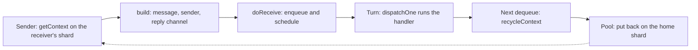
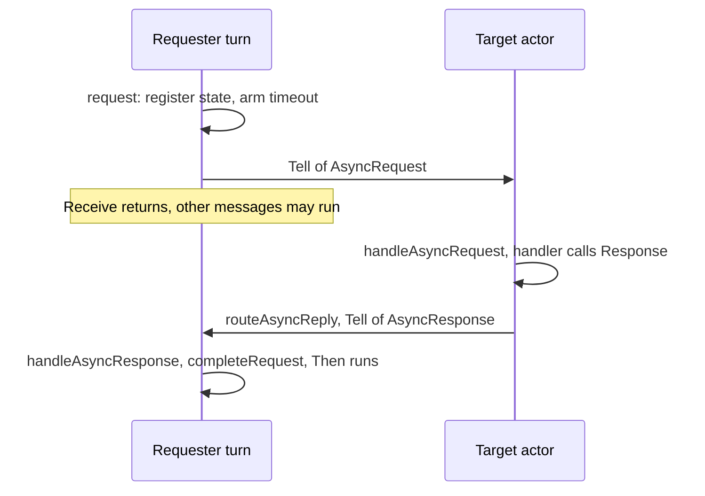
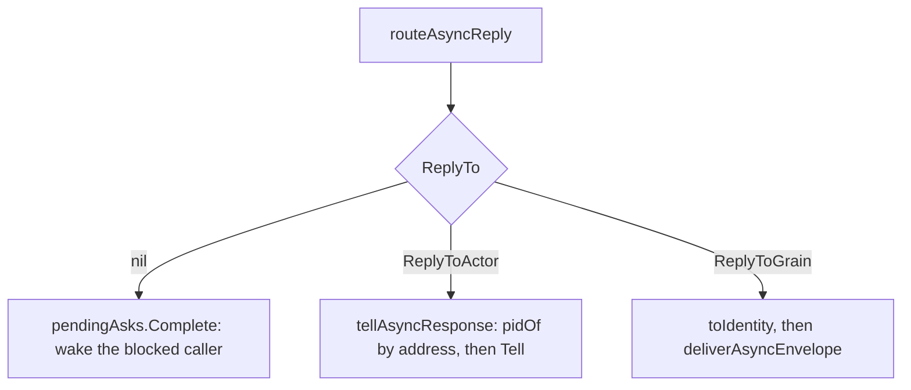
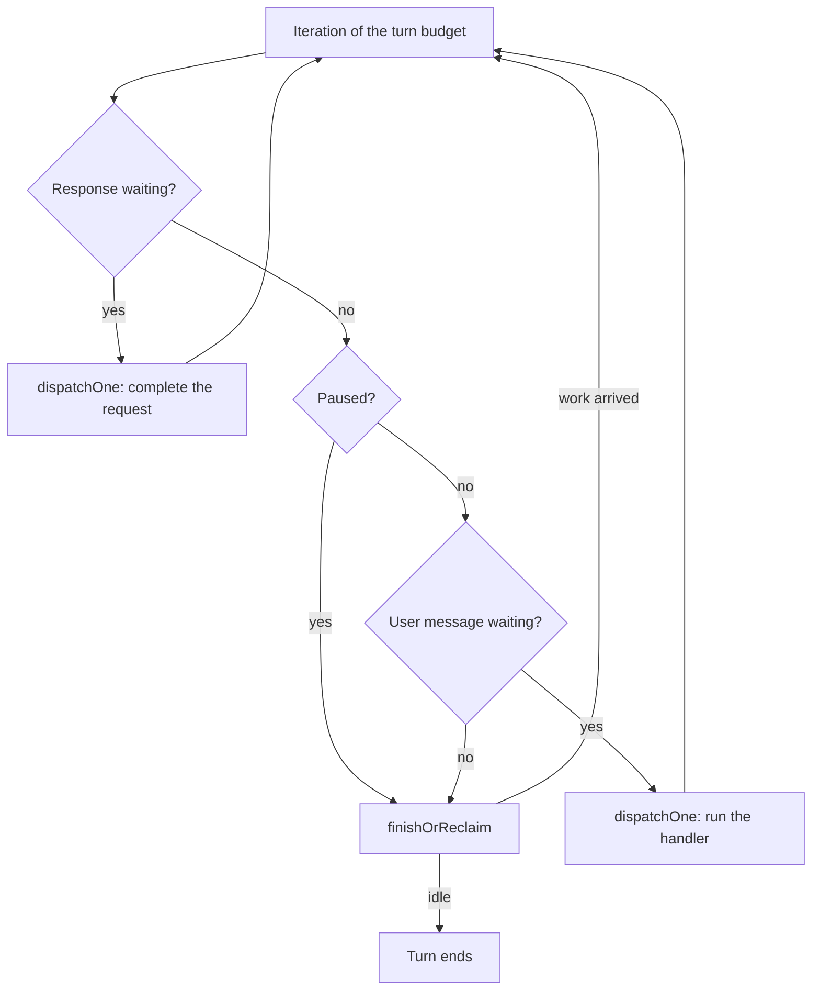

# 8. The Receive Context

## Contents

- [What you will learn](#what-you-will-learn)
- [8.1 One object per message](#81-one-object-per-message)
  - [The pool](#the-pool)
- [8.2 What a handler can do](#82-what-a-handler-can-do)
- [8.3 Behaviours](#83-behaviours)
- [8.4 The stash](#84-the-stash)
- [8.5 Reentrancy: requests that do not block](#85-reentrancy-requests-that-do-not-block)
  - [Modes](#modes)
  - [A request, end to end](#a-request-end-to-end)
  - [Stash mode](#stash-mode)
  - [When the actor stops](#when-the-actor-stops)
  - [The envelopes and their rules](#the-envelopes-and-their-rules)
  - [The shared state](#the-shared-state)
  - [Switching reentrancy at runtime](#switching-reentrancy-at-runtime)
  - [One reply router](#one-reply-router)
- [8.6 Reentrancy in grains](#86-reentrancy-in-grains)
  - [Two queues and the turn](#two-queues-and-the-turn)
  - [Stash mode is a pause](#stash-mode-is-a-pause)
  - [Envelope contexts and who owns the reply](#envelope-contexts-and-who-owns-the-reply)
  - [Asking a reentrant grain](#asking-a-reentrant-grain)
  - [Across nodes](#across-nodes)
  - [Passivation](#passivation)
  - [Shutdown and teardown](#shutdown-and-teardown)
- [Guarantees](#guarantees)
- [Implementation details (may change)](#implementation-details-may-change)
- [Behaviours to know](#behaviours-to-know)

## What you will learn

- What a `ReceiveContext` is, how long it lives, and why a handler must not keep it.
- How contexts are pooled per actor, and when one is cloned instead of reused.
- What a handler can do through the context, grouped by purpose.
- How behaviours are stored and switched, and when an actor's behaviour stack is emptied.
- How the stash works, and where unstashed messages actually go.
- How reentrancy turns a request into two messages, and how its stash mode releases what it held, including across a restart ([Chapter 9, §9.6](chap-09.md#96-the-restart-itself)).
- What the request and reply envelopes carry, the rules their decoders must keep, and how one router delivers every reply.
- How reentrancy is switched on and off at runtime without losing the requests in flight.
- How a grain ([Chapter 13](chap-13.md), [Chapter 14](chap-14.md)) does the same work with a second queue and a pause instead of a stash, and how that meets passivation ([Chapter 10](chap-10.md)) and shutdown ([Chapter 3, §3.5](chap-03.md#35-stop)).

## 8.1 One object per message

`Receive` ([Chapter 7, §7.3](chap-07.md#73-one-turn)) gets a `*ReceiveContext` that carries one message (`ReceiveContext` in `actor/receive_context.go`):

- the message, its sender, the receiving PID ([Chapter 4](chap-04.md)) and the sender's `context.Context`;
- for an `Ask` ([Chapter 5, §5.3](chap-05.md#53-how-a-reply-gets-back)), a reply channel, a once-only guard on it, and the moment the asker stops waiting (its deadline, [§5.2](chap-05.md#52-what-a-message-carries));
- for a request ([§8.5](#85-reentrancy-requests-that-do-not-block)), a correlation ID and where to route the reply;
- the error recorded with `Err`, whether the message arrived over remoting ([Chapter 17](chap-17.md)) and the flow-control credit it holds ([§17.9](chap-17.md#179-the-remote-hold-registry)), and the pool shard the object belongs to.

`ReceiveContext.Context` returns the context stored on the object, except for an `Ask`. A `Tell` stores the sender's context without its cancellation. An `Ask` stores the sender's context as it is, and `Context` then derives from it a context that ends when the asker stops waiting (the ask timeout, or the deadline of the asker's own context if that comes first) or when `Receive` returns. When the asker's own deadline comes first, the asker's context is returned as it is, with no release function. The derived context is created on the first call of a turn, so a handler that never asks for it pays nothing (`ReceiveContext.Context` and `ReceiveContext.releaseDeadlineContext` in `actor/receive_context.go`; `askContext` in `actor/ask_deadline.go`).

The same type is the mailbox node of the linked mailboxes: its first field, `next`, links it into one ([Chapter 6](chap-06.md)). That is why its lifetime is short and precise. The mailbox recycles a context on the dequeue *after* the one that returned it ([Chapter 6, §6.1](chap-06.md#61-the-contract)), and recycling clears every message field: `ReceiveContext.reset` in `actor/receive_context.go` leaves only the reply guard, which the next `build` or `cloneContext` clears, and the pool shard stamp. `recycleContext` also clears the `next` link.

The default mailbox hands a `Tell` to the handler in the actor's own **turn context**, refilled for the next such message by `ReceiveContext.reuse`. `reuse` calls `reset` only when handling the previous message left something on the context (an error, a reply channel, request metadata, a deadline, a credit share, the remote flag) ([Chapter 6, §6.2](chap-06.md#62-the-default-mailbox)). Either way, a handler that stores the context, or passes it to a goroutine that outlives `Receive`, will find it reused for an unrelated message. Copy what you need out of it.

`PreStart` and `PostStop` ([§4.4](chap-04.md#44-prestart-retries-and-the-timeout-that-is-not-one)) get a different and simpler type, `Context`: a `context.Context`, the actor system, the actor's name and its dependencies, with no message and no sending methods (`newContext` in `actor/context.go`).

### The pool

Contexts come from a sharded pool (`contextPool` in `actor/context_pool.go`). Its comment records the design it replaced: one buffered channel shared by every actor in the process, whose lock serialized every sender and every worker. Profiling a pairwise Tell workload showed about 80% of CPU inside that channel, and aggregate throughput capped at roughly the rate of a single actor.

The pool reuses contexts so the allocator stays off the hot path, takes no global lock, and keeps its memory bounded. It is a cache: under contention a `get` allocates and a `put` drops, so not every context is reused.

- **Shards.** There are at least twice `GOMAXPROCS` shards, a power of two between 8 and 128, so that a shard index is a bitmask (`contextShardCount` in `actor/context_pool.go`).
- **A home shard per actor.** Every actor is given a home shard at spawn ([§4.3](chap-04.md#43-inside-newpid)), round-robin, so that concurrently active actors land on distinct shards (`newPID` in `actor/pid.go`; `nextContextShard` in `actor/context_pool.go`). A sender takes a context from the **receiver's** shard. Many actors share a shard, and two actors with the same home shard contend on its cursors.
- **A home shard per context.** `get` stamps a newly allocated context with its shard in `poolShard`. `reset` keeps the stamp, and `put` returns a context to that shard whatever shard the caller was working with (`contextPoolShards.get` and `contextPoolShards.put` in `actor/context_pool.go`).
- **Nothing waits.** `push` and `pop` make at most four attempts (`poolSpinLimit` in `actor/context_pool.go`). An empty or contended shard makes `get` allocate a new context; a full or contended one makes `put` leave the context to the garbage collector. The 512 slots of a shard bound the memory kept warm, not throughput (`contextShardCapacity` in `actor/context_pool.go`). The capacity must be a power of two, because positions are mapped to cells with a bitmask.
- **`get` never returns nil.** Callers do not check. A `put` never blocks either: overflow is dropped.

Each shard is Vyukov's bounded multi-producer, multi-consumer array queue (`contextShard` in `actor/context_pool.go`). Both sides have many goroutines: every mailbox that recycles a context puts into the shard, and every sender to an actor on the shard gets from it. No one goroutine owns a shard, so it cannot be single-consumer like a mailbox. Its two cursors, `enqueuePos` and `dequeuePos`, are separated by 64 bytes of padding (`CacheLinePadding` in `actor/unbounded_mailbox.go`), so that getters and putters do not false-share a cache line. They are `uint64` values that only grow, and a position maps to the cell `pos & 511`. Each cell carries a sequence number that says which lap it is ready for (`poolCell` in `actor/context_pool.go`):

1. At construction, cell `i` holds sequence `i` (`newContextPool` in `actor/context_pool.go`).
2. A `push` at position `pos` may claim the cell when its sequence equals `pos`. It claims it by advancing `enqueuePos` with a compare-and-swap, stores the context, and then publishes sequence `pos + 1` (`contextShard.push` in `actor/context_pool.go`).
3. A `pop` at position `pos` may claim the cell when its sequence equals `pos + 1`. It advances `dequeuePos` the same way, takes the context, clears the cell, and releases it with sequence `pos + 512`, the position the next lap's `push` will arrive with (`contextShard.pop` in `actor/context_pool.go`).

A sequence behind the cursor means the shard is empty (for `pop`) or full (for `push`), and the operation gives up. A sequence ahead of it means another goroutine took the cell; the operation reloads the cursor and tries again. Because the sequence grows with every lap, an operation that stalls and resumes after the ring has wrapped finds a sequence that no longer matches its position. Its compare-and-swap then fails instead of claiming a cell that belongs to a later lap, so the ring needs no tagged pointers to avoid ABA. The context pointer itself is a plain field. It is ordered by the sequence number: written before the store that publishes it, and read after the load that observes it.

Only a local send takes from the pool, and not every one: `PID.tell` hands a message for a remote PID to remoting ([Chapter 15](chap-15.md)) before it reaches `getContext`, and stores a `Tell` to an actor on the default mailbox as values in a mailbox slot (`PID.tell` and `PID.putValue` in `actor/pid.go`; [Chapter 5, §5.1](chap-05.md#51-three-ways-to-send)). Once `doReceive` has handed a context to the mailbox, the sender must not touch it again, because it can be recycled and rebuilt for an unrelated message at any moment. `PID.Ask` keeps only the reply channel it captured beforehand, and a reply that arrives after the asker gave up lands in that channel and is dropped with it (`PID.Ask` in `actor/pid.go`). That reply channel comes from its own sharded pool, keyed by the same shard (`getResponseChannel` in `actor/pools.go`), and goes back to it only when the reply is in hand and the timeout was stopped before it fired.

`put` expects a context that is reset and no longer linked into a mailbox (`contextPoolShards.put` in `actor/context_pool.go`). `recycleContext` resets the context and clears its `next` link before it puts it back (`recycleContext` in `actor/context_pool.go`); the default mailbox recycles the contexts that came in through `Enqueue` the same way ([Chapter 6, §6.2](chap-06.md#62-the-default-mailbox)).

Not every context comes from the pool. `PipeTo` ([Chapter 5, §5.7](chap-05.md#57-pipeto)) delivers its result in a context built by `newReceiveContext` (`PID.handleCompletion` in `actor/pid.go`; `newReceiveContext` in `actor/receive_context.go`); it carries `poolShard` 0, so when a mailbox recycles it, it goes to shard 0. The default mailbox's turn context is part of the actor's `embeddedMailboxState` and is never pooled (`newEmbeddedMailboxState` in `actor/embedded_mailbox.go`). Grains have their own context type and pool ([Chapter 14, §14.5](chap-14.md#145-the-context-pool)).

A field of `ReceiveContext` is accounted for in three places: `reset` clears it before reuse, `cloneContext` copies the message-scoped ones for a clone, and `reuse` clears it on the turn context when handling can set it (`ReceiveContext.reset` and `ReceiveContext.reuse` in `actor/receive_context.go`; `cloneContext` in `actor/context_pool.go`).

The `benchmark/` suite has one benchmark per shape of load on the pool. `BenchmarkTell` (`benchmark/bench_tell_test.go`) sends from outside the system to one sink, and `BenchmarkPingPong` (`benchmark/bench_ping_pong_test.go`) between two actors. `BenchmarkPingPongParallel` and `BenchmarkPingPongPipelined` (`benchmark/bench_ping_pong_parallel_test.go`, `benchmark/bench_ping_pong_pipelined_test.go`) run `GOMAXPROCS` independent pairs at once. `BenchmarkTellParallel` (`benchmark/bench_tell_parallel_test.go`) races many producers on one receiver, and `BenchmarkAskParallel` (`benchmark/bench_ask_parallel_test.go`) many askers on one responder. The v4.5.0 release notes report the effect of the sharding on an 8-core Apple M1 (`changelogs/v4.5.0.md`): single-pair `Tell` went from 7.8M to about 12M messages per second, and pairwise `Tell` from 9.3M to 25M.

A context can sit in only one queue at a time. When a message must enter a second queue while the first still holds it, as when it is stashed during its own turn, the runtime enqueues a **clone** with the same message, sender, reply route, error and deadline (`cloneContext` in `actor/context_pool.go`). The clone is taken from the source's home shard. It carries neither the remote flag nor the credit share: the clone is enqueued by the actor's own turn, and the original releases the share once. It also clears the reply guard, so a recycled object cannot carry over the "already answered" mark of a previous `Ask`. `reset` leaves that guard set on purpose, to save an atomic store on the `Tell` path, and relies on `build` or `cloneContext` to clear it (`ReceiveContext.reset` in `actor/receive_context.go`).

## 8.2 What a handler can do

| Purpose | Methods | Chapter |
|---|---|---|
| Identity | `Self`, `Sender`, `Message`, `CorrelationID`, `Logger`, `ActorSystem` | [Chapter 5](chap-05.md) |
| Context | `Context` | [Chapter 5, §5.2](chap-05.md#52-what-a-message-carries) |
| Reply | `Response` | [Chapter 5, §5.3](chap-05.md#53-how-a-reply-gets-back) |
| Send | `Tell`, `BatchTell`, `Ask`, `BatchAsk`, `SendAsync`, `SendSync`, `Forward`, `ForwardTo`, `PipeTo`, `PipeToName`, `RemoteLookup` | [Chapter 5](chap-05.md) |
| Request without blocking | `Request`, `RequestName`, `RequestGrain`, `EnableReentrancy`, `DisableReentrancy` | [§8.5](#85-reentrancy-requests-that-do-not-block) |
| Children and others | `Spawn`, `Children`, `Child`, `Stop`, `Watch`, `UnWatch`, `Reinstate`, `ReinstateNamed`, `RemoteReSpawn` | [Chapter 4, §4.6](chap-04.md#46-children), [Chapter 9](chap-09.md) |
| Behaviour | `Become`, `BecomeStacked`, `UnBecome`, `UnBecomeStacked` | [§8.3](#83-behaviours) |
| Stash | `Stash`, `Unstash`, `UnstashAll` | [§8.4](#84-the-stash) |
| Failure | `Err`, `Unhandled` | [Chapter 5, §5.6](chap-05.md#56-sending-from-inside-receive-errors-become-supervision) |
| Lifecycle | `Shutdown` | [Chapter 3, §3.5](chap-03.md#35-stop) |
| Extensions | `Extensions`, `Extension`, `Dependencies`, `Dependency` | [Chapter 12](chap-12.md) |

Every method that can fail reports through `Err` instead of returning an error, except `EnableReentrancy`, which returns the error for a nil or invalid configuration (`ReceiveContext.EnableReentrancy` in `actor/receive_context.go`). As [Chapter 5, §5.6](chap-05.md#56-sending-from-inside-receive-errors-become-supervision) showed, an error recorded there is supervised once the handler returns ([Chapter 9](chap-09.md)).

## 8.3 Behaviours

An actor's handler is the top of a **behaviour stack**, a lock-free linked stack of `Behavior` functions (`behaviorStack` in `actor/behavior_stack.go`). `newPID` pushes the actor's `Receive` as the base ([§4.3](chap-04.md#43-inside-newpid); `actor/pid.go`), and `PID.handleReceived` runs whatever is on top. Because `handleReceived` reads the top before calling it, a switch made inside a handler takes effect from the **next** message.

Functions named in the table are in `actor/pid.go`.

| Method | What it does to the stack | Implemented by |
|---|---|---|
| `Become(b)` | empties it, pushes `b` | `PID.setBehavior` |
| `BecomeStacked(b)` | pushes `b` | `PID.setBehaviorStacked` |
| `UnBecomeStacked()` | pops the top, but never the bottom behaviour | `PID.unsetBehaviorStacked` |
| `UnBecome()` | empties it, pushes `Receive` | `PID.resetBehavior` |

While the actor runs, the stack therefore holds at least one behaviour. `UnBecomeStacked` with nothing stacked has no effect, as its comment says, instead of leaving an actor with nothing to handle its messages; and `UnBecome` returns to `Receive` for good, so a later `UnBecomeStacked` has nothing to go back to (`ReceiveContext.UnBecomeStacked` in `actor/receive_context.go`).

A stop empties the stack in `PID.reset`, and a restart puts `Receive` back with `resetBehavior` before `init` (`restartSubtree` in `actor/pid.go`; [Chapter 9, §9.6](chap-09.md#96-the-restart-itself)). No message is handled in between: the turn hands out no user message while the actor is stopping or restarting ([Chapter 7, §7.3](chap-07.md#73-one-turn)). A restarted actor therefore always starts on `Receive`, whatever it had switched to.

## 8.4 The stash

`Stash` sets the current message aside to handle later. It needs a stash buffer, created by `WithStashing` (`withStash` in `actor/pid_option.go`) or, lazily, by the first request in stash mode ([§8.5](#85-reentrancy-requests-that-do-not-block)). Without one, `Stash` records `ErrStashBufferNotSet` (`ReceiveContext.Stash` in `actor/receive_context.go`). The buffer is an `UnboundedMailbox` ([Chapter 6](chap-06.md)), so it is FIFO and has no limit (`stashState` in `actor/stash.go`). `PID.StashSize` in `actor/pid.go` reports how many messages it holds.

- **`Stash`** enqueues a clone of the current context, because the original still belongs to the mailbox, as its sentinel or as the turn context (`PID.stash` in `actor/stash.go`). The clone keeps the reply route and the deadline, so a stashed `Ask` can still be answered later, and is skipped if its asker has given up by the time it comes back (`PID.dispatchOne` in `actor/pid.go`; [Chapter 5, §5.2](chap-05.md#52-what-a-message-carries)).
- **`Unstash`** takes the oldest stashed message and sends it to the actor again through `doReceive`, which enqueues it and schedules the actor ([Chapter 7, §7.5](chap-07.md#75-the-ready-queue); `PID.unstash` in `actor/stash.go`). With nothing stashed it returns a plain error, "stash buffer may be closed", which `ReceiveContext.Unstash` records with `Err`. **`UnstashAll`** does the same for every stashed message, oldest first (`PID.unstashAll` in `actor/stash.go`).

Going through `doReceive` means **appending** to the mailbox. An unstashed message is handled after every message already in the mailbox, and before those that arrive after the unstash; the comments on `Unstash`, `UnstashAll` and `unstashAll` say so (`actor/receive_context.go`, `actor/stash.go`). A handler that stashes while it waits for some event, then unstashes, sees its stashed messages after everything that queued up meanwhile.

## 8.5 Reentrancy: requests that do not block

`ctx.Ask` blocks the worker until the reply arrives ([Chapter 5, §5.3](chap-05.md#53-how-a-reply-gets-back)). `ctx.Request` sends a request and returns a `RequestCall` at once (`RequestCall` in `actor/reentrancy.go`); the reply is delivered later as a message to the requesting actor. It is opt-in: the actor needs a reentrancy policy, from `WithReentrancy` at spawn or `EnableReentrancy` at runtime (`ReceiveContext.EnableReentrancy` in `actor/receive_context.go`). Without one, `Request` records `ErrReentrancyDisabled`. Reentrancy never lets two workers run the actor at once: handlers still run one at a time. What it changes is which messages may be handled while a request is waiting for its reply.

### Modes

The modes are declared in `reentrancy/reentrancy.go`.

| Mode | While a request is in flight |
|---|---|
| `Off` | requests are refused |
| `AllowAll` | the actor keeps handling every message; its state may change before the reply |
| `StashNonReentrant` | user messages are stashed until the last stash-mode request completes |

`WithReentrancyMode` overrides the mode for one request (`actor/reentrancy.go`). `WithMaxInFlight` caps the number of requests in flight, beyond which `Request` fails with `ErrReentrancyInFlightLimit` (`reentrancy/reentrancy.go`). The comment on `Mode` recommends `AllowAll` to avoid deadlocks in call cycles (A asks B while B asks A), and reserves `StashNonReentrant` for cases that need strict ordering (`reentrancy/reentrancy.go`).

### A request, end to end

Functions named in this subsection are in `actor/pid.go` unless another file is named.

1. **Register.** `PID.request` checks that both actors are running, that the message is not nil, that a reentrancy state exists and that the mode is not `Off`. It creates a `requestState` under a fresh UUID and registers it. Registration enforces the in-flight cap with a compare-and-swap loop and, in stash mode, increments the blocking count and creates the stash buffer if there is none (`PID.registerRequestState`).
2. **Time out, if asked.** `WithRequestTimeout` starts a goroutine with a pooled timer (`requestState.startTimeout` in `actor/reentrancy.go`). There is no default timeout for actors.
3. **Send.** The message travels inside an `AsyncRequest` envelope, sent with an ordinary `Tell` ([Chapter 5](chap-05.md)). If the send fails, the request is deregistered, which also stops the timeout.
4. **On the receiving side**, `PID.dispatchOne` hands the envelope to `PID.handleAsyncRequest`, which rejects one with an empty correlation ID, an invalid `ReplyTo` or a nil message as `ErrInvalidMessage`. Otherwise it puts the original message on the context together with the correlation ID and reply address, and calls the handler as for any message. The receiving actor needs no reentrancy of its own. Its `Response` routes an `AsyncResponse` back instead of writing to a channel ([Chapter 5, §5.3](chap-05.md#53-how-a-reply-gets-back)).
5. **Back home**, the `AsyncResponse` is a message to the requester, so it is handled on the requester's turn. `PID.completeRequest` finds the state, completes it once, deregisters it, and runs the `Then` callback right there, on the actor's turn (`PID.handleAsyncResponse`).

Timeouts and cancellations happen on other goroutines, so they are not completed in place. `PID.enqueueAsyncError` turns them into an `AsyncResponse` carrying an error and sends it to the actor like the real reply. Whichever arrives first wins, and the callback still runs on the actor's turn. The only exception is `Then` registered after the request has completed: it runs immediately, on the goroutine that calls `Then` (`requestState.setCallback` in `actor/reentrancy.go`).

Errors cross the envelope as strings. `asyncErrorFromString` turns the known ones back into their sentinels, so `errors.Is` works for `ErrRequestTimeout`, `ErrRequestCanceled`, `ErrDead`, `ErrSystemShuttingDown` and unhandled messages; any other error comes back as a plain `errors.New` with the same text (`asyncErrorFromString` in `actor/pid.go`).

### Stash mode

While the blocking count is above zero, `PID.dispatchOne` stashes every message except the reply envelopes and the control messages (`PID.enableReentrancyStash`). When the last blocking request is deregistered, `unstashAll` releases them (`PID.deregisterRequestState`). Since unstashing appends ([§8.4](#84-the-stash)), the messages that arrived after the reply, but before the turn handled it, are handled before the ones that were stashed. The mode's documentation says so (`Mode` in `reentrancy/reentrancy.go`): the mode keeps user messages from running while a request is in flight, not their arrival order.

A stash-mode request that is never answered and has no timeout keeps the actor stashing forever.

### When the actor stops

`PID.doStop` ([Chapter 3, §3.5](chap-03.md#how-one-actor-stops-pidshutdown)) calls `PID.cancelInFlightRequests` first. It completes every pending request with `ErrRequestCanceled` and clears the counters, but does not run the `Then` callbacks: the actor is going away.

A restart ([Chapter 9, §9.6](chap-09.md#96-the-restart-itself)) cancels in the same way before it stops the old incarnation, and `cancelInFlightRequests` reports whether one of the cancelled requests was a stash-mode one. The cancellation lifts the pause without replaying the stash, so `restartSubtree` calls `PID.replayStash` (`actor/stash.go`) between the stop of the old incarnation and the `init` of the new one. At that point no worker holds the actor and no turn can run, so the stashed messages move into the kept mailbox in their order, ahead of anything sent to the new incarnation, and nothing can stash again mid-replay. `replayStash` enqueues directly rather than through `doReceive`, so no turn is scheduled before `init` arms `PostStart`; `firePostStart` schedules it later and `PostStart` runs first from its own slot ([§4.3](chap-04.md#poststart-is-always-the-first-message)). A replayed message may pause the actor again; the messages keep their order all the same (`TestRestartReplayKeepsOrderUnderRePause`).

The replay happens only when a stash-mode request was in flight. The stash box is the one `WithStashing` uses, and a stash the actor made on its own with no such request stays for the new incarnation to unstash; with one in flight the whole box is replayed, as the completion of the last blocking request replays it.

A terminal stop abandons the stash with the mailbox: `PID.reset` calls `PID.abandonStash` (`actor/stash.go`), which drops the stashed messages and keeps the buffer, since `WithStashing` is spawn-time configuration that a later `Restart` of the stopped actor does not re-apply. Nothing is dead-lettered, as for the mailbox ([Chapter 6, §6.8](chap-06.md#68-stops-restarts-and-other-nodes)).

### The envelopes and their rules

Actors and grains ([§8.6](#86-reentrancy-in-grains)) share one request machinery. Its messages are plain structs in `internal/commands/async.go`:

| Struct | Field | Meaning |
|---|---|---|
| `AsyncRequest` | `CorrelationID` | a UUID; the key of the request in the requester's `requestStates` map |
| | `ReplyTo` | an `*AsyncReplyTo`: where the reply goes. Nil when a caller blocked in an ask on this node awaits it ([§8.6](#86-reentrancy-in-grains)) |
| | `Message` | the user's message |
| | `Deadline` | when the sender of an ask stops waiting, as a reading of the node's ask clock. It has no meaning on another node, so the serialiser does not send it |
| `AsyncResponse` | `CorrelationID` | the ID of the request it answers |
| | `Message` | the reply; may be nil |
| | `Error` | the failure as a string; empty on success |
| | `Refused` | set by `routeAsyncReply` when the failure is a node's refusal to run a grain message. A caller blocked on the same node reads it; the serialiser does not send it |
| `AsyncReplyTo` | `Kind` | `ReplyToActor` or `ReplyToGrain` |
| | `Actor` | the requester's parsed address, for an actor |
| | `Grain` | the requester's identity string, for a grain: the exact key of the grain registry |

Three rules hold for anyone who touches these types.

1. **An empty response is a success with a nil payload.** A grain that answers a request with `NoErr` has nothing to send, so `actorSystem.routeAsyncReply` builds an `AsyncResponse` with neither `Message` nor `Error` (`actor/async_reply.go`). Every decoder completes it as a nil result and a nil error: `PID.handleAsyncResponse`, `grainPID.handleAsyncResponse` and `actorSystem.envelopeAsk`. A decoder therefore cannot treat an empty response as invalid: `GrainContext.NoErr` on a request sends exactly that empty response (`actor/grain_context.go`). An actor cannot produce one: `ReceiveContext.Response(nil)` on a request records `ErrInvalidMessage` instead (`actor/receive_context.go`).
2. **Error identity is restored from strings.** This is `asyncErrorFromString`, described above. An unhandled message is recognised both as the bare sentinel and as the sentinel followed by a line of detail.
3. **Envelope frames never decode through the proto registry.** Each serialiser ([Chapter 17, §17.2](chap-17.md#172-serializers)) puts an 8-byte marker in front of the marshalled wire form; its first four bytes are `0xFF` (`asyncRequestMagic` and `asyncResponseMagic` in `internal/commands/async_serializer.go`). The comment there gives the reason. The remoting dispatcher reads every inbound frame as a length, a type name and a payload, and decodes it with the proto serialiser when the type name is in the protobuf registry. The wire forms of the envelopes are compiled into the binary, so a frame naming them would decode to the generated type and bypass every envelope branch in the runtime. Read as a header, the marker gives a total length of `0xFFFFFFFF`, which no frame satisfies, so the dispatcher falls through to the registered serialisers. `frameAsyncEnvelope` appends the wire form onto the marker with `MarshalAppend`, so no buffer size is computed from the payload length.

Two consequences of rule 3. Across nodes ([Chapter 17](chap-17.md)) the payload must be a `proto.Message`, because it travels in an `Any` (`marshalAsyncPayload` in `internal/commands/async_serializer.go`); locally any value will do. And `internal/commands` must never import the `actor` package. That is why a grain reply target is a string: `decodeAsyncReplyTo` only checks, at the node boundary, that it splits into two non-empty halves around the identity separator, and the `actor` package rebuilds the identity from it on the reply path.

### The shared state

One `reentrancyState` per actor or grain holds the policy and the requests in flight (`reentrancyState` in `actor/reentrancy.go`):

| Field | Meaning |
|---|---|
| `mode` | the default mode for new requests |
| `maxInFlight` | the cap on requests in flight; zero or less means no cap |
| `requestStates` | the requests in flight, by correlation ID |
| `inFlightCount` | how many there are |
| `blockingCount` | how many of them were admitted in `StashNonReentrant` mode |

Each `requestState` records the mode it was admitted with. Later changes to the default never touch a request in flight: it completes, and releases what it held, under its own mode.

Completion is exactly once. `requestState.complete` sets a flag under the request's mutex and returns the callback only to the first caller. `completeRequest` then deregisters the request, which decrements the counters and stops its timeout. A genuine reply that arrives after a timeout or a cancellation finds no request under its correlation ID and is dropped, with a line at debug level on actors and grains alike: losing the race against a timeout is normal. Nothing else happens.

The compare-and-swap loop on `inFlightCount` is what makes a burst of requests in one handler admit exactly `maxInFlight` of them.

### Switching reentrancy at runtime

`EnableReentrancy` and `DisableReentrancy` exist on `ReceiveContext` and on `GrainContext`, for an actor or grain that needs requests only in a particular case. Both `PID` and `grainPID` hold the state in an `atomic.Pointer[reentrancyState]`.

- **The state is installed at most once and never removed.** `installReentrancy` rejects a nil or invalid configuration with `ErrInvalidReentrancyMode`, installs a new state with a compare-and-swap if there is none, then calls `retune`, which stores the new `mode` and `maxInFlight` in the existing object (`installReentrancy` in `actor/reentrancy.go`). A second `EnableReentrancy` therefore retunes; the requests in flight keep their bookkeeping.
- **Disabling only sets the default mode to `Off`** (`reentrancyState.disable`). Requests in flight carry their own mode, so they still complete and still release the stash. New requests are refused with `ErrReentrancyDisabled`.
- **A per-request `WithReentrancyMode` still admits a request while the default is `Off`, provided the state exists.** It exists for an actor spawned with `WithReentrancy`, whatever its mode (`withReentrancy` in `actor/pid_option.go`), and for anything that has called `EnableReentrancy`. With no state at all, the request is refused before the option is read. A grain configured with mode `Off` gets no state (`newGrainPID` in `actor/grain_pid.go`).
- **The fields are atomics** because the toggle runs on the owner's turn while other goroutines read them: the gate that chooses how to ask a grain, envelope delivery, cancellation at shutdown, and the wire record built for relocation.

### One reply router

Every reply to a request goes through `actorSystem.routeAsyncReply` in `actor/async_reply.go`. It is called by `ReceiveContext.Response`, by the reply methods of `GrainContext`, and by `GrainReply` ([§8.6](#86-reentrancy-in-grains)). It refuses an empty correlation ID or a malformed target with `ErrInvalidMessage`, builds the `AsyncResponse`, and picks one of three arms:

| Target | What it does |
|---|---|
| nil `ReplyTo` | a caller is blocked in an ask on this node: `pendingAsks.Complete` hands it the response. A caller that has already given up is not an error; the response is dropped with a debug log |
| `ReplyToActor` | `actorSystem.tellAsyncResponse` resolves the recorded **address** with `pidOf` and tells the response, across the network if need be. The sender is the replying actor, or `NoSender` when the replier is a grain |
| `ReplyToGrain` | rebuilds the identity with `toIdentity` and calls `deliverAsyncEnvelope` ([§8.6](#86-reentrancy-in-grains)) |

The actor arm uses the address, not the name. The comment on `tellAsyncResponse` gives two reasons. The correlation ID lives in one process's memory, so another incarnation of the same name would only discard the response. And an address can be reached wherever remoting works, while a name can be resolved only where the cluster registry can.

## 8.6 Reentrancy in grains

A grain is a virtual actor: it is addressed by an identity (a kind and a name, [§13.2](chap-13.md#132-identity)), activated when the first message for it arrives ([§13.5](chap-13.md#135-activating-on-this-node)), and deactivated after a period of idleness, which is called passivation ([Chapter 10](chap-10.md)). Its process is a `grainPID` and its handler, `OnReceive`, gets a `*GrainContext` ([§14.4](chap-14.md#144-graincontext)). Chapters [13](chap-13.md) and [14](chap-14.md) cover grains; this section covers only what requests add.

A grain issues requests with `GrainContext.RequestGrain` and `GrainContext.RequestActor` (`actor/grain_context.go`). It needs a policy from `WithGrainReentrancy` at activation or from `EnableReentrancy`. The machinery of [§8.5](#85-reentrancy-requests-that-do-not-block) is shared; the differences are these:

| | Actor | Grain |
|---|---|---|
| A request that is refused, or cannot be sent | the error is recorded with `Err` and the call returns nil, so it is supervised, except `ErrDead`, which `PID.submitSupervision` never supervises | the call returns a handle that is already completed (`completedRequestCall`); `Then` runs at once with the error, and `Err` is not called |
| Timeout | none unless `WithRequestTimeout`; armed before the send, and stopped if the send fails | `DefaultGrainRequestTimeout` (5 seconds) unless `WithRequestTimeout`; a value of zero or less disables it; armed only after delivery succeeds |
| Where replies queue | the mailbox, with user messages | a separate response queue |
| Stash mode | messages are copied to a stash buffer and appended back later | the user mailbox is paused; nothing moves |
| Stop | `Then` callbacks do not run | `Then` callbacks run on the turn with `ErrRequestCanceled` |

Arming the timeout after delivery means a failed delivery can never race a timeout: the handle the grain gets back is completed once, with the delivery error (`grainPID.admitRequest` in `actor/grain_pid.go`). The functions named in the rest of this section are in `actor/grain_pid.go` unless another file is named.

### Two queues and the turn

A grain with a reentrancy state has two queues: its user mailbox ([§14.2](chap-14.md#142-mailboxes)) and `responses`, an unbounded mailbox for `AsyncResponse` envelopes only. The response queue is attached once, by `newGrainPID` for a configured policy or by `grainPID.enableReentrancy` at runtime, and never removed (`grainPID.attachResponseQueue`). A grain that never enables reentrancy has none.

`grainPID.enqueueEnvelope` sorts the envelopes. An `AsyncRequest` goes into the user mailbox, because it is an ordinary incoming message, and keeps the ask deadline it carries. An `AsyncResponse` goes into `responses`, or is refused with `ErrReentrancyDisabled` if there is no such queue. An inactive grain refuses both with `ErrDead`. Each successful enqueue schedules the grain.

On every iteration of its turn budget ([Chapter 7](chap-07.md); [§14.3](chap-14.md#143-scheduling-and-the-turn)), `grainPID.runTurn` does this:

1. Take a response, if there is one (`grainPID.dequeueResponse`).
2. Otherwise, and only if the grain is not paused, take a user message.
3. With nothing to take, try to go idle (`grainPID.finishOrReclaim`).

Responses come first so that a paused grain can always reach the completion that ends its pause. `paused` is read again on every iteration: a request registered in the middle of a turn pauses the grain at once, and the last completion resumes it within the same budget. `grainPID.hasPendingWork`, which decides whether an idle grain must be scheduled again, does not count user messages while the grain is paused. Its comment says why: counting them would make the grain bounce between workers for the whole pause.

Timeouts and `Cancel` reach the grain the same way as on an actor. `grainPID.enqueueAsyncError` puts an error response on the response queue, and the wake-up that goes with it is what gets a paused, idle grain scheduled again.

### Stash mode is a pause

`grainPID.paused` is simply `blockingCount > 0`. Nothing is copied to a side buffer. User messages, timer ticks and a `PoisonPill` wait where they are and are handled in their arrival order once the last blocking request completes; `grainPID.deregisterRequestState` has no unstash step. This differs from the actor, where the stashed messages go to the back of the mailbox ([§8.5](#85-reentrancy-requests-that-do-not-block)).

One consequence. An acknowledged `TellGrain` waits until the grain has processed the message. Against a paused grain that wait can end with `ErrRequestTimeout`, although the message is in the mailbox and will be processed after the pause.

### Envelope contexts and who owns the reply

`GrainContext.build` takes a mode that decides which reply channels the context gets (`grainContextMode` in `actor/grain_context.go`): `grainTell` an acknowledgement (error) channel, `grainAsk` a response channel and an error channel, `grainEnvelope` and `grainOneWay` none. Envelopes use `grainEnvelope`, so nothing can block on such a context. `grainPID.handleAsyncRequest` copies the correlation ID and the reply target onto the context as `requestID` and `requestReplyTo`, and puts the inner message in place of the envelope. A request with an empty correlation ID, a nil message or an invalid non-nil reply target is dropped with a warning. A nil reply target is valid on a grain: it is the ask of a caller blocked on this node. An envelope whose asker has stopped waiting is not handed to `OnReceive`; `grainPID.handleGrainContext` records `ErrRequestTimeout` instead.

While `requestID` is set, `Response`, `Err`, `NoErr` and `Unhandled` route a reply through `routeAsyncReply` instead of writing to a channel. The reply is sent once (`replySent`). A panic in the handler is answered the same way, as an error reply (`grainPID.recovery`).

`GrainContext.DeferResponse` moves the reply out of the turn. It marks the context `replyDeferred`, so its own reply methods do nothing, and returns a `*GrainReply` that holds the actor system, the reply target and the correlation ID, never the context (`GrainReply` in `actor/grain_reply.go`). The handle can be completed from any goroutine, typically from a `Then` callback, long after the context has been recycled. It completes once, guarded by a compare-and-swap. For a message that is not a request, `DeferResponse` returns nil, and every method of `GrainReply` is safe on a nil receiver. A deferred reply does not hold back passivation; only requests in flight do.

### Asking a reentrant grain

`AskGrain` normally parks the caller on the context's response channel ([§14.6](chap-14.md#146-sending-and-waiting)). For a grain whose mode is not `Off` (`grainPID.reentrantEnabled`), `actorSystem.localSendGrain` calls `actorSystem.envelopeAsk` instead (`actor/grain_engine.go`). The channel cannot serve here: the grain may reply from a later turn, after the context has been recycled.

1. Register the correlation ID in `pendingAsks`, the system-wide `pendingasks.Table`, and get a buffered channel of one slot.
2. Enqueue an `AsyncRequest` with a nil `ReplyTo` and the ask's `Deadline`.
3. Block the **caller**, not the grain, on the slot and the caller's context only. The timeout is an `envelopeTimer` that delivers a private response into the slot, for the reason the actor `Ask` gives in [Chapter 5, §5.3](chap-05.md#53-how-a-reply-gets-back) (`startEnvelopeTimer` in `actor/ask_timer.go`).

The reply arrives through the nil arm of the router. On timeout the caller calls `Abandon`. `Complete` takes the map entry with a `LoadAndDelete` and `Abandon` deletes it, so a reply that comes after an abandonment finds nothing to write to, and a reply that finds the slot already holding the timeout is dropped with it, because `Complete` writes without blocking (`Table` in `internal/pendingasks/table.go`). The table is always on the node that runs the grain, even when the ask came over the network. A grain without reentrancy keeps the channel path and never touches the table. Tells use the channel path for every grain.

### Across nodes

`actorSystem.deliverAsyncEnvelope` is the one entry for an envelope addressed to a grain (`actor/grain_engine.go`):

1. Refuse with `ErrActorSystemNotStarted` if the system is not started or is stopping. Without this, a late envelope could activate a grain after shutdown has taken its list of grains to stop, and that grain would never be stopped.
2. `ensureGrainProcess` finds or activates the grain.
3. If the grain is local, `grainPID.enqueueEnvelope`. If another node owns it, `actorSystem.sendToGrainOwner` sends the envelope to that node through `sendRemoteTellGrainRequest`. An envelope is never sent again after a refusal: the continuation that waits for a response, or the reply target of a request, may have been lost with the owner.

On the receiving node, `remoteTellGrainHandler` ([§17.7](chap-17.md#177-grain-entry-points)) checks the identity, then hands an `AsyncRequest` or `AsyncResponse` straight to `deliverAsyncEnvelope` (`actor/remote_server.go`). It must not take the ordinary path, which waits on channels an envelope never signals, and a response must reach a paused grain in any case. Envelopes addressed to an actor travel as an ordinary remote `Tell`.

The policy travels in the grain's wire record. `wireGrain` encodes the activation configuration, and `grainPID.toWireGrain` overwrites it with the **live** state, so a policy enabled at runtime survives relocation to another node ([§21.11](chap-21.md#2111-grain-relocation)). `grainOptionsFromWire` turns it back into `WithGrainReentrancy`, and a remote activation carries it in `remote.GrainRequest.Reentrancy`.

A grain reactivated by a plain send after passivation is a new activation. It is configured from the kind's defaults (`WithGrainDefaultOptions`) or, in a cluster, from a record that names this node ([§13.7](chap-13.md#137-when-the-recorded-owner-is-gone); `ensureNewGrainProcess`). A policy given only as an option to the first activation is gone, until it is given again or enabled from a handler.

Requests in flight live in the memory of one activation. They do not survive relocation or a crash of the requester, and a late reply to a new activation is dropped as an unknown correlation ID.

### Passivation

Two mechanisms keep the passivation manager ([§10.2](chap-10.md#102-the-manager-and-its-entries)) from deactivating a grain that awaits a reply, and from racing its turn.

**Pause and resume.** `grainPID.registerRequestState` calls `passivationManager.Pause` ([§10.6](chap-10.md#106-pause-resume-reinstate)) when the in-flight count goes from zero to one. `deregisterRequestState` calls `grainPID.resumePassivation` when it returns to zero: `Resume`, or `startPassivation` for a fresh entry when the manager no longer has one.

**The decision is taken on the turn.** `grainPID.passivationTry` never deactivates on the manager's goroutine. It enqueues a `grainPassivationPill` in the user mailbox and returns true, so the manager deletes its entry. On a full bounded mailbox it records activity and returns false, so the manager's next deadline is a full idle period away. `grainPID.handlePassivationPill` then checks the current state, in this order:

| Check on the turn | Outcome |
|---|---|
| Inactive, or a `PoisonPill` is being handled | drop the pill |
| A request in flight, or paused | drop the pill; the completion path registers again |
| Messages waiting in the mailbox | register a fresh entry |
| Last activity less than the idle period ago | register a fresh entry |
| Idle past the deadline | deactivate |

In stash mode the pill waits behind the pause like any user message. `grainPID.handlePoisonPill` checks `isActive` first, so a passivation pill followed by a `PoisonPill` runs `OnDeactivate` once.

### Shutdown and teardown

During `Stop` ([Chapter 3, §3.5](chap-03.md#35-stop)) every grain gets a `PoisonPill`. It travels through the user mailbox, so a paused grain would never see it. `poisonAllGrains` therefore runs a cancellation pass before it enqueues the pill (`actorSystem.poisonAllGrains` in `actor/actor_system.go`): `grainPID.enqueueInFlightCancellations` calls `cancel` on every request in flight, which puts one error response per request on the response queue. The comment explains why they are queued and not completed directly: completing them from outside the turn would zero the counters without a wake-up and would skip the callbacks.

When the pill is handled, `handlePoisonPill` calls `grainPID.teardownInFlightRequests` before `deactivate`. It completes every remaining request with `ErrRequestCanceled`, runs each callback inside `grainPID.runTeardownCallback`, which contains a panic, and resets the counters. The reset matters: a `grainPID` whose `OnDeactivate` failed and which is activated again must not start with a non-zero `blockingCount`, or it would be paused for ever.

The cancellation pass runs once, so a user message queued ahead of the pill could start a new blocking request after it. The pill would then wait behind the new pause, and with `WithRequestTimeout` of zero or less nothing would ever lift it: the pill never ran and `OnDeactivate` was skipped. `grainPID.registerRequestState` therefore admits no request while the system is stopping and returns `ErrActorSystemNotStarted`. `RequestGrain` already failed at delivery in that state (`deliverAsyncEnvelope`); the admission check covers a request whose delivery still succeeds, such as `RequestActor` toward an actor on another node, since the user guardian has stopped the local actors before the grains are poisoned. A grain stopped on its own is not concerned: its pill is handled on the turn and nothing is admitted after it. While the system runs, a stash-mode request should still keep a finite timeout: with `WithRequestTimeout` of zero or less, a lost reply pauses the grain until shutdown.

## Guarantees

| Statement | Enforced by |
|---|---|
| The pool returns a context to its home shard only, keeps the stamp across `reset`, tolerates more `put`s than a shard holds, survives wrap-around, and (under the race detector) hands no context to two goroutines at once | `TestContextPool_PutReturnsToHomeShardOnly`, `TestReceiveContext_ResetPreservesPoolShard`, `TestContextPool_OverflowDropsForGC`, `TestContextPool_Wraparound` and `TestContextPool_ConcurrentGetPut` in `actor/context_pool_test.go` |
| A clone does not inherit the reply guard of a recycled `Ask` | `TestCloneContext_ClearsResponseClosed` in `actor/context_pool_test.go` |
| Behaviour switching with `Become`, `BecomeStacked`, `UnBecomeStacked`, `UnBecome` | `TestReceiveContext` in `actor/receive_context_test.go`; `TestBehaviorStack` in `actor/behavior_stack_test.go`; `TestBehaviorStackKeepsDefault` in `actor/pid_test.go` |
| `Stash`, `Unstash` and `UnstashAll` hand stashed messages back; without a buffer, `PID.stash`, `PID.unstash` and `PID.unstashAll` fail with `ErrStashBufferNotSet`; `PID.unstash` with nothing stashed fails with the plain error "stash buffer may be closed" | `TestStash` in `actor/stash_test.go` |
| A stashed `Ask` is still answered | `TestStash` in `actor/stash_test.go` |
| `Request` needs reentrancy | `TestRequestRequiresReentrancy` in `actor/reentrancy_test.go` |
| `AllowAll` keeps handling messages while a request is in flight, and lets two actors call each other | `TestRequestAllowAllProcessesOtherMessages` and `TestReentrancyCycleAllowAll` in `actor/reentrancy_test.go` |
| `StashNonReentrant` holds user messages until the reply | `TestRequestStashNonReentrant` in `actor/reentrancy_test.go` |
| Timeouts, cancellation and `Then` after completion behave as described | `TestRequestTimeout`, `TestRequestCallCancel` and `TestRequestCallThenAfterCompletion` in `actor/reentrancy_test.go` |
| `WithMaxInFlight` caps the requests in flight | `TestRequestMaxInFlight` in `actor/reentrancy_test.go` |
| `cancelInFlightRequests` completes every request in flight with the given error and clears the counters | `TestCancelInFlightRequests` in `actor/reentrancy_test.go` |
| A restart ([Chapter 9, §9.6](chap-09.md#96-the-restart-itself)) replays the messages a stash-mode request stashed: the new incarnation handles them in order after `PostStart`, also when each replayed message pauses the actor again, and the stash is empty afterwards; a stash made with `WithStashing` and no blocking request in flight is left alone, and replayed with the rest when such a request was in flight | `TestRestartReplaysReentrancyStash`, `TestRestartReplayKeepsOrderUnderRePause`, `TestRestartKeepsExplicitStash` and `TestRestartReplaysExplicitStashWithBlockingRequest` in `actor/pid_test.go` |
| A grain admits no request once the system is stopping ([Chapter 3, §3.5](chap-03.md#35-stop)): the refusal counts nothing and does not pause the grain; a continuation that retries after the shutdown cancellation is refused and the grain deactivates | `TestGrainRegisterRequestStateRefusedWhileStopping` and `TestGrainShutdownRefusesRequestFromCancelledContinuation` in `actor/grain_pid_test.go` |
| A terminal stop ([Chapter 3, §3.5](chap-03.md#35-stop)) drops the stashed messages and keeps the buffer: an actor restarted later under the same name meets none of them and can stash again | `TestStopAbandonsStash` in `actor/pid_test.go` |
| An envelope frame is not read as a proto registry frame ([Chapter 17, §17.2](chap-17.md#172-serializers)) | `TestAsyncEnvelopeFrameIdentity` in `internal/commands/async_serializer_test.go` |
| An empty response completes a request, or an ask, with a nil result and no error | `TestGrainAsyncResponseWithoutPayloadCompletesAsSuccess` in `actor/grain_pid_test.go`; `TestEnvelopeAskEmptyResponseCompletesWithNil` in `actor/grain_engine_test.go` |
| A request completes once: a reply after a timeout or a cancellation is dropped and the callback does not run again | `TestGrainRequestLateReplyIdempotence` in `actor/grain_context_test.go` |
| A burst of grain requests admits exactly `maxInFlight`, and the count returns to zero | `TestGrainMaxInFlightBurst` in `actor/grain_context_test.go` |
| A refused grain request completes its handle with the error | `TestGrainRequestGuardsWithoutSystem` and `TestGrainRequestActorAdmissionFailure` in `actor/grain_context_test.go` |
| Reentrancy can be enabled and disabled at runtime; disabling refuses new requests, lets those in flight complete, and still honours a per-request mode | `TestActorEnableReentrancyAtRuntime`, `TestActorDisableReentrancyKeepsInFlight`, `TestEnableReentrancyValidation` and `TestDisableReentrancyPerCallOverride` in `actor/reentrancy_test.go` |
| On a grain, enabling switches asks to the envelope path and disabling switches them back | `TestGrainEnableReentrancyAtRuntime` in `actor/grain_context_test.go` |
| A grain without reentrancy, or configured `Off`, has no state and no response queue, and its asks never touch the pending-ask table | `TestNewGrainPIDBuildsReentrancyState` in `actor/grain_option_test.go`; `TestNewGrainPIDWithoutReentrancyHasNoResponseQueue` in `actor/grain_pid_test.go`; `TestNonReentrantAskSkipsPendingAsks` in `actor/grain_engine_test.go` |
| A paused grain handles no user message or timer tick ([§14.11](chap-14.md#1411-timers)), then handles them in arrival order | `TestGrainStashPausesUserMailboxUntilCompletion` and `TestGrainStashHoldsTimerTicksDuringPause` in `actor/grain_pid_test.go` |
| A timeout wakes a paused grain and ends the pause | `TestGrainAsyncErrorWakesPausedGrain` in `actor/grain_pid_test.go` |
| An acknowledged tell to a paused grain times out, and the message is still handled after the pause | `TestGrainTellAgainstPausedGrain` in `actor/grain_pid_test.go` |
| A deferred reply completes an ask from a later turn, and across nodes | `TestEnvelopeAskDeferredReply` in `actor/grain_engine_test.go`; `TestRemoteEnvelopeAskDeferredAcrossNodes` in `actor/remote_server_test.go` |
| Of a reply and an abandonment, exactly one takes the pending-ask slot | `TestCompleteAbandonRace` in `internal/pendingasks/table_test.go` |
| A reply to an actor is routed by address, with remoting and no cluster ([Chapter 15](chap-15.md), [Chapter 20, §20.4](chap-20.md#204-the-registry)) | `TestRouteAsyncReplyRemotingWithoutCluster` in `actor/async_reply_test.go` |
| Grain to grain, grain to actor and actor to grain requests work across two nodes ([Chapter 19](chap-19.md)) | `TestGrainRequestEdgesAcrossNodes` in `actor/reentrancy_test.go` |
| The reentrancy policy survives recreation from the wire record and remote activation, but not reactivation by a plain send | `TestRecreateGrainPreservesReentrancy`, `TestSendRemoteActivateGrainCarriesReentrancy` and `TestGrainReactivationUsesDefaultConfig` in `actor/grain_engine_test.go` |
| A grain with a request in flight is not passivated ([Chapter 10](chap-10.md)); the pill re-checks state on the turn | `TestGrainPassivationWaitsForInFlight` and `TestGrainPassivationPillChecks` in `actor/grain_pid_test.go` |
| A passivation pill followed by a `PoisonPill` deactivates once | `TestGrainPassivationPillThenPoisonPillDeactivatesOnce` in `actor/grain_pid_test.go` |
| Shutdown cancels a grain's requests in flight, unpauses it and deactivates it; a panicking callback does not block teardown | `TestGrainShutdownCancelsInFlightRequests`, `TestGrainPoisonPillDuringPauseCancelsInFlight`, `TestGrainPoisonPillTearsDownInFlightInline` and `TestGrainPoisonPillTeardownContainsPanickingContinuation` in `actor/grain_pid_test.go` |
| A blocking request started after the cancellation pass is lifted by its own timeout | `TestGrainShutdownRePauseWindow` in `actor/grain_pid_test.go` |

## Implementation details (may change)

- The pool's shard count, its 512 slots per shard and its limit of four attempts.
- The separate, sharded pool of Ask reply channels.
- The lock-free behaviour stack.
- One goroutine per request timeout.
- Errors carried as strings in the reply envelope.
- The 8-byte marker of the envelope frames, and the grain reply target carried as a string.
- The atomic fields of `reentrancyState`, and the mutex and flag behind exactly-once completion.
- The separate response queue of a grain, attached when the grain gets a reentrancy state.
- The pending-ask table as a map of one-slot channels.
- The passivation pill, and the order of its checks.

## Behaviours to know

| Behaviour | Source |
|---|---|
| A context is reused after the next dequeue: never keep it beyond `Receive` | `ReceiveContext.reset` in `actor/receive_context.go` |
| For an `Ask`, `Context` ends when the asker stops waiting, not only when `Receive` returns | `ReceiveContext.Context` in `actor/receive_context.go` |
| A behaviour switch applies from the next message | `PID.handleReceived` in `actor/pid.go` |
| Unstashed messages go to the back of the mailbox ([Chapter 6](chap-06.md)) | `PID.unstash` and `PID.unstashAll` in `actor/stash.go` |
| `Unstash` with nothing stashed records a plain error, which is supervised like any recorded error | `PID.unstash` in `actor/stash.go` |
| In stash mode, messages arriving just after the reply overtake the stashed ones | `PID.deregisterRequestState` in `actor/pid.go` |
| An actor's request has no timeout unless you give it one | `WithRequestTimeout` in `actor/reentrancy.go` |
| An error other than the known sentinels comes back from a request as plain text | `asyncErrorFromString` in `actor/pid.go` |
| Handler code stays single-threaded: replies, timeouts, cancellations, grain teardown and the passivation decision all run on the owner's turn. The one exception is `Then` registered after completion | `asyncErrorSink` and `requestState.setCallback` in `actor/reentrancy.go` |
| A refused request is supervised on an actor ([Chapter 9](chap-09.md)), because `Request` records it with `Err`, unless the error is `ErrDead`, which is never supervised; on a grain it only completes the handle | `ReceiveContext.Request` in `actor/receive_context.go`; `PID.submitSupervision` in `actor/pid.go`; `GrainContext.RequestGrain` in `actor/grain_context.go` |
| A grain request times out after 5 seconds unless told otherwise | `requestConfig.grainTimeout` in `actor/reentrancy.go`; `DefaultGrainRequestTimeout` in `actor/defaults.go` |
| With a reentrancy state present, `WithReentrancyMode` admits a request although the default mode is `Off`; with no state it does not | `PID.request` in `actor/pid.go`; `grainPID.admitRequest` in `actor/grain_pid.go` |
| An actor cannot answer a request with nil; only a grain's `NoErr` sends an empty response | `ReceiveContext.Response` in `actor/receive_context.go` |
| Across nodes ([Chapter 17](chap-17.md)), a request and its reply must be `proto.Message` values | `marshalAsyncPayload` in `internal/commands/async_serializer.go` |
| A paused grain keeps message order; an actor in stash mode does not | `grainPID.paused` in `actor/grain_pid.go` |
| A deferred reply does not hold back passivation ([Chapter 10](chap-10.md)) | `grainPID.handlePassivationPill` in `actor/grain_pid.go` |
| Requests in flight do not survive relocation or a crash of the requester | `reentrancyState` in `actor/reentrancy.go` |
| A stash-mode grain request with its timeout disabled and a lost reply pauses the grain until shutdown | `grainPID.paused` in `actor/grain_pid.go` |
