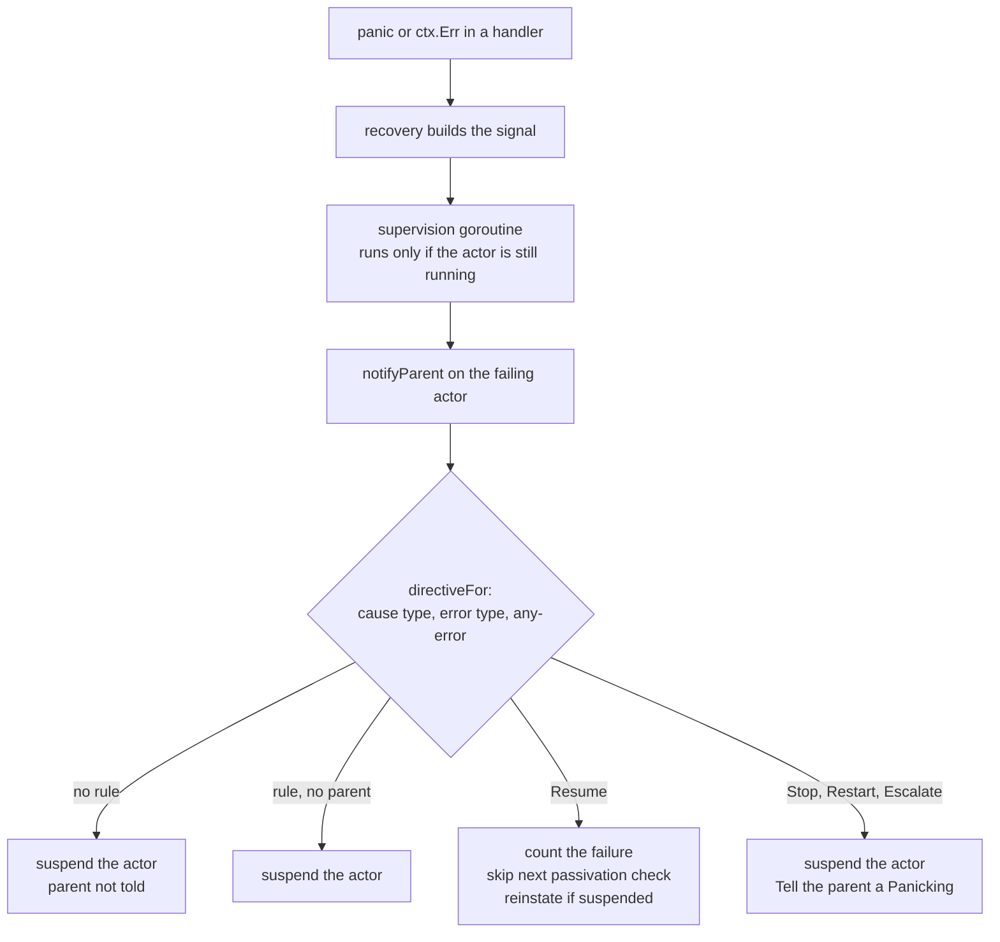
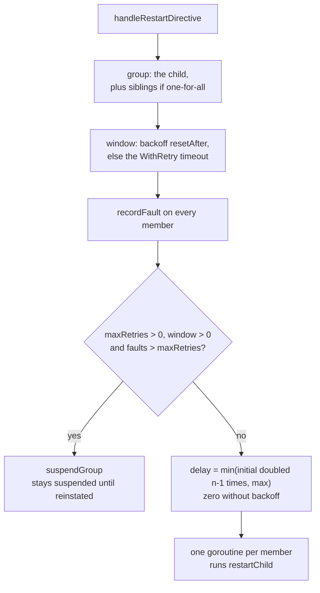
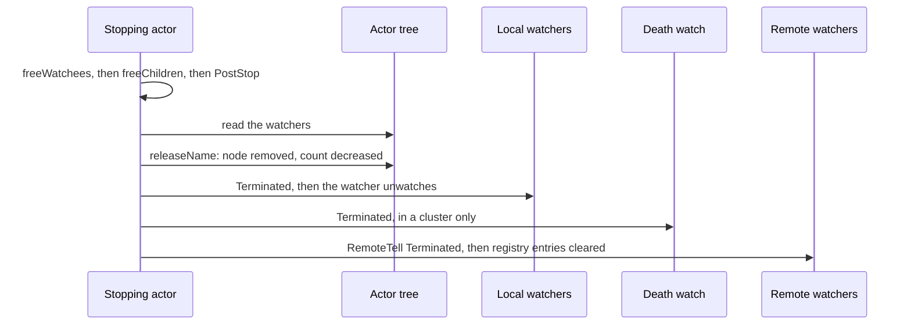

# 9. Supervision and Death Watch

## Contents

- [What you will learn](#what-you-will-learn)
- [9.1 The `Supervisor` value](#91-the-supervisor-value)
- [9.2 From a failure to a decision](#92-from-a-failure-to-a-decision)
- [9.3 The parent carries it out](#93-the-parent-carries-it-out)
- [9.4 Restart: budget, backoff and retries](#94-restart-budget-backoff-and-retries)
- [9.5 Escalation and the guardians](#95-escalation-and-the-guardians)
- [9.6 The restart itself](#96-the-restart-itself)
- [9.7 Reinstate](#97-reinstate)
- [9.8 Death watch](#98-death-watch)
- [9.9 Remote watch](#99-remote-watch)
- [Guarantees](#guarantees)
- [Implementation details (may change)](#implementation-details-may-change)
- [Behaviours to know](#behaviours-to-know)

## What you will learn

- What a `Supervisor` holds, how a rule is matched to an error, and why one instance can be shared.
- The path from a failing handler to a decision: whose supervisor decides, and who carries it out.
- What each directive does, including restart budgets, backoff and retried restarts.
- What escalation really does, and what the guardians do with a failure that reaches them.
- How a restart runs, and what it keeps and loses.
- How death watch works locally and across nodes, and in what order a watcher learns of a death.
- Where these paths meet other subsystems: the dispatcher's supervision goroutine ([Chapter 7, §7.6](chap-07.md#76-failures-leave-the-turn)), passivation ([Chapter 10, §10.6](chap-10.md#106-pause-resume-reinstate)), the guardians ([Chapter 3, §3.4](chap-03.md#34-the-guardian-tree)) and the remote watch registry ([Chapter 17, §17.8](chap-17.md#178-the-remote-watch-registry)).

Names in [§9.2](#92-from-a-failure-to-a-decision) to [§9.7](#97-reinstate) are in `actor/pid.go` unless another file is named. Names in [§9.1](#91-the-supervisor-value) are in `supervisor/supervisor.go`.

## 9.1 The `Supervisor` value

A `Supervisor` holds a strategy, a set of rules from error type to directive, and the retry and backoff settings (`Supervisor` in `supervisor/supervisor.go`).

| Strategy | Effect of a decision |
|---|---|
| `OneForOneStrategy` | applies to the failing actor |
| `OneForAllStrategy` | applies to the failing actor and its siblings (Stop and Restart only, [§9.3](#93-the-parent-carries-it-out)) |

The directives are `StopDirective`, `ResumeDirective`, `RestartDirective` and `EscalateDirective` (`Directive` in `supervisor/supervisor.go`).

**Construction.** `NewSupervisor` starts with one-for-one, no retries and a timeout of −1, installs two rules, `PanicError → Stop` and `runtime.PanicNilError → Restart`, and then applies the options (`NewSupervisor` in `supervisor/supervisor.go`). If the options include an any-error rule, every other rule is deleted, the two defaults included, so `WithAnyErrorDirective` cannot be combined with type rules through options.

**The rule key.** A rule is keyed by `errorType(err)`: the type of the error, dereferenced once if it is a pointer, as `reflect.Type.String()` (`errorType` in `supervisor/supervisor.go`). That string is the package name and the type name, for example `errors.PanicError`, not the import path. Three consequences follow:

- `&MyErr{}` and `MyErr{}` share a key.
- Every `errors.New` error has the key `errors.errorString`, and every `fmt.Errorf("%w", …)` error has `fmt.wrapError`. A rule cannot tell two sentinels apart, and a rule for `*MyErr` does not match a wrapped `*MyErr`: there is no unwrapping.
- Two types with the same package name and type name from different modules share a key.

The comments on `DirectiveRule` and `SetDirectiveByType` say the same: the key is the package name and the type name, never the import path.

**Lookup.** `Supervisor.Directive` returns the rule for the exact type and does not fall back to the any-error rule. The fallback is done by the caller ([§9.2](#92-from-a-failure-to-a-decision)).

**After construction.** `SetDirectiveByType` adds a rule by type name without removing the any-error rule; since the exact lookup comes first, it takes precedence. The death watch uses this to resume on its own cleanup error while escalating everything else (`actorSystem.spawnDeathWatch` in `actor/actor_system.go`). `Reset` deletes every rule and sets the strategy to one-for-all.

**Sharing.** A `Supervisor` holds no per-actor state: the fault counters live on each PID ([Chapter 4](chap-04.md)), and a stop leaves the supervisor alone (`PID.reset` in `actor/pid.go`). One instance can therefore serve many actors, and does: PIDs built without one share the package variable `defaultSupervisor`, and spawned actors share the system default ([Chapter 4, §4.6](chap-04.md#46-children)), which `WithDefaultSupervisor` replaces (`actor/option.go`). `Reset` and `SetDirectiveByType` change a shared instance for every actor that uses it.

## 9.2 From a failure to a decision

The first half of the path is [Chapter 7, §7.6](chap-07.md#76-failures-leave-the-turn): `PID.recovery` turns a panic or a `ctx.Err` into a supervision signal, `PID.submitSupervision` pauses the actor's user messages ([Chapter 7, §7.3](chap-07.md#73-one-turn)) and hands the signal to the supervision goroutine of the dispatcher the actor runs on (the default dispatcher and each named one have their own, `dispatcher` in `actor/dispatcher.go`), and that goroutine calls `notifyParent` and then lifts the pause (`supervision.run` in `actor/supervision.go`).

**A panic is supervised by the error it carries.** When the recovered error is, or wraps, a `PanicError`, `recovery` reports the `PanicError` it finds (`errors.As`) and sets no cause. It wraps any other recovered error in a new `PanicError` that adds the location of the panic and keeps the original as the **cause**; a recovered value that is not an error is wrapped the same way, with no cause (`PID.recovery` in `actor/pid.go`; `newPanicSupervisionSignal` in `actor/supervision_signal.go`). The lookup, `PID.directiveFor`, tries the cause's type first, then the reported error's type, then the any-error rule. So a panic with an error is supervised like `ctx.Err` with that error:

- A `WithDirective(&MyErr{}, …)` rule applies to `ctx.Err(&MyErr{})` and to `panic(&MyErr{})` alike.
- Go hands `recover()` a `*runtime.PanicNilError` for `panic(nil)`, so the default `PanicNilError → Restart` rule applies to it.
- A panic whose value matches no rule, a string or an `errors.New` error for example, falls under `PanicError → Stop`, which every supervisor has unless it has an any-error rule.

**The decision is the failing actor's own.** `PID.notifyParent` runs on the supervision goroutine and uses the **failing actor's** supervisor, the one passed to its own spawn with `WithSupervisor`:

1. It ignores `ErrDead`.
2. It looks for a rule with `directiveFor`. **With no rule, it suspends the actor and returns.** The parent is not told, and nothing reinstates the actor.
3. With a rule and a parent:
   - **Resume is carried out here**, without the parent. It counts the failure, marks the next passivation check to be skipped and reinstates the actor if an earlier failure had suspended it. The comment explains why: not suspending avoids a moment in which the actor looks stopped.
   - Any other directive suspends the actor and sends the parent a `commands.Panicking` carrying the directive, the strategy and the supervisor. The send's error is discarded, and `Tell` refuses a target that is suspended, stopping or passivating, so a failure reported to a parent in that state is lost and the child stays suspended.
4. With no parent, it suspends the actor. Every actor in the tree except the root guardian has a parent; top-level actors have the user guardian.

`PID.suspend` sets the suspended bit, counts a failure, pauses passivation and publishes `ActorSuspended`. It leaves the running bit set; `IsRunning` is false because it also checks the suspended bit. A suspended actor refuses `Tell` and `Ask` ([Chapter 5, §5.1](chap-05.md#51-three-ways-to-send)) with `ErrDead`, and keeps its queued messages for later ([Chapter 7, §7.6](chap-07.md#76-failures-leave-the-turn)). `suspend` also pauses passivation and a resume or reinstate restores it ([Chapter 10, §10.6](chap-10.md#106-pause-resume-reinstate)); `ActorSuspended` goes to the event stream ([Chapter 11, §11.3](chap-11.md#113-the-event-stream)).

## 9.3 The parent carries it out

`Panicking` is a control message ([Chapter 7, §7.4](chap-07.md#74-the-system-queue)), so the parent handles it after its running handler and ahead of its queued user messages, on its own turn and never in its `Receive` (`PID.dispatchOne` in `actor/pid.go`). `PID.handlePanicking` ignores the message unless it comes from the actor it names, and applies the directive the child sent, never the parent's own supervisor:

| Directive | What the parent does |
|---|---|
| Stop | `PID.handleStopDirective` shuts the child down (and its siblings, one-for-all) concurrently, and **waits** for every shutdown, `PostStop` included, on its own turn; errors are logged |
| Restart | `PID.handleRestartDirective` starts a goroutine per actor to restart and returns at once ([§9.4](#94-restart-budget-backoff-and-retries)) |
| Resume | reinstates the child; in practice the child has already resumed itself ([§9.2](#92-from-a-failure-to-a-decision)) |
| Escalate | the child sends the parent a `PanicSignal`, so the signal reaches the parent's `Receive` with the child as sender; the child stays suspended ([§9.5](#95-escalation-and-the-guardians)) |
| any other value | suspends the child again |

**Siblings.** Under one-for-all, the group is the failing child plus every other child of the same parent (`tree.siblings` in `actor/pid_tree.go`), whatever their own supervisors. For a top-level actor, the parent is the user guardian, so the group is every top-level user actor. Only Stop and Restart reach siblings: Resume is carried out by the child alone, and Escalate concerns only the child.

## 9.4 Restart: budget, backoff and retries

`PID.handleRestartDirective`:

1. **The group** is the child, plus its siblings under one-for-all.
2. **The window** is the backoff's `resetAfter` when backoff is configured, otherwise the `WithRetry` timeout.
3. **Faults are counted on every member** with `PID.recordFault`, which restarts the count when the previous fault is older than a positive window. The counters live on the PID and survive the restart. The faulty child's count drives the decision.
4. **The budget.** With `maxRetries > 0`, a positive window and more faults than `maxRetries`, `PID.suspendGroup` leaves the faulty child suspended and suspends the running siblings too, and they stay suspended until something reinstates them. Without a positive window the budget never applies.
5. **The delay** is `min(initial << (n−1), max)` for the nth consecutive fault, or zero without backoff (`backoffDelay` in `actor/pid.go`). Every member waits the same delay.
6. **One goroutine per member** runs `PID.restartChild`.

`restartChild`:

- After the delay, if any, it gives up if the parent is not running (`IsRunning` is false for a parent that is suspended, stopping or passivating) or the system is stopping. Nothing restarts, and the faulty child stays suspended.
- A successful restart tells no watcher ([§9.8](#98-death-watch)). A failed attempt does: `Restart` terminates the subtree, so the parent is told that the child died after each failed attempt, even when a later retry succeeds and makes the parent a watcher again (`restartNode.terminate` in `actor/pid.go`).
- With `maxRetries == 0` or a non-positive timeout it calls `Restart` once. Otherwise it calls `Restart` up to `maxRetries` times in all, the first attempt included, and tries again while it fails, for example when `PreStart` fails. It does this with `internal/retry`, whose bounds are the timeout, or the backoff bounds when backoff is configured: `maxRetries` is the retrier's attempt count (`NewRetrier` in `internal/retry/retry.go`). That retrier is exponential with jitter (`Retrier.RunContext` in `internal/retry/retry.go`), so with equal bounds the pace is constant only before jitter.
- If every attempt fails, it shuts the child down, and suspends it if that fails too.

A failed `Restart` stops the subtree it was restarting ([§9.6](#96-the-restart-itself)). A retry therefore restarts an actor that is already dead and out of the tree; `Restart` puts it back under its parent.

## 9.5 Escalation and the guardians

**Escalate does not fail the parent.** The child sends the parent a `PanicSignal` (`actor/messages.go`), and that signal reaches the parent's `Receive` with the child as sender. The child stays suspended. What happens next is up to the parent's code: it can stop, reinstate or restart `ctx.Sender()`. If it calls `ctx.Unhandled()` the signal becomes a dead letter ([Chapter 5, §5.4](chap-05.md#54-dead-letters)) and the child stays suspended for good. The grandparent hears of it only if the parent's handler itself fails.

**The guardians** ([Chapter 3, §3.4](chap-03.md#34-the-guardian-tree)):

| Guardian | Parent of | On a `PanicSignal` | Source |
|---|---|---|---|
| user guardian | top-level actors | `Unhandled`: an escalating top-level actor stays suspended | `userGuardian.Receive` in `actor/user_guardian.go` |
| system guardian | the death watch, the deadletter actor and the other system actors | **stops the actor system** when the sender is a system actor and the system is not already stopping | `systemGuardian.Receive` and `systemGuardian.handlePanicSignal` in `actor/system_guardian.go` |
| root guardian | both guardians | the same rule: stops the system | `rootGuardian.Receive` and `rootGuardian.handlePanicSignal` in `actor/root_guardian.go` |

A system actor is one whose name carries the reserved prefix (`isSystemName` in `actor/reserved.go`).

The supervisors the system gives its own actors (`actorSystem.spawnSystemGuardian`, `actorSystem.spawnUserGuardian`, `actorSystem.spawnDeathWatch`, `actorSystem.spawnRelocator`, `actorSystem.spawnDeadletter` and `actorSystem.spawnRootGuardian` in `actor/actor_system.go`):

| Actor | Directives |
|---|---|
| system guardian, user guardian | escalate any error |
| death watch | escalate any error, except its internal cleanup error, which resumes |
| deadletter actor | resume any error |
| relocator (spawned only when the cluster and relocation are enabled, [Chapter 21, §21.9](chap-21.md#219-the-relocator-and-its-workers)) | restart on `PanicError`, `PanicNilError` and `RebalancingError`; resume on `InternalError` and `SpawnError` |
| root guardian | the system's default supervisor |

A panic in the death watch, other than its cleanup error, therefore escalates to the system guardian and stops the actor system.

## 9.6 The restart itself

`PID.Restart` is used by the restart directive, by `ActorSystem.ReSpawn` and by application code:

1. Snapshot the subtree of running and suspended actors (`buildRestartSubtree` in `actor/pid.go`).
2. Find the parent with `PID.restartParent`: in the tree for a running or suspended actor; for a stopped actor, which has left the tree, from its address, that is its parent actor, or the user guardian for a top-level actor. A parent that is gone fails the restart with `ErrDead`.
3. Mark the whole subtree as restarting, so each teardown keeps its name and registry record ([Chapter 4, §4.7](chap-04.md#47-looking-up-killing-and-restarting-by-name)).
4. Run `restartSubtree`; if it fails, stop the whole subtree (`restartNode.terminate`).

`restartSubtree`, for each node:

1. Cancel the requests in flight.
2. If the actor is running **or suspended**, stop it with `PID.stop`, the shutdown without the system-actor check of `Shutdown`, since a supervisor may restart a system actor, and wait until it is no longer running. `PostStop` therefore runs before `PreStart` on every restart, and a `PostStop` error fails the restart. A stopped actor skips this step.
3. Wait until no worker holds the actor, then force its dispatch state to idle while no sender can reach it ([Chapter 7, §7.2](chap-07.md#72-the-dispatch-state)), and reset the behaviour stack to `Receive` ([Chapter 8, §8.3](chap-08.md#83-behaviours)).
4. Replay the stash when step 1 cancelled a stash-mode request (below), then run `PID.init`: `PreStart` with its retries ([Chapter 4, §4.4](chap-04.md#44-prestart-retries-and-the-timeout-that-is-not-one)), `PostStart` armed, the restart counted, running bit set; then store the start time, so the uptime starts again.
5. Re-attach the actor to the tree under its parent, mark it for the death watch again, and write its cluster record ([Chapter 20, §20.4](chap-20.md#204-the-registry)). The tree refuses a parent that is stopping or passivating, under the parent's node lock, the lock its `freeChildren` reads the children under (`tree.addOrAttachNode`, `tree.addNodeUnder` and `tree.attachNode` in `actor/pid_tree.go`), so a restart that races the parent's stop fails here and the subtree is terminated instead of outliving its parent.
6. Restart its children concurrently.
7. Clear the suspended bit, restart passivation, schedule `PostStart`, and publish `ActorRestarted`.

The replay in step 4 moves the reentrancy stash into the kept mailbox with `PID.replayStash` (`actor/stash.go`) when step 1 cancelled a stash-mode request: the messages keep their order, nothing can stash again meanwhile, and `PostStart` still runs first from its own slot. An explicit `WithStashing` stash with no such request in flight is left alone ([Chapter 8, §8.5](chap-08.md#85-reentrancy-requests-that-do-not-block)).

Subscribers to the event stream ([Chapter 11, §11.3](chap-11.md#113-the-event-stream)) see `ActorStopped` from the teardown, `ActorStarted` from `init` and `ActorRestarted` at the end; the first two are published only when someone is subscribed.

Whether a supervisor decided it or `Restart` was called, a restart keeps and resets the same things, decided in `PID.reset` by the `restartingState` bit:

| State | Across a restart |
|---|---|
| Mailbox and queued messages | kept; the new incarnation handles them after `PostStart` ([Chapter 6, §6.8](chap-06.md#68-stops-restarts-and-other-nodes)) |
| Stash | kept; replayed when a stash-mode request was in flight ([Chapter 8, §8.4](chap-08.md#84-the-stash)) |
| `PostStop` | runs on the old incarnation |
| Its watchers | kept, and told nothing: a restart is not a death |
| What it watches | kept |
| Dependencies | kept, like the other spawn-time configuration ([Chapter 12, §12.2](chap-12.md#122-dependencies)) |
| Restart count, failure count | kept and accumulating |
| Start time | set again after `init`: the uptime starts with the incarnation |
| Processed, reinstate and unhandled counts | zeroed |
| Behaviour stack | back to `Receive` |
| Supervisor, fault counters, spawn-time configuration | kept |
| Tree node and registry record | kept |

The actor value is the same Go value ([Chapter 4, §4.7](chap-04.md#47-looking-up-killing-and-restarting-by-name)), and messages sent while the restart runs are refused with `ErrDead`.

## 9.7 Reinstate

`PID.doReinstate` does nothing for an actor that is running and not suspended. Otherwise it clears the suspended bit, counts a reinstate, protects the actor from an immediate passivation and resumes passivation ([Chapter 10, §10.6](chap-10.md#106-pause-resume-reinstate)), publishes `ActorReinstated` and schedules the messages that waited ([Chapter 7, §7.6](chap-07.md#76-failures-leave-the-turn)).

`PID.Reinstate(cid)` returns `ErrDead` when the caller is not running. It forwards to the remote node when the caller is remote ([Chapter 16](chap-16.md)) and, from a local caller, when the actor it looks up by name turns out to live on another node. It does nothing for an actor that is not suspended. `PID.ReinstateNamed` looks the actor up by name and forwards the call when that actor lives on another node; called on a remote PID, it returns `ErrNotLocal` instead of forwarding. Neither method checks that `cid` is a child of the caller: any local actor can reinstate any other.

## 9.8 Death watch

**The local API.** `PID.Watch(cid)` adds the caller to `cid`'s watchers in the tree, and `PID.UnWatch` removes it. `tree.addWatcher` does nothing when either actor is not in the tree (`actor/pid_tree.go`): watching an actor that has already stopped registers nothing, and no `Terminated` ever comes. Watchers are deduplicated by ID (`putWatcher` in `actor/pid_tree.go`), and a parent is made a watcher of each child when the child joins the tree (`tree.addNodeUnder` in `actor/pid_tree.go`). The death watch actor holds no edge. Every actor spawned through `actorSystem.attachAndPublish` (`actor/actor_system.go`) and every restarted actor is marked for it (`deathWatchedState` in `actor/pid_state.go`; the system actors attached by `actorSystem.attachSystemActor` are marked only once restarted), and a marked actor tells it directly when it stops, after its own watchers.

**When a watched actor stops.** `PID.doStop`:

1. Runs, failing fast: `PID.freeWatchees`, then `PID.freeChildren`, then `PostStop`.
   - `freeWatchees` unwatches everything this actor watches and sends a best-effort `RemoteUnWatch` for remote watchees. It is skipped during a restart: a restarting actor keeps watching.
   - `freeChildren` unwatches each child before stopping it, so a stopping parent is not told about its children.
2. Reads the watchers from the tree, **releases the name** (`PID.releaseName`: tree node and live-actor count), then runs `PID.freeWatchers`, even if one of those steps failed:
   - Each local watcher that is running is sent `Terminated`, with the dead actor as sender, and then unwatches. A suspended watcher is told too, through `PID.tellSuspended`, since control messages are handled while an actor is suspended. A watcher in any other state is skipped.
   - During a restart nobody is told and every watch is kept: a restart is not a death.
   - Each remote watcher from the registry is sent `Terminated`, and only then are this actor's registry entries cleared.
3. In a deferred step, clears the running bit and resets the PID.

**Ordering.** Read against that sequence:

- `Terminated` is sent after `PostStop` returns.
- `Terminated` is sent **after** the name is released, so a watcher that handles it and spawns the same name finds the name free.
- `Terminated` is a control message (`isControlMessage` in `actor/pid.go`): in the watcher it overtakes the user messages still queued, including messages the dead actor sent before it died. It reaches the watcher's ordinary `Receive`.
- A watcher that dies first unwatches everything in its own `freeWatchees`, so it receives nothing afterwards.

**The death watch actor** (`deathWatch.Receive` in `actor/death_watch.go`) is a stateless system actor. It does not clean the local tree: the dead actor leaves the tree and the live-actor count by itself in `releaseName`. `deathWatch.handleTerminated` accepts only a `Terminated` sent by the dead PID itself, ignores it if that PID is running again, and in a cluster removes the actor's registry record, fenced by its incarnation. System actors have no record to remove, except the companions of reliable delivery ([Chapter 23](chap-23.md)). If the removal fails, it returns an error its supervisor resumes on and, unless the failure is the cluster engine not running, schedules a retry, starting at 500 ms, doubling, at most five times (`deathWatchRemovalMaxRetries`, `deathWatch.handleRetryDeadActorRemoval` and `deathWatch.scheduleRemovalRetry` in `actor/death_watch.go`). A retry is dropped when the system is stopping, when the system is no longer in a cluster, when the cluster engine is not running, or after the fifth failure, which is logged ([Chapter 20, §20.4](chap-20.md#204-the-registry)). Outside a cluster the death watch has nothing to do, and a stopping actor does not send it a `Terminated` at all (`PID.freeWatchers` in `actor/pid.go`).

## 9.9 Remote watch

**Watching.** `PID.Watch` on a remote PID calls `RemoteWatch` ([Chapter 16](chap-16.md)) on the caller's goroutine, bounded by the remote watch timeout (5 s by default), and records the watch locally only once the other node has acknowledged it (`DefaultRemoteWatchTimeout` in `actor/defaults.go`). A failure is logged at debug level and leaves no watch. From a handler, the call holds the worker.

**The other node.** The watcher sends the actor's qualified name, `parent/child` for a child ([Chapter 4, §4.5](chap-04.md#45-names-addresses-and-identity)), and `actorSystem.remoteWatchHandler` (`actor/remote_server.go`, [Chapter 17, §17.6](chap-17.md#176-actor-lifecycle-and-query-handlers)) resolves it with `actorSystem.localActor` (`actor/actor_system.go`). That function tries the qualified name first and then a bare actor name, a child's included; when several actors share the bare name, it takes the most recently spawned one. The handler refuses a system actor's name. Remote unwatch and remote reinstate resolve names the same way.

**The registry** keeps remote watchers and watchees per local actor, with reverse indexes by **host**, under one lock (`remoteWatchRegistry` in `actor/remote_watch_registry.go`; its structure is [Chapter 17, §17.8](chap-17.md#178-the-remote-watch-registry)).

**On the wire,** `Terminated` is a small frame: an 8-byte magic, the path's length and text, and a Unix-nanosecond timestamp (`terminatedMagicLen` in `actor/terminated_serializer.go`).

**When a node leaves** the cluster ([Chapter 21, §21.6](chap-21.md#216-what-every-node-does-on-nodeleft)), `actorSystem.pruneRemoteWatchesForNode` drops the registry entries whose remote side is the departed node, told apart from other nodes on the same host by its remoting port, and sends each running local watcher of a dropped watchee a `Terminated` stamped with the membership event's time, with the death watch as sender (`actor/actor_system.go`; `remoteWatchRegistry.dropNode` in `actor/remote_watch_registry.go`). Dropped remote watchers are discarded silently. When the port is not known, every entry on the host is dropped (`remoteWatchRegistry.dropHost`). Without a cluster there is no departure event, so nothing tells a remote watcher that a node is gone.

## Guarantees

| Statement | Enforced by |
|---|---|
| `NewSupervisor` defaults: one-for-one, no retries, timeout −1, `PanicError → Stop`, `PanicNilError → Restart` | `TestNewSupervisorDefaults` in `supervisor/supervisor_test.go` |
| An any-error rule deletes every other rule | `TestNewSupervisorAnyErrorOverrides` in `supervisor/supervisor_test.go` |
| `Reset` deletes the rules and selects one-for-all; pointer and value types share a key | `TestResetAndRules` and `TestErrorType` in `supervisor/supervisor_test.go` |
| Without a supervisor option a child shares the system default supervisor | `TestSpawnChildSharesDefaultSupervisor` and `TestNewPIDDefaultSupervisorAndStrategy` in `actor/pid_test.go` |
| Stop stops the child (and, one-for-all, its siblings), even when `PostStop` fails, and frees the names | `TestSupervisorStrategy` in `actor/pid_test.go` |
| Under the default supervisor a panicking child is stopped | `TestSupervisorStrategy` in `actor/pid_test.go` |
| An error with no rule, or an unknown directive, suspends the actor | `TestSupervisorStrategy` in `actor/pid_test.go` |
| Restart leaves the child (and, one-for-all, its siblings) running | `TestSupervisorStrategy` in `actor/pid_test.go` |
| Resume keeps the child running and answering | `TestSupervisorStrategy` in `actor/pid_test.go` |
| Escalate delivers a `PanicSignal` to the parent with the child as sender, and the parent can reinstate it | `TestSupervisorStrategy` in `actor/pid_test.go` |
| A failing actor with no parent is suspended | `TestSupervisorStrategy` in `actor/pid_test.go` |
| A suspended actor can be restarted and goes back under its parent | `TestSupervisorStrategy` in `actor/pid_test.go` |
| More faults than `maxRetries` within the window leave the child, and its one-for-all siblings, suspended; a shared supervisor keeps its rules | `TestSupervisorRestartBudget` and `TestSupervisorRestartBudgetOneForAll` in `actor/pid_test.go` |
| Backoff delays the nth restart by `min(initial << (n−1), max)`; the fault count resets after a gap longer than the window | `TestBackoffDelay`, `TestRecordFault` and `TestSupervisorExponentialBackoffDelaysRestart` in `actor/pid_test.go` |
| Queued messages wait for the decision and reach the restarted actor | `TestFailureWithholdsQueuedMessages` and `TestRestartKeepsMailbox` in `actor/pid_test.go` |
| A restart never lets two workers run the actor | `TestRestartNeverRunsTwoTurns` in `actor/pid_test.go` |
| `Restart` restarts the descendants, keeps the actor and its children in the tree, and delivers `PostStart` again | `TestRestart` in `actor/pid_test.go` |
| A failed restart stops the subtree, tells its watcher and frees the names | `TestRestart` in `actor/pid_test.go` |
| A successful restart keeps the registry records; a failed one removes them, fenced by incarnation | `TestRestart` in `actor/pid_test.go` |
| A restart whose `PostStop` fails returns an error and leaves the actor stopped | `TestRestart` in `actor/pid_test.go` |
| A failed `PostStop` still frees the name and tells the watchers | `TestShutdown` in `actor/pid_test.go` |
| A remote `Watch` records nothing when it fails; `UnWatch` clears the local entry even when the call fails | `TestWatchUnWatchRemote` in `actor/pid_test.go` |
| A reinstate during a passivation attempt prevents the stop | `TestReinstateAvoidsPassivationRace` in `actor/pid_test.go` |
| The death watch removes only the dead actor's own record, only on that actor's `Terminated`, and keeps the system running when removal fails | `TestDeathWatch` in `actor/death_watch_test.go` |
| A failed registry cleanup is retried until it succeeds, and no retry follows the last attempt of the budget | `TestDeathWatchClusterCleanupFailure` in `actor/death_watch_test.go` |
| The host-wide prune of remote watches drops watcher entries silently and sends each local watcher of a dropped watchee a `Terminated` stamped with the time given to the prune | `TestPruneRemoteWatchesForHost` in `actor/actor_system_test.go` |
| `Terminated` round-trips on the wire; malformed frames are rejected | `TestTerminatedSerializer_Serialize`, `TestTerminatedSerializer_Deserialize` and `TestTerminatedSerializer_RoundTripIdempotent` in `actor/terminated_serializer_test.go` |
| A panic is supervised by its error's type: `panic(nil)` restarts, a typed rule resumes, an unmatched error stops | `TestPanicSupervisedByItsErrorType` in `actor/pid_test.go` |
| A restart tells the watchers nothing and keeps the watches in both directions | `TestRestartKeepsWatches` in `actor/pid_test.go` |
| `Terminated` arrives once the name is free; a suspended watcher receives it; remote watchers are told | `TestTerminatedArrivesAfterNameRelease`, `TestSuspendedWatcherReceivesTerminated` and `TestShutdownTellsRemoteWatchers` in `actor/pid_test.go` |
| A stopped actor restarted goes back into the tree, as does a child whose supervised restart succeeds on a retry | `TestRestartOfStoppedActorRejoinsTree` in `actor/pid_test.go` |
| A failed supervised restart tells the parent; a supervised restart runs `PostStop`; the restart count and dependencies survive a restart, and the uptime starts again | `TestFailedSupervisedRestartTellsParent`, `TestSupervisedRestartRunsPostStop` and `TestRestartKeepsCountersAndDependencies` in `actor/pid_test.go` |
| A child cannot be attached under a stopping parent | `TestTreeAddOrAttachNodeRefusesStoppingParent` in `actor/pid_tree_test.go` |
| Backoff and every rule survive the wire | `TestEncodeDecodeSupervisorBackoff` and `TestEncodeDecodeSupervisorAnyErrorKeepsSpecificRules` in `internal/codec/codec_test.go` |
| A node's departure drops its watches and no other node's | `TestRemoteWatchRegistry_DropNode` in `actor/remote_watch_registry_test.go` |

## Implementation details (may change)

- One supervision goroutine per dispatcher with a 1,024-signal buffer ([Chapter 7](chap-07.md)).
- Retried restarts use `internal/retry`, exponential with jitter.
- The 10 ms ticker waiting for the teardown, and the spin on the dispatch state.
- The 5 s remote watch timeout, and the death watch's five retries from 500 ms.
- The `Terminated` frame layout.
- The supervisor's wire form carries the strategy, retries, timeout, backoff settings and every rule (`protos/internal/actor.proto`).

## Behaviours to know

| Behaviour | Source |
|---|---|
| The failing actor's own supervisor decides; the parent's supervisor governs only the parent's failures | `PID.notifyParent` in `actor/pid.go` |
| A panic is supervised by the type of the error it carries, then by the `PanicError` rule | `PID.directiveFor` in `actor/pid.go` |
| Rules match the exact type name, with no unwrapping | `errorType` in `supervisor/supervisor.go` |
| An error with no rule suspends the actor without telling the parent | `PID.notifyParent` in `actor/pid.go` |
| A failure reported to a suspended, stopping or passivating parent is lost, and the child stays suspended | `PID.notifyParent` in `actor/pid.go` |
| One-for-all on a top-level actor applies to every top-level actor | `tree.siblings` in `actor/pid_tree.go` |
| A Stop directive runs the shutdowns, `PostStop` included, on the parent's turn | `PID.handleStopDirective` in `actor/pid.go` |
| A restart is dropped, and the faulty child stays suspended, when the parent is not running once the delay has elapsed, a suspended parent included | `PID.restartChild` in `actor/pid.go` |
| Escalation from a top-level actor leaves it suspended for good | `userGuardian.Receive` in `actor/user_guardian.go` |
| An escalation that reaches the system or root guardian stops the actor system | `systemGuardian.handlePanicSignal` in `actor/system_guardian.go` |
| A restart runs `PostStop` and then `PreStart` on the same actor value; the mailbox, the watches, the dependencies and the restart count are kept | `PID.reset` in `actor/pid.go` |
| Restarting an actor tells its watchers nothing | `PID.freeWatchers` in `actor/pid.go` |
| An actor restarted after it stopped goes back under its parent; with a dead parent the restart fails | `PID.restartParent` in `actor/pid.go` |
| A restart racing the parent's stop fails rather than leaving the child unparented | `tree.addOrAttachNode` in `actor/pid_tree.go` |
| When a supervised restart fails for good, the parent is told the child died | `PID.restartChild` in `actor/pid.go` |
| `Terminated` arrives after the name is free, and overtakes queued messages; a suspended watcher receives it too | `PID.doStop` in `actor/pid.go` |
| Watching an actor that has already stopped never produces `Terminated` | `tree.addWatcher` in `actor/pid_tree.go` |
| Remote watchers are told when the actor stops; remote watch and reinstate reach children by qualified name | `PID.freeWatchers` in `actor/pid.go`; `actorSystem.remoteWatchHandler` in `actor/remote_server.go` |
| A departing node's watches are pruned by host and port, so other nodes on the same host keep theirs | `actorSystem.pruneRemoteWatchesForNode` in `actor/actor_system.go` |
| `Reinstate` with a PID that lives on another node forwards the call there | `PID.Reinstate` in `actor/pid.go` |
| Any local actor may stop or reinstate any other; neither checks parenthood | `PID.Stop` in `actor/pid.go` |
