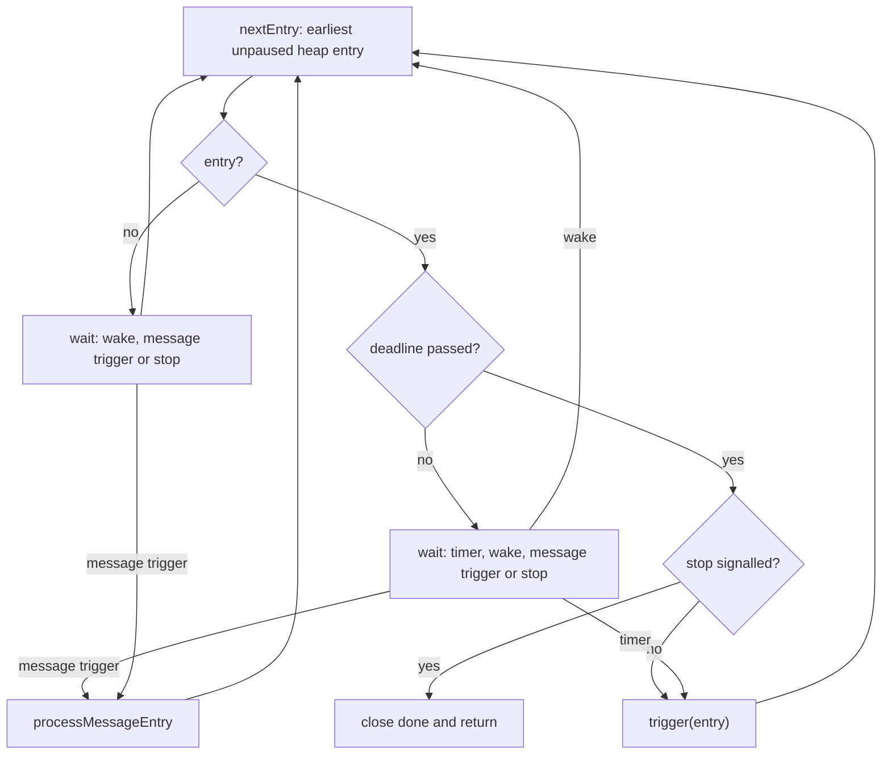
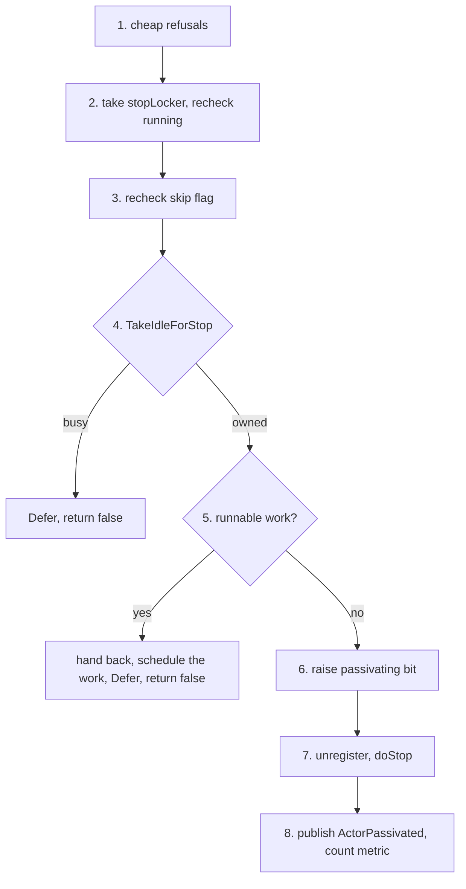

# 10. Passivation and Eviction

## Contents

- [What you will learn](#what-you-will-learn)
- [10.1 Strategies](#101-strategies)
- [10.2 The manager and its entries](#102-the-manager-and-its-entries)
- [10.3 Activity](#103-activity)
- [10.4 The loop](#104-the-loop)
- [10.5 One attempt](#105-one-attempt)
- [10.6 Pause, resume, reinstate](#106-pause-resume-reinstate)
- [10.7 System eviction](#107-system-eviction)
- [Guarantees](#guarantees)
- [Implementation details (may change)](#implementation-details-may-change)
- [Behaviours to know](#behaviours-to-know)

## What you will learn

- The three passivation strategies, which actor gets which, and what each costs.
- How an actor's activity reaches the passivation manager, and why the manager may not trust its own deadline.
- What the manager's one goroutine does on a deadline or a message count, and what it does with an actor that refuses.
- What a passivation attempt is, step by step, and the four races it closes.
- How pause, resume and reinstate interact with passivation.
- What system eviction is, how it picks actors, and why it is a stop rather than a passivation.

Names are declared in `actor/passivation_manager.go` (the manager) and `actor/pid.go` (the actor side, [Chapter 4](chap-04.md)) unless another file is named. Grains use the same manager with their own decision step ([Chapter 14, §14.9](chap-14.md#149-idle-passivation)).

## 10.1 Strategies

A `Strategy` is a name and a string (`Strategy` in `passivation/strategy.go`); three implementations carry the parameters:

| Strategy | Constructor | Meaning |
|---|---|---|
| time-based | `NewTimeBasedStrategy(timeout)` | stop the actor once it has been idle for `timeout` |
| message-count | `NewMessageCountBasedStrategy(n)` | stop the actor once it has handled `n` user messages |
| long-lived | `NewLongLivedStrategy()` | never passivate |

The constructors are `NewTimeBasedStrategy`, `NewMessageCountBasedStrategy` and `NewLongLivedStrategy` in `passivation/strategy.go`.

A `Strategy` is configuration, not behaviour: the interface has only `Name` and `String`, and all the logic is in the passivation manager. Implementing the interface is therefore not enough to add a strategy: spawn validation rejects any type other than the three, `PID.setPassivationStrategy` recognises only the message-count type, and `passivationManager.Register` drops the entry of a strategy it does not know.

The constructors do not validate their argument: a timeout of zero passivates the actor right after it starts, and a count of zero passivates it after `PostStart`. Spawn validation only checks that the strategy is one of the three types (`spawnConfig.Validate` in `actor/spawn_option.go`).

**Which strategy an actor gets.**

| Actor | Strategy | Set by |
|---|---|---|
| spawned with `WithPassivationStrategy` or `WithLongLived` ([Chapter 4, §4.1](chap-04.md#41-the-spawn-entry-points)) | the one given | `actor/spawn_option.go` |
| spawned without an option, a child included | time-based, two minutes (`DefaultPassivationTimeout`) | `NewActorSystem` in `actor/actor_system.go`; `DefaultPassivationTimeout` in `actor/defaults.go`; `newPID` in `actor/pid.go` |
| system actors ([Chapter 3, §3.4](chap-03.md#34-the-guardian-tree)), singletons ([Chapter 21, §21.4](chap-21.md#214-cluster-singletons)), routers and their routees ([Chapter 11, §11.2](chap-11.md#112-routers)), relocation workers ([Chapter 21, §21.9](chap-21.md#219-the-relocator-and-its-workers)) | long-lived | `WithLongLived` at their spawn sites, for example `actorSystem.SpawnRouter` in `actor/spawn.go` and `router.spawnRoutees` in `actor/router.go` |
| reliable-delivery endpoints and their controllers ([Chapter 23](chap-23.md)) | long-lived, the only strategy a reliable endpoint accepts | `actorSystem.configPIDAt` in `actor/actor_system.go`; `spawnConfig.Validate` in `actor/spawn_option.go` |

No option changes the default system-wide. The PID also records whether its strategy is message-count based, in an atomic read on the hot path instead of a type switch (`PID.setPassivationStrategy` in `actor/pid_option.go`).

## 10.2 The manager and its entries

There is one `passivationManager` per actor system, created with the system and started by `Start` ([Chapter 3, §3.3](chap-03.md#33-start); `NewActorSystem` in `actor/actor_system.go`). Every PID, and every grain, receives it at construction and takes part through the `passivationParticipant` interface: an ID, a latest-activity time and a `passivationTry` call.

The manager holds, under one mutex, a map of entries by actor ID and a min-heap of the time-based entries ordered by deadline. A `passivationEntry` carries:

- the strategy's parameters, and the deadline (time-based) or the message baseline (message-count);
- four flags: `paused`, `pending`, `enqueued` (keeps an entry from being queued on the trigger channel twice) and `deferred`;
- a `triggers` count that a message-count attempt compares before and after it runs.

**Registration.** `newPID` ([Chapter 4, §4.3](chap-04.md#43-inside-newpid)) registers the actor after `init` and before `PostStart` runs, unless the strategy is long-lived (`PID.startPassivation` in `actor/pid.go`); a restart registers it again. `Register` does the following:

- nothing when the manager is not started;
- for a time-based entry, sets the deadline to the latest activity (now, if there is none yet) plus the timeout and pushes it on the heap, waking the loop only when the entry became the earliest;
- for a message-count entry, sets the baseline to the processed count **plus one**, because `PostStart` has not run yet and is counted like any message, so the threshold is crossed after `n` user messages.

`Unregister` removes the entry; `PID.stop` and a successful attempt call it.

**Start and Stop.** `Start` creates fresh stop and done channels, so a manager stopped by `ActorSystem.Stop` starts again with the system. `Stop` closes the stop channel and waits for the loop to end; the loop reads the stop channel before it attempts an expired entry, so the wait is bounded by the attempt in progress.

## 10.3 Activity

Inside a turn, `PID.handleReceived` marks activity and counts the message **before** the handler runs. A message that bypasses `handleReceived` is neither: `dispatchOne` handles `PoisonPill`, the supervision signal, `PausePassivation`, `ResumePassivation` and async responses itself, drops an `Ask` whose sender has stopped waiting, and stashes a message while a reentrant request blocks the actor ([Chapter 8, §8.5](chap-08.md#85-reentrancy-requests-that-do-not-block)); an async request is unwrapped and then counted like any message (`PID.dispatchOne` and `PID.handleAsyncRequest` in `actor/pid.go`). The control messages come from the system queue ([Chapter 7, §7.4](chap-07.md#74-the-system-queue)). The time is read once per turn ([Chapter 7, §7.3](chap-07.md#73-one-turn)), so every message of a turn records the turn's start.

`PID.markActivity` stores the time in the PID, skipping the store when that instant is already recorded (every message of a turn after its first). At most once per 100 ms (`passivationTouchInterval` in `actor/pid.go`) it also tells the manager with `Touch`, which recomputes the entry's deadline and fixes the heap. The heap's deadline can therefore lag the actor's true latest activity by up to 100 ms. The manager knows that: when a deadline fires, it reads the actor's latest activity and, if the actor has not been idle for the whole timeout yet, re-arms the entry for the remaining time instead of attempting (`passivationManager.trigger`).

`PID.recordProcessedMessage` increments the processed count and, for a message-count actor, calls `MessageProcessed`. `MessageProcessed` compares the count with the baseline plus the threshold; at or above it, it marks the entry pending and hands it to the manager through a 1,024-slot channel, with a goroutine as the fallback when the channel is full (`passivationManager.signalMessageEntry`). Since the count is raised before the handler runs, the first attempt usually finds the actor busy and is deferred, unless the turn has already ended by the time the manager goroutine reaches it. The turn's end calls `MessageProcessed` again when nothing is left to process, which raises the trigger if the threshold is still reached and so retries a deferred attempt (`PID.finishOrReclaim` in `actor/pid.go`).

## 10.4 The loop

One goroutine runs `passivationManager.run`.

`nextEntry` skips paused entries, removing them from the heap. The wait uses one reused timer.

`passivationManager.trigger` runs one pass:

1. Check that the entry is still at the top and due.
2. Re-arm it if the actor's latest activity says it is not idle yet ([§10.3](#103-activity)).
3. Pop it, release the mutex, and call the actor's `tryPassivation`.
4. Under the mutex again, settle the outcome:
   - an entry removed or replaced meanwhile is left alone;
   - a passivated one is deleted;
   - a paused one stays out of the heap;
   - a refused one is re-armed for its refreshed deadline, moved to at least one timeout from now when the attempt was deferred or the refreshed deadline is not in the future, so the loop never spins on an actor it cannot stop.

`passivationManager.processMessageEntry` is the message-count counterpart. After a deferred attempt it retries only if a trigger was raised during the attempt; otherwise it waits for the next one. `Defer` records that an attempt found the actor busy; both consumers read and clear it after the attempt.

## 10.5 One attempt

`PID.tryPassivation` runs on the manager's goroutine ([Chapter 4, §4.3](chap-04.md#43-inside-newpid) lists the PID state bits it reads).

In order:

1. Return `false` for a long-lived strategy, while the actor system is stopping ([Chapter 3, §3.5](chap-03.md#35-stop)), when the one-shot skip flag is set (consuming it), and when the actor is stopping, suspended or paused.
2. Take the actor's stop lock, which `Shutdown` ([Chapter 3, §3.5](chap-03.md#35-stop)) also takes, and **check again that the actor is running and not stopping**: a `Shutdown` that took the lock first has already stopped it, and `PostStop` must not run twice.
3. Check the skip flag again: a reinstate that landed after step 1 cancels the attempt.
4. **Take the dispatch state from `Idle` to `Processing`** with `TakeIdleForStop` (`dispatchState.TakeIdleForStop` in `actor/dispatch_state.go`; [Chapter 7, §7.2](chap-07.md#72-the-dispatch-state)). This succeeds only when no turn is running or waiting, and while the attempt owns the state no worker can start one, so `PostStop` cannot overlap `Receive` ([Chapter 3, §3.5](chap-03.md#35-stop)). A busy actor refuses the attempt: `Defer` is recorded and the attempt returns `false`.
5. **Check for work.** A sender that enqueued a message just before step 4 and lost the race to schedule the actor has left it in the mailbox. If the mailbox ([Chapter 6](chap-06.md)), the system queue or the `PostStart` slot is not empty, the attempt hands the actor back, schedules that work, defers and returns `false` (`PID.hasRunnableWork` and `PID.scheduleWithheldWork`).
6. **Raise the passivating bit**, only now that the stop is certain. The bit makes `Tell` refuse the actor with `ErrDead` ([Chapter 5, §5.1](chap-05.md#51-three-ways-to-send)) and `IsRunning` report false; raising it earlier would make a live, busy actor look dead to its senders, its parent and the actors it watches for the length of a refused attempt.
7. Unregister the entry and run `PID.doStop`: cancel the requests in flight, release what the actor watches, stop its children ([Chapter 4, §4.6](chap-04.md#46-children)), run `PostStop`, release the name, tell the watchers ([Chapter 9, §9.8](chap-09.md#98-death-watch)). The children are stopped with `Shutdown`, which does not wait for a child's running handler, so a child's `PostStop` can overlap its `Receive` even though the parent's cannot.
8. Publish `ActorPassivated` on the event stream ([Chapter 11, §11.3](chap-11.md#113-the-event-stream)) and count the `passivated` metric ([Chapter 12, §12.4](chap-12.md#124-opentelemetry-instruments)). A passivation publishes no `ActorStopped`.

The four races are a concurrent `Shutdown` (step 2), a reinstate (steps 1 and 3), a turn in progress (step 4) and a message accepted just before the attempt (step 5).

A `PostStop` that fails still leaves the actor dead: `doStop` releases the name regardless. The attempt then logs the error, returns `false` and publishes nothing.

## 10.6 Pause, resume, reinstate

`PausePassivation` and `ResumePassivation` are control messages, handled between two user messages (`PID.pausePassivation` and `PID.resumePassivation`). Pausing marks the entry paused and removes it from the heap (`passivationManager.Pause`); resuming puts a time-based entry back with a deadline recomputed from the actor's latest activity, or re-signals a pending message-count entry (`passivationManager.Resume`). A `ResumePassivation` sent to an actor that was never paused registers it again, which for a message-count actor restarts the count.

A suspension ([Chapter 9, §9.2](chap-09.md#92-from-a-failure-to-a-decision)) pauses passivation and a reinstate resumes it ([Chapter 9, §9.7](chap-09.md#97-reinstate)). A reinstate also sets the one-shot skip flag and marks activity, so an attempt that was already past its first check is cancelled and the actor is not stopped the moment it comes back (`PID.doReinstate`). A `ResumeDirective` ([Chapter 9, §9.1](chap-09.md#91-the-supervisor-value)) sets the same flag without a suspension (`PID.notifyParent`).

## 10.7 System eviction

Eviction is a system-wide bound on the number of user actors, independent of per-actor strategies. `NewEvictionStrategy(limit, policy, percentage)` rejects a limit of zero and an unknown policy, and clamps the percentage to 0 to 100 (`actor/system_eviction.go`). `WithEvictionStrategy(strategy, interval)` installs it; a non-positive interval falls back to `DefaultEvictionInterval`, five seconds (`actor/option.go`).

`Start` ([Chapter 3, §3.3](chap-03.md#33-start)) runs `evictionLoop`, which calls `runEviction` on every tick until `Stop` closes its signal (`actorSystem.startEviction` in `actor/actor_system.go`). Each run:

1. Does nothing unless `NumActors`, the count of actors not flagged as system actors, **exceeds** the limit.
2. Takes the candidates: every actor in the tree whose name does not start with the reserved prefix, children included (`actorSystem.localActors`). The count in step 1 excludes actors flagged as system actors instead, which routers and routees are ([Behaviours to know](#behaviours-to-know)).
3. Orders them by policy (`actorSystem.getLRUActors`, `actorSystem.getLFUActors` and `actorSystem.getMRUActors`):

   | Policy | Order | Tie-break |
   |---|---|---|
   | LRU | ascending latest activity | ascending processed count |
   | LFU | ascending processed count | ascending latest activity |
   | MRU | descending latest activity | descending processed count |

   Activity is compared to the second.
4. Evicts `max(excess, candidates × percentage / 100)` of them, capped at the number of candidates (`computeEvictionCount`). The percentage applies to all candidates, not to the excess.
5. Calls `Shutdown` on each (`actorSystem.runEviction`; [Chapter 3, §3.5](chap-03.md#35-stop)). Eviction is a **stop**, not a passivation: it ignores the actor's strategy, so long-lived actors are evicted; it does not wait for an idle moment; it publishes `ActorStopped` ([Chapter 11, §11.3](chap-11.md#113-the-event-stream)) and counts `stopped` ([Chapter 12, §12.4](chap-12.md#124-opentelemetry-instruments)). Stopping a parent stops its children ([Chapter 4, §4.6](chap-04.md#46-children)), so more actors can disappear than the count says.

## Guarantees

| Statement | Enforced by |
|---|---|
| A time-based actor is passivated once idle, one `ActorPassivated` names it, and a later `Tell` returns `ErrDead`; a message-count actor is passivated after `n` messages; a long-lived one stays; passivation frees the name | `TestPassivation` in `actor/pid_test.go` |
| `PausePassivation` keeps a time-based actor alive past its timeout and a message-count actor alive past its count; `ResumePassivation` lets a paused time-based actor passivate | `TestPassivation` in `actor/pid_test.go` |
| An actor whose `PostStop` fails during passivation is still dead | `TestPassivation` in `actor/pid_test.go` |
| Passivation leaves a busy actor alone and passivates it once idle, for both strategies; a refused attempt never makes the actor refuse messages | `TestPassivationSkipsBusyActor` in `actor/pid_test.go` |
| An attempt after a `Shutdown` runs `PostStop` no second time; a message accepted just before an attempt is handled | `TestPassivationRaces` in `actor/pid_test.go` |
| A reinstate that lands after the first skip check cancels the attempt | `TestReinstateAvoidsPassivationRace` in `actor/pid_test.go` |
| An attempt is refused while the actor system is stopping, and a set skip flag refuses it once and is consumed | `TestPIDTryPassivationSkipsWhenSystemStopping` and `TestPIDTryPassivationSkipsWhenSkipFlagSet` in `actor/pid_test.go` |
| The manager fires an expired entry, and a stopped manager starts again | `TestPassivationManager_TimeBasedTrigger` and `TestPassivationManager_RestartAfterStop` in `actor/passivation_manager_test.go` |
| A deferred message-count attempt is retried only on a new trigger; a deferred time-based attempt a whole timeout later | `TestPassivationManager_Defer` in `actor/passivation_manager_test.go` |
| A stale deadline re-arms for the remaining idle time; a refused attempt is retried a timeout later; a paused entry stays out of the heap | `TestPassivationManager_TriggerPaths` in `actor/passivation_manager_test.go` |
| `Stop` returns while an expired entry is being refused, and the loop reads the stop signal before an expired entry | `TestPassivationManager_StopReturnsWhileRefusedEntryIsExpired` and `TestPassivationManager_RunObservesStopBeforeExpiredEntry` in `actor/passivation_manager_test.go` |
| `NewEvictionStrategy` rejects a zero limit and an unknown policy, and clamps the percentage; a non-positive interval falls back to the default | `TestEvictionStrategy` and `TestNewEvictionStrategy` in `actor/system_eviction_test.go`; `TestWithEvictionStrategy` in `actor/option_test.go` |
| Over the limit, LRU, LFU and MRU eviction bring the count down, long-lived actors included | `TestActorSystem` in `actor/actor_system_test.go` |
| A router is long-lived | `TestSpawnRouterIsLongLived` in `actor/spawn_test.go` |

## Implementation details (may change)

- The two-minute default, the 100 ms touch interval, the 1,024-slot trigger channel and the five-second eviction interval.
- One manager goroutine, which also runs the `PostStop` of every passivated actor.
- The `processedCount + 1` baseline.
- Second-granularity ordering for LRU and MRU.

## Behaviours to know

| Behaviour | Source |
|---|---|
| Every actor spawned without an option, children included, passivates after two idle minutes, and no system-wide option changes that | `NewActorSystem` in `actor/actor_system.go` |
| Only messages that reach `handleReceived` are activity and are counted, `PostStart`, `Terminated` and the payload of an async request among them; `PoisonPill`, the supervision signal, the passivation controls, async responses and an expired `Ask` are not; all messages of a turn record the turn's start | `PID.handleReceived` and `PID.dispatchOne` in `actor/pid.go` |
| The message-count threshold is crossed as the `n`th message starts; the actor is passivated the first time it goes idle after that, so the messages already queued behind it are handled first | `PID.recordProcessedMessage` and `PID.finishOrReclaim` in `actor/pid.go` |
| A passivated actor's children are stopped at once, not between messages | `PID.freeChildren` in `actor/pid.go` |
| Passivation publishes `ActorPassivated`; eviction publishes `ActorStopped` | `PID.tryPassivation` in `actor/pid.go`; `actorSystem.runEviction` in `actor/actor_system.go` |
| A `PostStop` error during passivation leaves the actor dead with no lifecycle event | `PID.tryPassivation` in `actor/pid.go` |
| A slow `PostStop` delays every other passivation, and `ActorSystem.Stop` behind it | `passivationManager.Stop` in `actor/passivation_manager.go` |
| `ResumePassivation` without a prior pause restarts a message-count actor's count | `PID.resumePassivation` in `actor/pid.go` |
| A zero timeout or count passivates the actor right after it starts; neither is validated | `NewTimeBasedStrategy` in `passivation/strategy.go` |
| Eviction ignores strategies, counts children among its candidates, and applies its percentage to all candidates | `actorSystem.runEviction` and `computeEvictionCount` in `actor/actor_system.go` |
| Routers and routees carry the system flag, so `NumActors` does not count them, but their names do not start with the reserved prefix, so eviction can choose them | `actorSystem.localActors` and `actorSystem.attachAndPublish` in `actor/actor_system.go`; `router.spawnRoutees` in `actor/router.go` |
| `Stop` does not wait for an eviction round in progress | `actorSystem.evictionLoop` in `actor/actor_system.go` |
