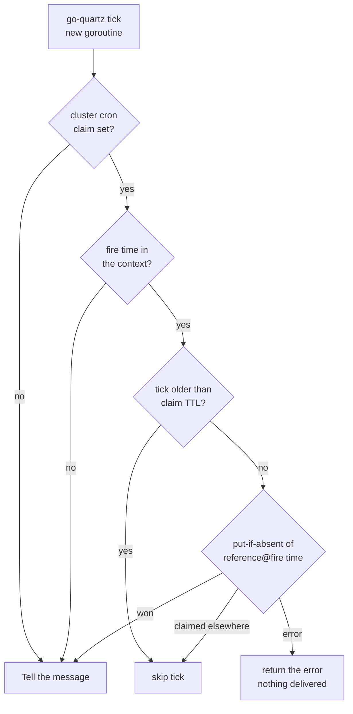
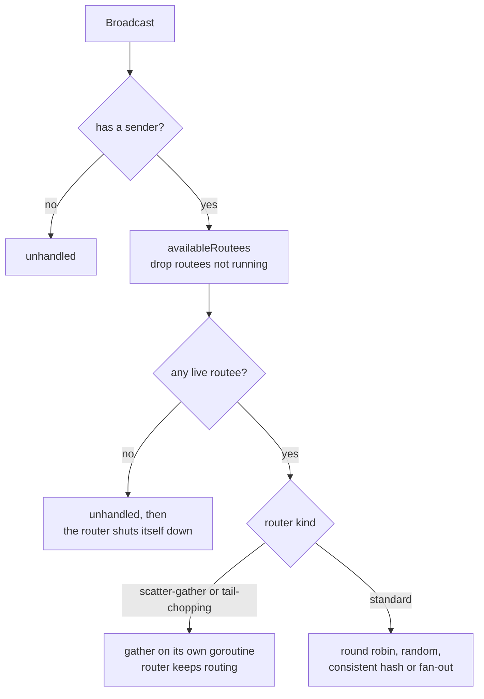
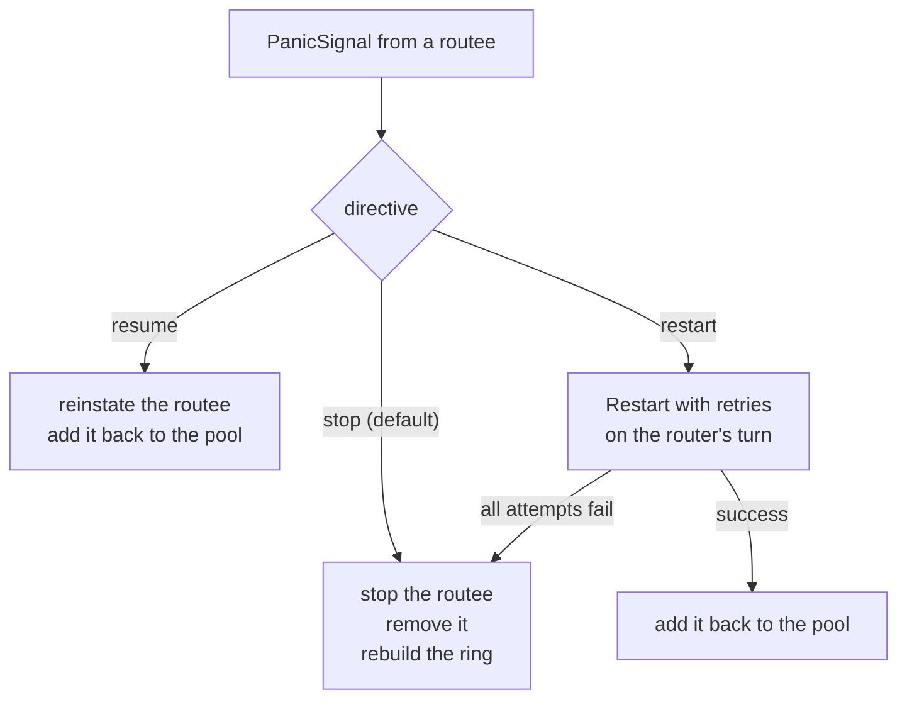
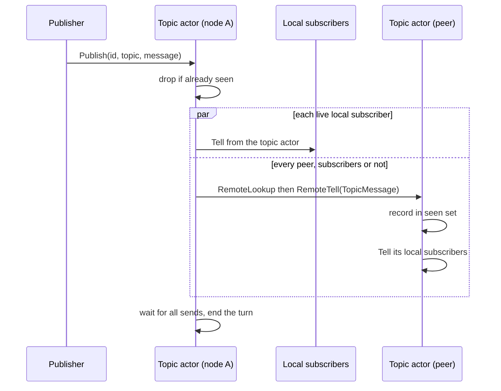

# 11. Scheduling, Routers, Event Stream, Pub/Sub

## Contents

- [What you will learn](#what-you-will-learn)
- [11.1 The scheduler](#111-the-scheduler)
  - [Registering](#registering)
  - [Firing](#firing)
  - [Cron in a cluster](#cron-in-a-cluster)
  - [Managing schedules](#managing-schedules)
- [11.2 Routers](#112-routers)
  - [Routing a message](#routing-a-message)
  - [When a routee fails or stops](#when-a-routee-fails-or-stops)
  - [Resizing](#resizing)
- [11.3 The event stream](#113-the-event-stream)
- [11.4 Publish and subscribe](#114-publish-and-subscribe)
- [Guarantees](#guarantees)
- [Implementation details (may change)](#implementation-details-may-change)
- [Behaviours to know](#behaviours-to-know)

## What you will learn

- How the scheduler wraps go-quartz, what it delivers on each tick, and what it keeps track of.
- How a cron schedule fires once per tick across a [cluster](chap-20.md#206-claims-fences-and-scans).
- What a router is, how each routing strategy picks routees, and what happens when a routee fails or stops ([supervision](chap-09.md#95-escalation-and-the-guardians)).
- How the event stream delivers system events, and what a subscriber must do to read them.
- How the topic actor implements publish and subscribe, locally and across nodes ([remoting](chap-16.md)).

## 11.1 The scheduler

The scheduling methods of `ActorSystem` ([Chapter 3](chap-03.md)) forward to a private `scheduler` (`actorSystem.Schedule` in `actor/actor_system.go`). Their `ctx` argument is not used. Functions and types in this section are in `actor/scheduler.go` unless another file is named.

**The engine** is a go-quartz `StdScheduler`, created with its logging off, job metadata on and an "outdated" threshold of 24 hours (`newScheduler`). The comment explains the threshold: with go-quartz's default of 100 ms, a one-shot that runs a little late is dropped.

**Lifecycle.** Each `ActorSystem.Start` builds a new scheduler and starts it once the start chain has run, before the replicator, the passivation manager and eviction start ([Chapter 3, §3.3](chap-03.md#33-start), [Chapter 10](chap-10.md); `actorSystem.startMessagesScheduler` in `actor/actor_system.go`). Shutdown stops it before any actor ([§3.5](chap-03.md#35-stop)). `scheduler.Start` gives go-quartz a context of the scheduler's own, not the one passed to `ActorSystem.Start`: go-quartz stops itself when its context ends, and the application's start context, often a `WithTimeout`, must not take every schedule with it. `scheduler.Stop` clears the queue, stops go-quartz and cancels that context. Then, with the scheduler's lock released, it waits for running jobs for at most the shutdown timeout (`DefaultShutdownTimeout`, 5 minutes, in `actor/defaults.go`), and empties the bookkeeping maps. A scheduler that never started ignores `Stop`.

**Counters.** The scheduler counts the schedules it accepted and the cancellations it honoured; they feed `scheduler.scheduled.count` and `scheduler.cancelled.count` ([Chapter 12, §12.4](chap-12.md#124-opentelemetry-instruments)). A restart of the system builds a new scheduler and zeroes them.

### Registering

Every registering method follows one pattern (`scheduler.ScheduleOnce`):

1. Under the scheduler's lock, fail with `ErrSchedulerNotStarted` unless started.
2. For a remote PID ([Chapter 16](chap-16.md)) without remoting, fail with `ErrRemotingDisabled`. For a grain ([Chapter 13](chap-13.md)), validate the identity (`NewErrInvalidGrainIdentity` wraps the failure).
3. Take the reference from `WithReference`, or generate a UUID (`newScheduleConfig` in `actor/schedule_option.go`).
4. Build the job: a closure that sends the message.
5. Hand the job to go-quartz, and **record the reference and its target only once go-quartz has accepted it**. A reference still in use is rejected by go-quartz with `ErrJobAlreadyExists`, and the recorded target stays the original one.
6. Count the schedule.

The cron methods first build the trigger, so an invalid expression fails before the reference is taken.

| Method | go-quartz trigger | First fire |
|---|---|---|
| `ScheduleOnce`, `ScheduleGrainOnce` | `RunOnceTrigger(delay)` | after `delay` |
| `Schedule`, `ScheduleGrain` | `SimpleTrigger(interval)` | after one `interval`, then every `interval` |
| `ScheduleWithCron`, `ScheduleGrainWithCron` | `CronTriggerWithLoc(expr, location)` | the next cron instant |

Neither `delay` nor `interval` is validated (`scheduler.Schedule`).

### Firing

go-quartz runs one loop goroutine and, with no worker limit, which is how GoAkt configures it, **starts a new goroutine for every tick**. A recurring job is rescheduled before it runs, whatever happened on its previous run, so an error never removes it. A job panic is recovered, and a failed run is not retried (the job's retry count is zero).

The actor job (`scheduler.makeJobFn`) resolves its sender once, at registration: `WithSender`, or the system's `NoSender` actor, which is not `nil` ([Chapter 3, §3.4](chap-03.md#34-the-guardian-tree)). On each tick it runs the cluster claim, if any ([below](#cron-in-a-cluster)), then `sender.Tell(ctx, to, message)` ([Chapter 5, §5.1](chap-05.md#51-three-ways-to-send)). Three things follow from this closure:

- `Tell` to an actor that is not running fails with `ErrDead` before any dead letter is built ([Chapter 5, §5.4](chap-05.md#54-dead-letters)), so a tick to a stopped, suspended, stopping or passivating actor is lost without trace (`PID.tell` in `actor/pid.go`). A passivated actor ([Chapter 10](chap-10.md)) is not reactivated by its schedules; a grain is, because the grain job (`scheduler.makeGrainJobFn`) calls `TellGrain` ([Chapter 13, §13.4](chap-13.md#134-finding-a-grain)) with `WithOneWay()` and ignores `WithSender`.
- The closure holds the **PID**, not the name. A recurring schedule whose target stopped keeps firing into it, and an actor later spawned under the same name does not receive it. Cancel the schedule yourself.
- The same message value is sent on every tick, and two ticks can be in flight at once, on two goroutines.

### Cron in a cluster

A cron schedule should fire once per tick across the cluster, even though every node registers it (`scheduler.ScheduleWithCron`):

- Cluster mode is detected from the cluster engine rather than from `InCluster()`, because the engine is wired before the scheduler starts while the started flag is set after.
- In a cluster the expression is evaluated in UTC, otherwise in local time.
- `WithReference` is required in a cluster (`ErrScheduleReferenceRequired` otherwise), so every node uses the same reference.
- At each tick, `scheduler.claimClusterFire` writes the key `<reference>@<fire time>` (the tick's fire time in Unix nanoseconds, read from the job metadata) with put-if-absent and an expiry (`ClaimScheduleFire`, [Chapter 20, §20.6](chap-20.md#206-claims-fences-and-scans)); only the node that wins delivers. A tick with no metadata in its context is delivered without a claim. The expiry is the gap between the first two fire times after registration, clamped between one minute and 24 hours (`cronClaimTTL`). A tick older than that expiry is skipped without claiming: go-quartz replays missed ticks, and a late node could otherwise win an expired claim and deliver a second time.

The claim is keyed by the reference alone. If each node registers the cron against its own local actor, one of those actors receives each tick, not each of them. Interval and one-shot schedules never claim: they fire on every node that registered them.

### Managing schedules

`CancelSchedule`, `PauseSchedule` and `ResumeSchedule` forward to go-quartz by reference; an unknown reference gives `ErrScheduledReferenceNotFound`. `ListSchedules` walks the recorded references and keeps those go-quartz still knows. Each `ScheduleInfo` carries the reference and either an actor `Path` or a `Grain` identity.

A one-shot releases its reference when it fires, before the delivery (`scheduler.oneShotJobFn` and `scheduler.releaseSchedule`): cancelling, pausing or resuming it afterwards returns `ErrScheduledReferenceNotFound`, and the reference can be used again.

Resuming a paused **one-shot** needs care: go-quartz's `ResumeJob` asks the run-once trigger for its next fire time, which it reports as expired, and drops the job. `ResumeSchedule` therefore reschedules a paused one-shot itself, for its original fire time, or at once when that time has passed (`scheduler.ResumeSchedule` and `scheduler.resumeOneShot`). Resuming a one-shot that is not paused is an error (`quartz.ErrJobIsActive`).

## 11.2 Routers

Functions and types in this section are in `actor/router.go` unless another file is named.

**A router is an actor.** `SpawnRouter` spawns it through `ActorSystem.Spawn` ([Chapter 4, §4.2](chap-04.md#42-the-local-spawn-path-step-by-step)) with relocation disabled ([Chapter 21, §21.3](chap-21.md#213-what-relocates)), long-lived, flagged as a system actor ([Chapter 3, §3.4](chap-03.md#34-the-guardian-tree)), and supervised to resume on any error (`actorSystem.SpawnRouter` in `actor/spawn.go`; [Chapter 9](chap-09.md)). Its defaults are fan-out routing and the stop directive for failing routees (`newRouter`). `router.PreStart` ([Chapter 4, §4.4](chap-04.md#44-prestart-retries-and-the-timeout-that-is-not-one)) validates the settings:

| Setting | Error |
|---|---|
| pool size not positive | `ErrInvalidRouterPoolSize` |
| tail-chopping with `interval` or `within` not positive | `ErrTailChopingRouterMisconfigured` |
| scatter-gather with `within` not positive | `ErrScatterGatherFirstRouterMisconfigured` |
| consistent hash without a key extractor | `ErrConsistentHashRouterMisconfigured` |

**Routees are children** ([Chapter 4, §4.6](chap-04.md#46-children)). On `PostStart` the router spawns its routees and switches to its `broadcast` behaviour (`router.postStart`; [Chapter 8, §8.3](chap-08.md#83-behaviours)). Each routee is a **zero value** of the routee type, created with `reflect.New`, so any field set on the value passed to `SpawnRouter` is lost. It is named `<router>Routee<i>`, flagged as a system actor, long-lived, relocation disabled, and supervised to escalate every error to the router (`router.spawnRoutees`). The router keeps its routees in a slice in spawn order, next to a map keyed by ID; a routee put back after a restart or a resume goes to the end of the slice. Both are touched only on the router's own turn ([Chapter 7, §7.3](chap-07.md#73-one-turn)).

**What a router accepts** (`router.Receive` and `router.broadcast`): `Broadcast` wrapping the real message, `PanicSignal` from a routee, `GetRoutees` (replies with the names of the live routees) and `AdjustRouterPoolSize`. Everything else is unhandled and becomes a dead letter ([Chapter 5, §5.4](chap-05.md#54-dead-letters)).

### Routing a message

`router.handleBroadcast` first checks the sender: a `Broadcast` without one is unhandled. It then collects the routees with `router.availableRoutees`, which walks the slice, removes every routee that is no longer running (from the slice, the map and the hash ring) and returns the rest in the stable order. A routee that stopped by itself is therefore never chosen. With no live routee, the message is unhandled and the router shuts itself down (`router.handleNoRoutees`). Otherwise `router.dispatchToRoutees` hands the message to the strategy.

| Strategy | How it picks | Sender the routee sees |
|---|---|---|
| Round robin | a counter indexes the live routees in stable order, so they take turns in spawn order | router |
| Random | `rand.IntN` | router |
| Consistent hash | the key from the extractor, looked up on a hash ring of 150 points per routee by default, rebuilt whenever the pool changes; an empty key, or a routee that is missing or not running, falls back to random | router |
| Fan-out (default) | every routee, told from the router's turn, so each routee receives the broadcasts in order | router |
| Scatter-gather first | asks every routee; replies with the first success, or a `StatusFailure` when every ask failed or `within` elapsed | `NoSender` |
| Tail-chopping | asks one routee in random order, then another every `interval`, until a success or `within` | `NoSender` |

The strategies are in `router.routeByStrategy`, `router.routeByConsistentHash` and `consistentHashRing`; the asking ones are in `gather.scatterGatherFirst` and `gather.tailChopping`. The router kind set by `AsScatterGatherFirst` or `AsTailChopping` takes precedence over the routing strategy. The ring hashes with the default hasher (xxh3, `hash.DefaultHasher` in `hash/hasher.go`) unless `WithConsistentHashHasher` replaces it, and `WithConsistentHashRouter` resets the hasher and the virtual-node count, so those two options only take effect when given after it.

Two consequences for routee code:

- **The original sender is never visible.** A routee that answers `ctx.Sender()` answers the router, which treats the reply as unhandled. The two asking strategies send the outcome to the original sender themselves, as a `Tell` from the router (`gather.reply`), never as a reply to an `Ask` ([Chapter 5, §5.3](chap-05.md#53-how-a-reply-gets-back)): an `Ask` sent to the router gets no reply.
- **The asking strategies do not hold the router.** A `gather` captures the sender, the payload and a context from the turn, and runs the asks and the wait on its own goroutine, bounded by `within`; the router's `Receive` returns at once and keeps routing (`router.newGather`).

### When a routee fails or stops

A routee's error escalates: the routee is suspended and the router receives a `PanicSignal` ([Chapter 9, §9.5](chap-09.md#95-escalation-and-the-guardians)). `router.handlePanicSignal` applies the router's directive:

- **stop** (the default): stop the routee, remove it from the pool, rebuild the hash ring.
- **restart** (`WithRestartRouteeOnFailure(maxRetries, timeout)`): `Restart` the routee ([Chapter 9, §9.6](chap-09.md#96-the-restart-itself)), with at most `maxRetries` attempts (the first included) and an exponential backoff whose interval starts at, and is capped by, `timeout`, each wait randomised by up to half of it (`Retrier.RunContext` in `internal/retry/retry.go`), all on the router's turn. With zero attempts or no positive `timeout` it tries once. If that fails, it stops the routee.
- **resume** ([Chapter 9, §9.7](chap-09.md#97-reinstate)): reinstate it and put it back into the pool. A broadcast handled while the routee was suspended has already removed it, since a suspended routee is not running.

The router does not watch its routees ([death watch](chap-09.md#98-death-watch)). A routee that stops by itself is noticed only when `availableRoutees` next runs.

### Resizing

`AdjustRouterPoolSize` adds or removes routees (`router.handleAdjustRouterPoolSize`). New routees are named from a counter that only grows, so a name never collides with a live routee's after a removal, and the pool grows by the requested number. A negative delta stops the first live routees in pool order, at most the live count. Shrinking to zero is allowed; the next `Broadcast` then shuts the router down. A shrink when no routee is live does nothing.

## 11.3 The event stream

One `EventsStream` per actor system is created by `NewActorSystem` (`actor/actor_system.go`) and reused across a `Stop` and `Start`; stopping closes it, which deactivates every subscriber and forgets every topic, so a subscriber must be created again after a restart ([Chapter 3, §3.5](chap-03.md#35-stop)). The system publishes on a single topic, `topic.events` (`eventsTopic` in `actor/reserved.go`). `ActorSystem.Subscribe` and `ActorSystem.Unsubscribe` require a running system. Functions and types here are in `eventstream/eventstream.go` or `eventstream/subscriber.go` as named.

**Publishing is synchronous.** `EventsStream.Publish` takes a read lock, copies the topic's subscribers, and signals each active one on the publisher's goroutine (`EventsStream.publishToTopic`). A topic with no subscriber drops the message. The publisher is whichever goroutine reaches the event: the caller of `Spawn` or `Shutdown`, an actor's own turn, the dead-letter actor, the cluster event handler, or the supervision goroutine, which publishes `ActorSuspended` ([Chapter 7, §7.6](chap-07.md#76-failures-leave-the-turn)).

**Each subscriber has an unbounded queue** (`subscriber.signal`). A publisher never blocks and never drops, so a subscriber that does not read grows without bound. The queue is a lock-free linked list (`Queue.Enqueue` and `Queue.Dequeue` in `internal/queue/queue.go`); a dequeued node is left to the garbage collector rather than reused, because a producer may still hold it as the tail.

**Reading.** `subscriber.Iterator` reads the current length, makes a channel of that size, moves that many messages into it, closes it and returns it. It is a snapshot: a consumer must call it again to see later events. Each element is a `Message` with a `Topic` and a `Payload`.

**What the system publishes:**

| Event | Published from | Source |
|---|---|---|
| `ActorStarted` | the end of `init`, built only when the topic has a subscriber at that moment | `PID.init` in `actor/pid.go` |
| `ActorStopped` | `PID.stop` (reached from `Shutdown`, [Chapter 3, §3.5](chap-03.md#35-stop)), after `doStop`, built only when the topic has a subscriber at that moment | `PID.stop` in `actor/pid.go` |
| `ActorPassivated` | passivation ([Chapter 10, §10.5](chap-10.md#105-one-attempt)) | `PID.tryPassivation` in `actor/pid.go` |
| `ActorChildCreated` | the parent, after spawning a child, built only when the topic has a subscriber at that moment | `PID.spawnChildLocal` in `actor/pid.go` |
| `ActorRestarted` | the end of a restart ([Chapter 9, §9.6](chap-09.md#96-the-restart-itself)) | `restartSubtree` in `actor/pid.go` |
| `ActorSuspended`, `ActorReinstated` | `suspend`, `doReinstate` | `PID.suspend` and `PID.doReinstate` in `actor/pid.go` |
| `Deadletter` | the dead-letter actor, one by one or in a batch ([Chapter 5, §5.4](chap-05.md#54-dead-letters)) | `deadLetter.handleDeadletter` and `deadLetter.handlePublishDeadletters` in `actor/dead_letter.go` |
| `NodeJoined`, `NodeLeft`, `LeaderChanged` | the cluster event handler ([Chapter 20, §20.9](chap-20.md#209-cluster-events)) | `actorSystem.handleClusterEvent` in `actor/actor_system.go` |
| `RelocationStarted`, `RelocationFailed` | relocation of a departed peer's actors and grains ([Chapter 21](chap-21.md)) | `actorSystem.publishRelocationStarted` in `actor/actor_system.go`, `relocationWorker.relocate` in `actor/relocation_worker.go` and `publishRelocationFailed` in `actor/relocator.go` |
| `ReliableDeliveryFailed` | a reliable-delivery controller that gives up ([Chapter 23](chap-23.md)) | `producerController.publishFailure` in `actor/reliable_delivery_producer_controller.go`, `consumerController.fail` in `actor/reliable_delivery_consumer_controller.go` and `workPullingProducerController.publishFailure` in `actor/reliable_delivery_work_pulling_controller.go` |

## 11.4 Publish and subscribe

Functions and types in this section are in `actor/topic_actor.go`.

**The topic actor** is a system actor ([Chapter 3, §3.4](chap-03.md#34-the-guardian-tree)) named `GoAktTopicActor`, long-lived and supervised to resume on any error, spawned at `Start` when the system runs in a cluster or has `WithPubSub()` (`actorSystem.spawnTopicActor`). It keeps, per topic, a map of subscribers, and a time-limited set of the publications it has seen, keyed by publisher, topic and publication ID (`topicActor`). Retention is two minutes by default (`DefaultMessageRetention` in `actor/defaults.go`) and `WithMessageRetention` changes it.

**Subscribe** adds the sender to the topic, watches it ([Chapter 9, §9.8](chap-09.md#98-death-watch)), and acknowledges (`topicActor.handleSubscribe`); a sender that is not running is ignored without an acknowledgement. **Unsubscribe** removes it and acknowledges, even for a topic it was not subscribed to (`topicActor.handleUnsubscribe`). When a subscriber terminates it is removed from every topic (`topicActor.handleTerminated`). A topic exists only while it has subscribers: the last one leaving removes it (`topicActor.forgetTopicIfEmpty`).

**Publish** (`topicActor.handlePublish`):

1. Drop the publication if the same sender already published the same ID on the same topic within the retention window; otherwise record it.
2. Deliver locally: one goroutine per live local subscriber, each a `Tell` **from the topic actor**, so subscribers see the topic actor as sender, not the publisher (`topicActor.sendToLocalSubscribers`). A subscriber that is gone or not running is dropped from the topic.
3. In a cluster, send the publication to **every** peer's topic actor ([Chapter 20, §20.8](chap-20.md#208-peers-members-and-the-leader)), each from a goroutine doing a `RemoteLookup` and a `RemoteTell` ([Chapter 16, §16.7](chap-16.md#167-sending-a-tell)), whether or not that peer has subscribers (`topicActor.sendToRemoteTopicActors`). The message is serialized with the remoting serializer for its type ([Chapter 17, §17.2](chap-17.md#172-serializers)); a lookup, serialization or send failure is logged and that peer is skipped.
4. Wait for all of these before the turn ends. Every enqueue of one publication therefore happens before the next publication starts, which keeps per-subscriber order; and one slow peer slows every publication on the node.

A peer's topic actor delivers a `TopicMessage` to its local subscribers the same way, waits for those sends, and records it in its seen-set keyed by the sending topic actor, so a message redelivered by the same peer is dropped (`topicActor.handleTopicMessage`). It does not forward the message again.

**TopicStats** (`ActorSystem.TopicStats`, which fails with `ErrTopicActorNotStarted` when there is no topic actor) asks the local topic actor for its number of live subscribers. Its instance count is 1 when the node has at least one live subscriber, and 0 otherwise.

In a cluster it asks every peer's topic actor for its subscriber count and adds 1 for each peer with a non-zero count. The instance count is therefore the number of nodes with subscribers.

That fan-out runs on a goroutine that replies to the asker when done, so the topic actor's turn ends at once and it can answer the peers' own requests meanwhile (`topicActor.handleGetTopicStats` and `topicActor.queryRemotePeerInstanceCount`). An error from any peer means no reply, so the caller sees its own timeout.

## Guarantees

| Statement | Enforced by |
|---|---|
| A one-shot is delivered once and leaves go-quartz; twenty in a row are all delivered | `TestScheduler` in `actor/scheduler_test.go` |
| Scheduling to a stopped actor is accepted and delivers nothing; scheduling on a stopped scheduler fails | `TestScheduler` in `actor/scheduler_test.go` |
| An interval schedule first fires one interval after registration and stays registered, even when its target is stopped | `TestScheduler` in `actor/scheduler_test.go` |
| A remote PID without remoting is rejected | `TestScheduler` in `actor/scheduler_test.go` |
| Pause and resume work for an interval schedule; cancel stops deliveries; an unknown reference gives `ErrScheduledReferenceNotFound` | `TestScheduler` in `actor/scheduler_test.go` |
| A cluster cron needs `WithReference`, and is evaluated in UTC; outside a cluster it uses local time | `TestScheduler` and `TestScheduleWithCronTimezone` in `actor/scheduler_test.go` |
| The claim expiry is the cron period clamped to one minute and 24 hours; a stale tick or a claimed tick is skipped | `TestCronClaimTTL` and `TestClaimClusterFire` in `actor/scheduler_test.go` |
| A grain cron registered on three nodes does not multiply its deliveries; two nodes registering one reference for an interval each deliver their own | `TestGrainSchedulerMultiNode` in `actor/scheduler_test.go` |
| `ListSchedules` lists a schedule until it is cancelled or, for a one-shot, until it fires | `TestSchedulerListSchedules` in `actor/scheduler_test.go` |
| A live reference cannot be reused; a delivery to a passivated grain activates it again | `TestGrainScheduler` in `actor/scheduler_test.go` |
| The scheduler survives a cancelled start context; a fired one-shot releases its reference; a rejected duplicate keeps the listed target; a paused one-shot resumes | `TestSchedulerSurvivesCanceledStartContext`, `TestSchedulerFiredOneShotReleasesReference`, `TestSchedulerDuplicateReferenceKeepsTarget` and `TestSchedulerPauseResumeOneShot` in `actor/scheduler_test.go` |
| Fan-out reaches every routee; scatter-gather and tail-chopping relay the first success, or one `StatusFailure` | `TestRouter` in `actor/router_test.go` |
| With no routee left, the next broadcast becomes a dead letter and the router stops | `TestRouter` in `actor/router_test.go` |
| Invalid pool size, strategy settings or missing key extractor fail `SpawnRouter` | `TestRouter` in `actor/router_test.go` |
| The restart, resume and stop directives apply to a failing routee | `TestRouter` in `actor/router_test.go` |
| The pool can be resized | `TestRouter` in `actor/router_test.go` |
| Consistent hashing sends one key to one routee, an empty key falls back to random, and the ring remaps only a fraction of keys when members change | `TestRouter` and `TestConsistentHashRing` in `actor/router_test.go` |
| Round robin rotates in order; fan-out keeps per-routee order; a stopped routee is dropped before routing; a resumed routee rejoins the pool; scale-up after a removal grows the pool; the asking strategies do not block the router | `TestRouterRoundRobinRotatesInOrder`, `TestRouterFanOutPreservesPerRouteeOrder`, `TestRouterDropsStoppedRouteeBeforeRouting`, `TestRouterResumeReinsertsRoutee`, `TestRouterScaleUpAfterRemovalGrowsPool`, `TestRouterScatterGatherDoesNotBlockRouter` and `TestRouterTailChoppingDoesNotBlockRouter` in `actor/router_test.go` |
| Publish reaches every active subscriber; inactive ones receive nothing; `Iterator` drains what is buffered; closing the stream shuts every subscriber down | `TestStream` in `eventstream/eventstream_test.go` |
| Many producers deliver every value once through the subscriber queue | `TestQueueConcurrentProducersDeliverEveryValueOnce` in `internal/queue/queue_test.go` |
| Subscribe and unsubscribe are acknowledged; a publish reaches subscribers on all three nodes | `TestTopicActor` in `actor/topic_actor_test.go` |
| A repeated ID is not delivered again within the retention window, and is delivered again after it | `TestTopicActor` in `actor/topic_actor_test.go` |
| A terminated subscriber is removed; an empty topic is forgotten | `TestTopicActor` in `actor/topic_actor_test.go` |
| `TopicStats` counts live local subscribers and agrees across nodes; it fails with `ErrTopicActorNotStarted` without a topic actor; the peer query behind it fails when a peer is unreachable; concurrent queries across the cluster answer | `TestTopicActor` in `actor/topic_actor_test.go` |

## Implementation details (may change)

- go-quartz v0.15.2, with a 24-hour outdated threshold and one goroutine per tick, on a context of the scheduler's own.
- UUID references by default; the claim key `<reference>@<fire time>`.
- Router default of fan-out routing and the stop directive, 150 virtual nodes per routee, xxh3 hashing.
- The event topic `topic.events`.
- The topic actor's name and its two-minute default retention.

## Behaviours to know

| Behaviour | Source |
|---|---|
| The scheduler is not bound to the context passed to `ActorSystem.Start` | `scheduler.Start` in `actor/scheduler.go` |
| Without `WithSender`, the sender is the `NoSender` actor, not `nil`; a grain schedule ignores `WithSender` | `scheduler.makeJobFn` and `scheduler.makeGrainJobFn` in `actor/scheduler.go` |
| A tick to an actor that is not running is lost without a dead letter; a recurring schedule outlives its target | `scheduler.makeJobFn` in `actor/scheduler.go` |
| A fired one-shot releases its reference, which can then be used again | `scheduler.oneShotJobFn` in `actor/scheduler.go` |
| A paused one-shot resumes for its original fire time, at once if that time has passed | `scheduler.resumeOneShot` in `actor/scheduler.go` |
| `CancelSchedule` removes the bookkeeping entry even when go-quartz returns an error from the delete | `scheduler.CancelSchedule` in `actor/scheduler.go` |
| A cluster cron delivers each tick to one node's target | `scheduler.claimClusterFire` in `actor/scheduler.go` |
| Routees start from the zero value of their type | `router.spawnRoutees` in `actor/router.go` |
| Round robin rotates in spawn order; fan-out keeps each routee's order | `router.routeByStrategy` in `actor/router.go` |
| A routee that stopped by itself is dropped before the next message is routed | `router.availableRoutees` in `actor/router.go` |
| Scatter-gather and tail-chopping run off the router's turn | `router.newGather` in `actor/router.go` |
| Scatter-gather fails at once when every ask failed, and at `within` otherwise | `gather.scatterGatherFirst` in `actor/router.go` |
| Tail-chopping asks the next routee only on an interval tick, even when the previous ask failed at once; when `interval` is not below `within`, it asks one routee only | `gather.tailChopping` in `actor/router.go` |
| The restart directive's attempts and delay come only from `WithRestartRouteeOnFailure` | `WithRestartRouteeOnFailure` in `actor/router_option.go` |
| `WithConsistentHashVirtualNodes` and `WithConsistentHashHasher` are overwritten by a later `WithConsistentHashRouter` | `WithConsistentHashRouter` in `actor/router_option.go` |
| An event-stream subscriber that does not read grows without bound; `Iterator` is a snapshot | `subscriber.Iterator` and `subscriber.signal` in `eventstream/subscriber.go` |
| Stopping the actor system closes the event stream, so subscribers do not survive a restart | `EventsStream.Close` in `eventstream/eventstream.go` |
| Pub/sub subscribers see the topic actor as sender | `topicActor.sendToLocalSubscribers` in `actor/topic_actor.go` |
| Every publication goes to every peer, and a slow peer slows every publication | `topicActor.sendToRemoteTopicActors` in `actor/topic_actor.go` |
| The publishing node keys its seen-set by publisher, a receiving node by the sending topic actor, so on a peer two publishers reusing one ID within the retention window share a key | `topicActor.handlePublish` and `topicActor.handleTopicMessage` in `actor/topic_actor.go` |
| The publication is recorded as seen before the peer list is read; when reading it fails, the turn ends with an error, the peers are not sent the message, and a retry with the same ID is dropped | `topicActor.handlePublish` in `actor/topic_actor.go` |
| A topic exists only while it has subscribers | `topicActor.forgetTopicIfEmpty` in `actor/topic_actor.go` |
| The `TopicStats` instance count is the number of nodes with a live subscriber, not the number of subscribers; its peer fan-out runs off the topic actor's turn | `topicActor.handleGetTopicStats` in `actor/topic_actor.go` |
