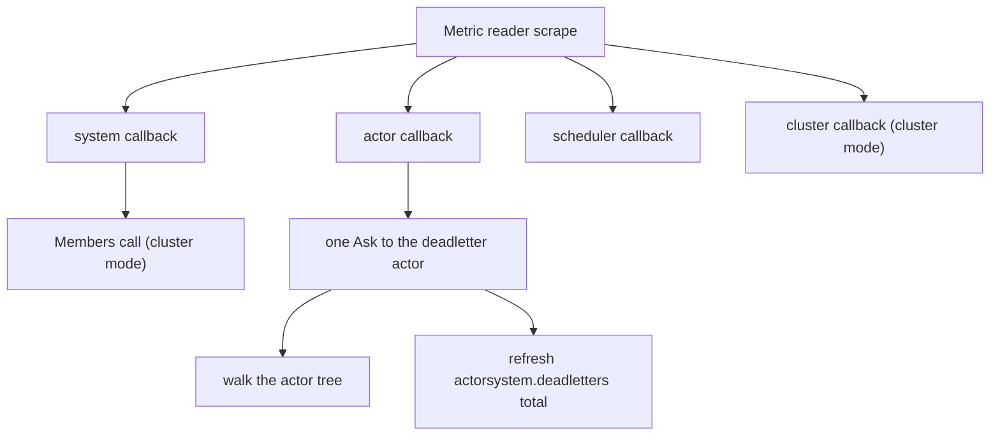

# 12. Extensions, Dependencies, Observability, Logging

## Contents

- [What you will learn](#what-you-will-learn)
- [12.1 Extensions](#121-extensions)
- [12.2 Dependencies](#122-dependencies)
- [12.3 Metric snapshots](#123-metric-snapshots)
  - [What each counter counts](#what-each-counter-counts)
- [12.4 OpenTelemetry instruments](#124-opentelemetry-instruments)
  - [The instruments](#the-instruments)
  - [What one scrape costs](#what-one-scrape-costs)
- [12.5 Logging](#125-logging)
- [Guarantees](#guarantees)
- [Implementation details (may change)](#implementation-details-may-change)
- [Behaviours to know](#behaviours-to-know)

## What you will learn

- What an extension is, how [the actor system](chap-03.md) registers and validates it, and why it has no lifecycle.
- How dependencies are stored per actor, what a restart does to them, and how they cross nodes ([Chapter 21, §21.10](chap-21.md#2110-inside-one-relocation)).
- How the metric snapshots (`ActorSystem.Metric`, `PID.Metric`) are computed, and what each counter really counts.
- Which OpenTelemetry instruments exist (including those of the [scheduler](chap-11.md), the cluster and the [CRDT replicator](chap-24.md)), how they are registered, and what one scrape costs.
- How logging is wired: the `Logger` interface, its three implementations, and why every actor shares one logger.

## 12.1 Extensions

An extension is anything with an `ID() string` (`Extension` in `extension/extension.go`). The interface has nothing else: no `Start`, no `Stop`. The runtime calls `ID()` and nothing more, so it never starts or closes an extension: the application owns its lifecycle around `NewActorSystem` ([Chapter 3, §3.2](chap-03.md#32-construction-newactorsystem)) and `Stop` ([Chapter 3, §3.5](chap-03.md#35-stop)).

**Registration.** `WithExtensions` stores each extension in a map keyed by its ID (`actor/option.go`). `Set` overwrites, so a second extension with the same ID silently replaces the first, although the option's comment asks for unique IDs.

**Validation.** `NewActorSystem` validates every ID after applying the options (`actorSystem.validate` and `actorSystem.validateExtensions` in `actor/actor_system.go`) with the same validator dependencies use (`idValidator.Validate` in `internal/validation/id.go`):

```go
trimmed := strings.TrimSpace(v.id)
return New(FailFast()).
	AddAssertion(len(trimmed) > 1 && len(trimmed) <= 255, "invalid id").
	AddValidator(NewRegexpValidator(idRegexp, trimmed, ...)).
```

Two consequences, which the interface's comment states (`Extension` in `extension/extension.go`):

- **An ID needs at least two characters.** `"a"` fails with `invalid id`.
- **The ID is validated trimmed but stored as given.** `" store"` passes validation, is stored under `" store"`, and `Extension("store")` returns `nil`.

**Retrieval.** `Extensions()` returns the map's values, in no particular order, and `Extension(id)` returns one or `nil` (`actor/actor_system.go`). The three context types ([Chapter 8, §8.2](chap-08.md#82-what-a-handler-can-do)) delegate to the system: `ReceiveContext` (`actor/receive_context.go`), `Context` for `PreStart` and `PostStop` (`actor/context.go`) and `GrainContext` (`actor/grain_context.go`).

**Concurrency.** Nothing serializes calls to an extension. Many actors call it at once, from different [dispatcher workers](chap-07.md#71-the-pieces). The `ReceiveContext.Extension` comment (`actor/receive_context.go`) says the returned value is shared system-wide and should be treated as read-safe or used according to its own concurrency contract.

**The runtime's own extension.** In a cluster configured with CRDT replication, on a node that has the role the CRDT configuration requires, if any ([Chapter 24, §24.3](chap-24.md#243-the-replicator)), `Start` registers an internal extension with the ID `goakt.crdt.config` before it spawns the replicator, and sets it again on every `Start` (`crdtConfigExtensionID` and `actorSystem.spawnReplicator` in `actor/replicator.go`). It is added after validation, so its dots are accepted; no user ID can contain a dot, so it cannot collide with one. It does appear in every `ctx.Extensions()`.

Extensions survive a `Stop` followed by a `Start` of the same system ([Chapter 3, §3.7](chap-03.md#37-starting-again)): the shutdown `reset` leaves the map alone (`actor/actor_system.go`).

## 12.2 Dependencies

A dependency is an extension that can be serialized: `ID()` plus `MarshalBinary` and `UnmarshalBinary` (`Dependency` and `Serializable` in `extension/dependency.go`). Extensions belong to the system; dependencies belong to one actor ([Chapter 4](chap-04.md)) and travel with it. A grain takes its own through `WithGrainDependencies` ([Chapter 13, §13.3](chap-13.md#133-configuration)).

**Configuration.** `WithDependencies` replaces the spawn configuration's list rather than appending to it, so only the last `WithDependencies` option counts (`actor/spawn_option.go`). The IDs are checked by the validator of [§12.1](#121-extensions) (`spawnConfig.Validate` in `actor/spawn_option.go`); duplicates are not detected, and the PID's map keeps the last dependency of a given ID.

**Type registration.** A dependency is rebuilt on another node from its type name, so its Go type must be in that node's type registry. A local `Spawn` ([Chapter 4, §4.2](chap-04.md#42-the-local-spawn-path-step-by-step)) registers it (`actorSystem.configPIDAt` in `actor/actor_system.go`), as does `SpawnChild` ([Chapter 4, §4.6](chap-04.md#46-children)) through `Inject` (`PID.spawnChildLocal` in `actor/pid.go`). `ActorSystem.Inject` only registers types, and fails before `Start`. The registry key is the lower-cased `reflect.Type.String()` of the pointed-to type, computed once per type and cached (`Name`, `lowTrim` and `typeNames` in `internal/types/registry.go`), for example `db.client`: the package name and type name, without the import path. Two types with the same package and type name in different modules collide. `reflectType` calls `Elem()`, so a dependency must be a pointer.

**Storage.** The PID keeps its dependencies in a concurrent map keyed by ID (`withDependencies` in `actor/pid_option.go`; `actor/pid.go`). `PID.Dependency(id)` scans `PID.Dependencies()`; on a remote PID ([Chapter 16](chap-16.md)), each of these calls is a network round trip, and any error, including a type not registered locally, comes back as `nil`. `ReceiveContext` reads the PID's map (`actor/receive_context.go`). The `Context` given to `PreStart` and `PostStop` gets a copy taken when the context is built (`PID.init` in `actor/pid.go`; `actor/context.go`).

**Across a stop.** The stop path builds `PostStop`'s context before the deferred `reset` runs, so `PostStop` sees the dependencies (`PID.doStop` in `actor/pid.go`). A terminal stop then empties the map; the teardown inside a restart ([Chapter 9, §9.6](chap-09.md#96-the-restart-itself)) keeps it, like the other spawn-time configuration, so the new incarnation's `PreStart` sees the same dependencies and the cluster record keeps carrying them.

**Across nodes.** `codec.EncodeDependencies` writes each dependency as its ID, its type name and the bytes of `MarshalBinary` (`internal/codec/codec.go`). The actor's serialized record carries them (`PID.toSerialize` in `actor/pid.go`); it is written to the cluster registry ([Chapter 20, §20.4](chap-20.md#204-the-registry)) and to the snapshot a departing node hands over ([Chapter 21, §21.8](chap-21.md#218-graceful-leave-the-peer-state-snapshot)). On the receiving node, `dependencyFromBytes` looks the type name up (`ErrDependencyTypeNotRegistered` when absent), checks that the type implements `Dependency` (`ErrInstanceNotDependency`), allocates a fresh value with `reflect.New` and calls `UnmarshalBinary` (`reflection.dependenciesFromProto` in `actor/reflection.go`). The same decoding serves a remote spawn request ([Chapter 17, §17.6](chap-17.md#176-actor-lifecycle-and-query-handlers)), where a dependency that cannot be rebuilt fails the request, and the relocation of an actor ([Chapter 21, §21.10](chap-21.md#2110-inside-one-relocation)). What crosses nodes is bytes. A connection, a pool or a goroutine inside a dependency does not travel: `UnmarshalBinary`, or the first use, must rebuild it.

## 12.3 Metric snapshots

Two methods return a snapshot on demand.

**`ActorSystem.Metric`** returns `nil` unless the system is started (`actor/actor_system.go`). It asks the deadletter actor ([Chapter 5, §5.4](chap-05.md#54-dead-letters)) for its total and caches it (`actorSystem.getSetDeadlettersCount` in `actor/actor_system.go`), reads the host's memory, and reports the dead-letter total, the count of non-system actors, the system's uptime and the memory figures (`Metric` in `actor/metric.go`).

**`PID.Metric`** returns an `ActorMetric` (`actor/pid.go`, `actor/metric.go`), which holds ten values: dead letters, children, uptime, time since the last received message, restarts, processed messages, stash size, failures, reinstates and unhandled messages. It holds no mailbox size and no start time; those two exist only as the instruments of [§12.4](#124-opentelemetry-instruments).

- On a remote PID ([Chapter 16](chap-16.md)), it makes one `RemoteMetric` call and copies the same ten values from the answer. The owning node runs its own `PID.Metric` to produce them (`actorSystem.remoteMetricHandler` in `actor/remote_server.go`), so the owner asks its deadletter actor. Any error makes the caller's `Metric` return `nil`, and so does an owner whose actor is not running, because the handler answers not found.
- On a local PID that is not running, it returns `nil`. Suspended ([Chapter 9](chap-09.md)), stopping and passivating ([Chapter 10](chap-10.md)) actors are not running ([Chapter 4](chap-04.md)), so a suspended actor has no snapshot.
- Otherwise it reads the PID's counters and asks the deadletter actor for the dead letters addressed to this actor (`PID.getDeadlettersCount` in `actor/pid.go`).

The local `ActorSystem.Metric` and `PID.Metric` each send an `Ask` ([Chapter 5, §5.3](chap-05.md#53-how-a-reply-gets-back)) to the deadletter actor. Called from `Receive`, they hold the worker for up to the ask timeout.

### What each counter counts

| Value | Written | Zeroed by `reset` | Source |
|---|---|---|---|
| processed | in `handleReceived`, **before** the handler runs, for `PostStart`, user messages, `Terminated` ([Chapter 9, §9.8](chap-09.md#98-death-watch)) and request payloads ([Chapter 8, §8.5](chap-08.md#85-reentrancy-requests-that-do-not-block)); `PoisonPill`, `Panicking`, `PausePassivation` and `ResumePassivation` are handled by `dispatchOne` and not counted | yes | `PID.handleReceived`, `PID.dispatchOne` and `newPID` in `actor/pid.go` |
| last received time | `markActivity(now)`, with `now` read once per turn ([Chapter 7, §7.3](chap-07.md#73-one-turn)); `markActivity` skips an instant it already holds, so only the first message of the turn stores it; `doReinstate` also calls it | yes | `PID.runTurn`, `PID.markActivity` and `PID.reset` in `actor/pid.go` |
| restarts | `restartCount.Inc()` in `PID.init`, before the restarted actor is announced as running, so a reader that sees it running sees the restart | only on a terminal stop | `PID.init`, `PID.reset` and `newPID` in `actor/pid.go` |
| failures | `suspend`, and `notifyParent` for a failure resumed with a resume directive ([Chapter 9, §9.3](chap-09.md#93-the-parent-carries-it-out)) | only on a terminal stop | `PID.suspend`, `PID.notifyParent`, `PID.reset` and `newPID` in `actor/pid.go` |
| reinstates | `doReinstate`, unless the actor is running and not suspended ([Chapter 9, §9.7](chap-09.md#97-reinstate)) | yes | `PID.doReinstate` and `newPID` in `actor/pid.go` |
| unhandled | `ReceiveContext.Unhandled` | yes | `ReceiveContext.Unhandled` in `actor/receive_context.go`; `newPID` in `actor/pid.go` |
| start time | `newPID` after `init`, and `restartSubtree` after each restart's `init` | yes | `newPID` and `restartSubtree` in `actor/pid.go` |
| mailbox enqueued and dequeued | `putValue`, `doReceive`, `runTurn` and the stash replay, only when metrics are enabled | only on a terminal stop | `PID.putValue`, `PID.doReceive`, `PID.runTurn` and `PID.reset` in `actor/pid.go`; `PID.replayStash` in `actor/stash.go` |

Reading the table against the restart paths gives the values a user sees:

- **Processed** counts a message before its handler runs, so a message that fails is counted. `PID.Metric` subtracts one for `PostStart` once a message has been counted, so an actor that has not handled `PostStart` yet reads zero (`actor/pid.go`).
- **Processed on a remote PID** differs from a local read: `PID.ProcessedCount` on a local PID returns the raw count, `PostStart` included, while on a remote PID it returns the owner's `Metric` value, which excludes `PostStart` (`PID.ProcessedCount` and `PID.Metric` in `actor/pid.go`).
- **Restarts** accumulate across restarts, whether a supervisor decided them or `Restart` did; a terminal stop ends the count.
- **Start time** is set again after each restart's `init`, so the uptime is that of the current incarnation.
- **Failures** count the failures the supervisor acted on: suspensions, and failures resumed with a resume directive. They survive restarts.
- **Last processed duration** is `time.Since` the last received time: how long ago the turn that handled the last message started, not how long handling took (`PID.LatestProcessedDuration` in `actor/pid.go`).
- **Dead letters** in an actor's snapshot are those **addressed to** that actor, including the messages it rejected with `Unhandled`, because the deadletter actor keys its counts by receiver (`deadletterKey` in `actor/dead_letter.go`).
- **Mailbox size** is `enqueued − dequeued`, clamped at zero because the two loads are not taken together (`PID.observedMailboxSize` in `actor/pid.go`). It counts user messages only: control messages go to the system queue, and the message in flight has already been dequeued. A message put aside by the [stash](chap-08.md#84-the-stash) leaves the count when the turn takes it and joins it again when `replayStash` puts it back. A restart keeps the [mailbox](chap-06.md) ([Chapter 6, §6.8](chap-06.md#68-stops-restarts-and-other-nodes)), so it keeps both counts.

## 12.4 OpenTelemetry instruments

**Wiring.** `WithMetrics` creates a provider (`WithMetrics` in `actor/option.go`), which takes a meter from `otel.GetMeterProvider()` at that moment, under the instrumentation scope `github.com/Tochemey/goakt/v4/telemetry` (`instrumentationName` in `internal/metric/provider.go`). While no provider is installed, `otel.GetMeterProvider()` returns OpenTelemetry's default delegating provider. The delegate is set once: instruments taken from it forward to the first provider later installed with `otel.SetMeterProvider`, and to no later one (`SetMeterProvider` in the `go.opentelemetry.io/otel/internal/global` package). Every PID receives the provider (`actorSystem.configPID` in `actor/actor_system.go`) and, after `init` ([Chapter 4, §4.3](chap-04.md#43-inside-newpid)), caches its attributes: `actor.system`, `actor.name`, `actor.kind` and `actor.address`, or only the kind in low-cardinality mode (`PID.buildObserveOptions` in `actor/pid.go`).

**Registration.** `Start` calls `registerMetrics` once the system is started, and a failure stops the system and fails `Start` (`actor/actor_system.go`). `registerMetrics` creates the instruments (the relocation ones included) and registers one callback each for the system, the whole actor tree, the scheduler and, in a cluster, the membership counters. The number of callbacks does not grow with the number of actors. The registrations are kept, and `Stop` unregisters them, so a system stopped and started again in the same process is observed once (`actorSystem.unregisterMetrics` in `actor/actor_system.go`).

### The instruments

System level, attribute `actor.system` (`NewActorSystemMetric` in `internal/metric/actor_system_metric.go`, observed in `actorSystem.observeSystemMetrics` in `actor/actor_system.go`):

| Instrument | Kind | Value |
|---|---|---|
| `actorsystem.deadletters.count` | counter | the total every receiver included, refreshed by the per-actor callback's request to the [deadletter actor](chap-05.md#54-dead-letters) on every scrape, and by `ActorSystem.Metric` |
| `actorsystem.actors.count` | gauge | non-system actors |
| `actorsystem.grains.count` | gauge | active [grains](chap-13.md) |
| `actorsystem.uptime` | gauge, `s` | since `Start` |
| `actorsystem.peers.count` | gauge | cluster members ([Chapter 19](chap-19.md)); a membership error fails the whole system callback for that scrape |
| `actor.spawned.count`, `actor.stopped.count`, `actor.passivated.count` | counters, plus `actor.kind` | per actor kind, system actors excluded (passivation: [Chapter 10](chap-10.md)); `stopped` does not count the teardown inside a restart, and a passivation counts as `passivated` only (`PID.stop` records `stopped`, `PID.tryPassivation` records `passivated`) |

The three lifecycle counters are kept even when metrics are disabled (`actorSystem.recordActorSpawned`, `actorSystem.recordActorStopped` and `actorSystem.recordActorPassivated` in `actor/actor_system.go`); only observing them needs a provider.

Per actor, with the four cached attributes or `actor.system` and `actor.kind` (`NewActorMetric` in `internal/metric/actor_metric.go`, observed in `actorSystem.observeEachActor` in `actor/actor_system.go`):

| Kind | Instruments |
|---|---|
| gauge | `actor.children.count`, `actor.stash.size`, `actor.last.received.duration` (`ms`), `actor.uptime` (`s`), `actor.mailbox.size` |
| counter | `actor.processed.count`, `actor.restart.count`, `actor.failure.count`, `actor.reinstate.count`, `actor.unhandled.count`, `actor.deadletters.count` (one series per `message.type`, or one zero series without the attribute when the actor dropped nothing) |

- `actor.mailbox.size` is reported for every non-system actor whatever its state, so a suspended actor's backlog is visible (`actorSystem.observeEachActor` in `actor/actor_system.go`).
- Every other per-actor instrument requires the actor to be running and to have handled `PostStart`. The callback reads the processed count once and skips the actor when it is below one, so a concurrent `reset` cannot make it report −1; it reports that count minus one, as `PID.Metric` does (`actorSystem.observeEachActor` in `actor/actor_system.go`). In the default mode these instruments include system actors; only `actor.mailbox.size` leaves them out.
- In low-cardinality mode, the values of one kind are summed, except uptime, which takes the maximum, and the last-received duration, which takes the minimum; system actors are skipped (`actorKindAggregate`, `actorKindAggregate.accumulate` and `actorSystem.observeActorKinds` in `actor/actor_system.go`).

Scheduler ([Chapter 11](chap-11.md)): `scheduler.scheduled.count` and `scheduler.cancelled.count` (`NewSchedulerMetric` in `internal/metric/scheduler_metric.go`). Cluster, only in cluster mode: `cluster.members.joined.count` and `cluster.members.left.count` (`NewClusterMetric` in `internal/metric/cluster_metric.go`). Relocation ([Chapter 21, §21.9](chap-21.md#219-the-relocator-and-its-workers)) records synchronous instruments (attributes `actor.system` and `relocation.node`, except `buffered`, which carries `actor.system` only) directly rather than through a callback: the histogram `actorsystem.relocation.duration` (`ms`) and the counters `actorsystem.relocation.relocated.count`, `actorsystem.relocation.failed.count` and `actorsystem.relocation.buffered.count` (`NewRelocationMetric` in `internal/metric/relocation_metric.go`). The CRDT replicator registers its own instruments when a provider is set (`NewReplicatorMetric` in `internal/metric/replicator_metric.go`; [Chapter 24, §24.11](chap-24.md#2411-memory-metrics-and-performance)).

### What one scrape costs



The actor callback walks the whole tree and sends **one** `Ask` to the deadletter actor for all actors' dead-letter counts (`actorSystem.deadletterSnapshot` in `actor/actor_system.go`); if it fails, that scrape reports no dead letters. A slow deadletter actor therefore slows every scrape, up to the ask timeout. In a cluster ([Chapter 20, §20.8](chap-20.md#208-peers-members-and-the-leader)), the system callback also calls `Members` (`actorSystem.observedPeersCount` in `actor/actor_system.go`), and an error from it fails that callback for the scrape.

The runtime registers metric instruments only: no package under `actor`, `internal` or `remote` imports the OpenTelemetry trace API.

## 12.5 Logging

**The interface.** `log.Logger` has `Info`, `Warn`, `Error` and `Debug`, each in four forms (plain, formatted, with a context, both), plus `LogLevel`, `Enabled`, `With`, `Flush` and `StdLogger` (`log/logger.go`). It deliberately has no `Fatal` or `Panic`: a library must not end the host process. The concrete types still have them.

**Levels.** The constants are `Info=0`, `Warning=1`, `Error=2`, `Fatal=3`, `Panic=4`, `Debug=5` and `InvalidLevel=6` (`InfoLevel` in `log/level.go`). They are not in order of severity, so code must ask `Enabled` rather than compare numbers. Each implementation compares in its backend's own level space (`log/slog.go`).

**Zap** (`NewZap`, `log/zap.go`):

- JSON output, with the caller.
- Error lines and above carry a stack trace (`AddStacktrace(ErrorLevel)`).
- When the logger's level is below `Error`, writes to an `*os.File` other than stdout and stderr go, for lines below `Error`, through a buffered syncer of 256 KiB flushed every 30 s; lines at `Error` and above, and every other writer, are written at once. A logger built at `Error` or above buffers nothing (`bufferedWriteSize`, `newZapCore` and `Zap` in `log/zap.go`). In such a file an error line can therefore appear before an info line logged earlier.
- `Flush` writes the buffer out and syncs the files; the logger stays usable afterwards (`log/zap.go`). `ActorSystem.Stop` calls `Flush` ([Chapter 3, §3.5](chap-03.md#35-stop)).
- The configuration declares sampling, but the logger is built with `zap.New(core)`, not from that configuration, so no sampling is applied (`newZapConfig` in `log/zap.go`).
- `NewZapFrom` wraps a `*zap.Logger` you own; its `Flush` is `Sync` (`log/zap.go`).

**Slog** (`NewSlog`, `log/slog.go`): an ordered JSON handler (`level`, `ts`, `caller`, `msg`, then the attributes) whose writes share one mutex (`slogOrderedHandler` in `log/slog.go`). The leveled methods check `Enabled` before formatting (`Slog.emit` and `Slog.emitf` in `log/slog.go`); `Fatal` and `Panic` log without that check. The caller is found with `runtime.Caller` and cached per program counter in a process-wide map that is never cleared (`callerAttr` in `log/slog.go`). `Fatal` and `Panic` log at `Error` and then exit or panic. `Flush` does nothing. `NewSlogFrom` wraps a `*slog.Logger` you own, with the GoAkt level as an extra floor.

**Discard** (`log.DiscardLogger`): every logging method does nothing, `LogLevel` is `InfoLevel`, and `Enabled` is false for every level but `FatalLevel` and `PanicLevel`; `Fatal` still exits and `Panic` still panics (`discardLogger` in `log/discard.go`).

**How actors get the logger.** The system's default is Zap at `Error` level on stderr (`NewActorSystem` in `actor/actor_system.go`), not `log.DefaultLogger`, which is `Info` on stdout (`DefaultLogger` in `log/zap.go`). `WithLogger(nil)` and `WithLoggingDisabled()` both install `DiscardLogger` (`actor/option.go`). The logger is set at construction and never replaced. `PID.getLogger` returns the **system's** logger; a PID with no system, such as a remote handle ([Chapter 16](chap-16.md)), gets a package default with the same settings (`defaultLogger` in `actor/pid.go`). `ReceiveContext.Logger()` and `Context.Logger()` return the same logger (`actor/receive_context.go`, `actor/context.go`). No actor name is attached with `With`: one logger serves every actor, and an actor's identity appears only in the message text that the runtime or your code writes.

## Guarantees

| Statement | Enforced by |
|---|---|
| A registered extension is returned by `Extensions` and `Extension`; an ID over 255 characters, or with other characters than letters, digits, `-` and `_`, makes `NewActorSystem` fail | `TestActorSystem` in `actor/actor_system_test.go` |
| Extensions survive a `Stop` followed by a `Start` | `TestActorSystem` in `actor/actor_system_test.go` |
| `Context` and `GrainContext` reach the system's extensions | `TestContextWithExtension` in `actor/context_test.go`; `TestGrainContext` in `actor/grain_context_test.go` |
| `Inject` before `Start` fails with `ErrActorSystemNotStarted` | `TestActorSystem` in `actor/actor_system_test.go` |
| A dependency with an invalid ID fails spawn validation | `TestSpawnConfig` in `actor/spawn_option_test.go` |
| Dependencies are visible through `Context` and `ReceiveContext` | `TestContextWithDependencies` in `actor/context_test.go`; `TestReceiveContext` in `actor/receive_context_test.go` |
| `SpawnChild` registers its dependencies' types and the child carries them | `TestSpawnChild` in `actor/pid_test.go` |
| Decoding a dependency round-trips through `MarshalBinary` and `UnmarshalBinary`, and fails for an unregistered type or one that is not a `Dependency` | `TestReflection` in `actor/reflection_test.go` |
| A relocated actor carries its dependency with its field values | `TestRelocationWithDependency` in `actor/relocator_test.go` |
| `PID.Metric().ProcessedCount()` excludes `PostStart` | `TestReceive` in `actor/pid_test.go` |
| `PID.Metric().DeadlettersCount()` counts the actor's unhandled messages | `TestDeadletterCountMetric` in `actor/pid_test.go` |
| A failing instrument or callback registration fails `Start` | `TestNewPID` in `actor/pid_test.go` |
| A system registers three callbacks outside a cluster, and a stopped actor leaves the per-actor scrape | `TestNewPID` in `actor/pid_test.go` |
| One scrape sends one request to the deadletter actor, however many actors there are | `TestRegisterMetricsAsksDeadletterOncePerScrape` in `actor/metric_test.go` |
| `actorsystem.deadletters.count` reflects the dead letters at each scrape | `TestRegisterMetricsRefreshesDeadlettersCount` in `actor/metric_test.go` |
| The scrape observes unhandled counts, dead letters per message type, lifecycle counts per kind, grains and scheduler totals | `TestRegisterMetricsObservesRuntimeCounters` and `TestRegisterMetricsObservesSubsystemCounters` in `actor/metric_test.go` |
| Low-cardinality mode sums per kind, takes the maximum uptime and the minimum last-received duration, and skips system actors | `TestRegisterMetricsAggregatesPerActorKind` in `actor/metric_test.go` |
| `actor.mailbox.size` is reported for a suspended actor and never for a system actor | `TestRegisterMetricsAggregatesPerActorKind`, `TestRegisterMetricsObservesMailboxSize` and `TestRegisterMetricsAggregatesMailboxSizePerKind` in `actor/metric_test.go` |
| `WithLogger(nil)` and `WithLoggingDisabled()` install the discard logger | `TestOption` in `actor/option_test.go` |
| PIDs share the system's logger | `TestNewPIDDefaultLogger` in `actor/pid_test.go` |
| `Enabled` follows severity for Zap and Slog | `TestLogEnabled` in `log/zap_test.go`; `TestSlogEnabled` in `log/slog_test.go` |
| The discard logger reports every level but `Fatal` and `Panic` disabled, `Panic` still panics and `Fatal` still exits | `TestDiscardLoggerBasics`, `TestDiscardLoggerPanic`, `TestDiscardLoggerPanicf` and `TestDiscardLoggerFatal` in `log/discard_test.go` |
| `ProcessedCount` reads zero before `PostStart`; the restart count accumulates and the dependencies survive a restart | `TestMetricProcessedCountBeforePostStart` and `TestRestartKeepsCountersAndDependencies` in `actor/pid_test.go` |
| `Stop` unregisters the callbacks and a system started again registers them once; a scrape observes the grain count and the scheduler totals | `TestNewPID` in `actor/pid_test.go`; `TestRegisterMetricsObservesSubsystemCounters` in `actor/metric_test.go` |
| Reading the stash size during a stash-mode request is race-free | `TestStashSizeDuringStashModeRequest` in `actor/pid_test.go` |
| `Flush` writes buffered file output through, and the logger keeps flushing afterwards | `TestFlushKeepsFlushingFileOutput` in `log/zap_test.go` |
| Zap error lines carry a stack trace and warnings do not | `TestErrorLinesCarryStacktrace` in `log/zap_test.go` |
| Slog writes `level`, `ts`, `caller`, `msg` in that order | `TestSlogFieldOrder` in `log/slog_test.go` |

## Implementation details (may change)

- The ID rule: trimmed, 2 to 255 characters, `^[a-zA-Z0-9][a-zA-Z0-9-_]*$`.
- The type registry key: the lower-cased type name without the import path.
- One callback for the whole actor tree, and one dead-letter request per scrape.
- Zap's 256 KiB buffer and 30 s flush interval; Slog's per-program-counter caller cache.
- The default system logger: Zap, `Error` level, stderr.

## Behaviours to know

| Behaviour | Source |
|---|---|
| Extensions have no lifecycle, and many actors call them concurrently | `Extension` in `extension/extension.go` |
| A second extension with the same ID replaces the first | `WithExtensions` in `actor/option.go` |
| `WithDependencies` replaces the list; only the last one counts | `WithDependencies` in `actor/spawn_option.go` |
| A restart keeps the dependencies; a terminal stop empties them | `PID.reset` in `actor/pid.go` |
| A dependency on another node is a fresh value filled by `UnmarshalBinary`; live resources must be rebuilt there | `reflection.dependencyFromBytes` and `reflection.dependenciesFromProto` in `actor/reflection.go` |
| A remote PID's `Dependencies()` returns `nil` on any error and costs a round trip per call | `PID.Dependencies` in `actor/pid.go` |
| `PID.Metric` returns `nil` for a suspended actor | `PID.Metric` in `actor/pid.go` |
| `ActorMetric` has no mailbox size and no start time, locally or remotely | `ActorMetric` in `actor/metric.go` |
| `PID.ProcessedCount` includes `PostStart` on a local PID and excludes it on a remote one | `PID.ProcessedCount` and `PID.Metric` in `actor/pid.go` |
| The restart and failure counts accumulate across restarts; the uptime starts again with each incarnation | `PID.reset` in `actor/pid.go` |
| `actorsystem.deadletters.count` is refreshed by every scrape | `actorSystem.deadletterSnapshot` in `actor/actor_system.go` |
| `Stop` unregisters the metric callbacks | `actorSystem.unregisterMetrics` in `actor/actor_system.go` |
| Calling a `Metric` method from `Receive` blocks the worker on an `Ask` | `PID.getDeadlettersCount` in `actor/pid.go` |
| Zap on a file buffers lines below `Error` when its level is below `Error`, so an error line can precede an earlier info line in the file | `newZapCore` in `log/zap.go` |
| Level constants are not ordered by severity | `InfoLevel` in `log/level.go` |
| Even `DiscardLogger.Fatal` exits the process | `discardLogger` in `log/discard.go` |
